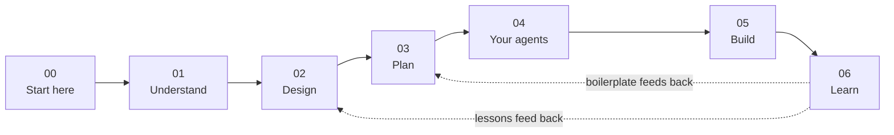

# Go beyond vibe coding — reach the top 1% of AI-assisted software development

> [!TIP] New here?
> Start with [Getting started](getting-started.md) — clone, tools, Path A or B,
> and a day-one checklist. Return here for philosophy and the chapter journey.

> [!NOTE] An honest word on "top 1%"
> The tools alone won't get you there. In a controlled trial, experienced
> developers expected AI to make them 24% faster and *felt* 20% faster — yet
> were measured 19% **slower** (METR, 2025). Broad adoption studies plateau
> near a 10% gain even above 90% usage (DX). The gap between the felt speedup
> and the real one is the gap between vibe coding and the top 1%. What closes
> it is not the model — it is the system this book builds around it: the
> constraints, decisions, and feedback loops that make AI output trustworthy.
> Raw tool use buys ~0–10%; the harness and the discipline are the
> differentiator.

## What this is

A book that is also a working project. Every folder is a chapter. Every file
teaches you something *and* becomes a real artifact of the software you are
building. You don't read about the method and then go apply it somewhere else —
the folder you are standing in **is** the method, and by the last chapter it
contains your shipped product.

It was written using the methodology it teaches. You can check: the
[DEBT-LEDGER](../06-learn/DEBT-LEDGER.md) lists this project's own known compromises, and
`02-design/decisions/` holds the decisions, including the rejected options.

## Who it is for

Anyone who wants to build a software product with AI, regardless of technical
background. The structure compensates for experience either way: pre-filled
sections are guardrails for newcomers, empty templates are flexibility for
veterans. You will never be asked to trust a step you can't inspect.

## How to use it

Work the chapters in order. Each file does two jobs — first it explains what
something is and why it matters, then it gives you the structure to fill in for
*your* project. Where a section gets technical, you'll see two paths:

> [!LEARN] Learn It
> The default: what this is, why it matters, step-by-step, and what's
> happening underneath. Take this path if the topic is new.

> [!TIP] Fast Track
> Already know this? The short version and the command. You own the outcome.

Neither path is the "smart" one. They end in the same place.

## The journey

You define who the software is for ([Understand](../01-understand/)), design its
four layers ([Design](../02-design/README.md)), break it into tasks no bigger than one
sitting ([Plan](../03-plan/)), configure an AI agent team to execute them
([Your agents](../04-your-agents/README.md)), build ([Build](../05-build/README.md)), and then feed
what you learned back into the system ([Learn](../06-learn/README.md)) — so the next
feature, and the next project, starts further ahead.

## Setup

**First time:** [Getting started](getting-started.md) — prerequisites, default
stack, Path A (learn) vs Path B (build your product), day-one checklist, success
checks.

**Tool indexes** (when you outgrow the default):

| Phase | Folder | Index |
| :---- | :----- | :---- |
| Design (Ch. 01–04) | `setup/design-tools/` | [Design tools](setup/design-tools/README.md) |
| Build (Ch. 05+) | `setup/execution-tools/` | [Execution tools](setup/execution-tools/README.md) |

Read [manifesto](manifesto.md) before deep work — one page, and it is the contract the rest
of the book keeps.

**Maintaining this book repo:** [For book maintainers](maintainers.md) (STATE,
session workflow, dashboard — not day-one reading).
