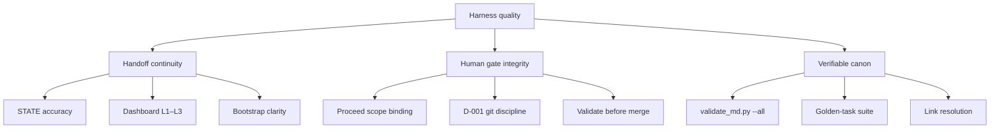

# arc42 §10 — Quality Requirements

**Question answered:** Which quality attributes matter, and how will you
verify them?

> [!NOTE] REAL — harness-meta
> Quality tree and scenarios for **this repo**, derived from §1 quality
> goals. Your product fork replaces attributes and scenarios — keep the
> arc42 shape (tree + stimulus / environment / response / measure).

## Quality tree

Top-level attributes mirror §1 **Quality goals** — not a separate wish list.

Diagram budget: 12 nodes ([[ADR-002-modeling-conventions|ADR-002]]).

## Quality scenarios

Each scenario ties one §1 goal to a measurable response.

### QS-1 — Handoff continuity (session close)

| Field | Value |
| :---- | :---- |
| **Stimulus** | Agent completes session work and runs close checklist |
| **Environment** | Session branch; human has not yet merged |
| **Response** | STATE closed paragraph, dashboard L1–L3 updated, S(N+1) bootstrap present |
| **Measure** | Next agent reads only STATE + dashboard — no chat archaeology needed |

**Evidence hook:** [[session-workflow]] close draft is postcondition before merge is offered.

### QS-2 — Human gate integrity (Proceed)

| Field | Value |
| :---- | :---- |
| **Stimulus** | Human says `proceed` at session open |
| **Environment** | Plan phase complete; no branch yet |
| **Response** | Agent creates boot line + L3 row; build starts on session branch only |
| **Measure** | No file edits on `main`; scope matches numbered Plan lists |

**Evidence hook:** D-001 — git commit/merge stays human-side; agent supplies PS blocks only.

### QS-3 — Human gate integrity (merge)

| Field | Value |
| :---- | :---- |
| **Stimulus** | Human validates work diff + handoff docs |
| **Environment** | Close draft on session branch; `validate_md.py --all` green |
| **Response** | Human runs merge to `main`; deletes session branch |
| **Measure** | Irreversible git actions require explicit human run — not agent default |

**Evidence hook:** [[Agents.md|Agents]] human gate shape; dashboard **Git branch** row returns to `main`.

### QS-4 — Verifiable canon (validator)

| Field | Value |
| :---- | :---- |
| **Stimulus** | Agent finishes a logical edit batch |
| **Environment** | Pre-commit or manual `--all` run |
| **Response** | Zero validator failures; warnings within grace band |
| **Measure** | `python scripts/validate_md.py --all` exit code 0 |

**Evidence hook:** [[global|constraints/global]] budgets; link resolution (D-003 resolved S9).

### QS-5 — Verifiable canon (golden tasks)

| Field | Value |
| :---- | :---- |
| **Stimulus** | Change touches agent pack, context loader, or task templates |
| **Environment** | Local dev; optional CI when wired |
| **Response** | Golden-task suite green |
| **Measure** | `pytest scripts/test_golden_tasks.py` (and related tests) pass |

**Evidence hook:** Ch. 04 evaluator; task 01–04 fixtures in `04-your-agents/golden-tasks/`.

### QS-6 — Maintainability (canon co-evolution)

| Field | Value |
| :---- | :---- |
| **Stimulus** | Significant design decision during a session |
| **Environment** | Same session branch as the code/doc change |
| **Response** | ADR written; §9 row appended; affected arc42 section linked |
| **Measure** | Decision traceable without opening git blame |

**Evidence hook:** §9 process table; [[09-architectural-decisions]].

## Deferred quality work

Lower priority for this harness — tracked in §11, not blocking arc42 completeness:

| Item | Why deferred |
| :---- | :----------- |
| Ch. 07/08 reader-product runbooks | Partial chapters; product fork scope |
| Diagram-explorer HTML | `_inbox/` experiment; not canon |
| Bulk `_inbox/` promotion | Needs triage gate (S40 roadmap) |
| Full threat-model template fill | Teaching scaffold; harness risks live in §11 |

## ESL checklist (this section)

| Rule | Pass |
| :---- | :---- |
| Tree traces to §1 goals | Three top attributes = §1 top three |
| Scenarios have all four fields | Stimulus, environment, response, measure |
| Measures name evidence hooks | session-workflow, validator, pytest |
| Product fork reminder | Reader replaces harness scenarios |

## Where to go next

- **Goals (§1):** [[01-introduction-and-goals]]
- **Risks (§11):** [[11-risks-and-technical-debt]]
- **Glossary (§12):** [[12-glossary]]
- **Section index:** [[README]]
