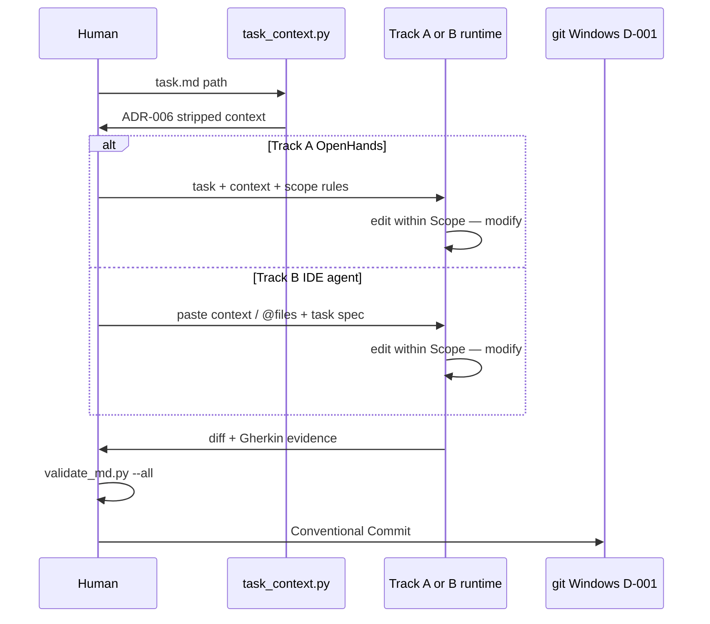

# ADR-007 — Dual execution tracks: OpenHands vs subscription IDE agents

**Status:** accepted — 2026-06-17, Session 14.

## Context

Ch. 05 shipped [openhands](../../05-build/execution-tools/openhands.md) as the book's first **full** execution guide
(Session 12). The harness itself is often authored with **Track B** IDE agents
under [session-workflow](../../context/system/session-workflow.md) — same task files, same review gates, different
runtime. Without a decision, agents and readers inherit ambiguous wording
("primary execution tool" vs "how we actually work") and task `Mechanisms`
sections drift.

**Hierarchy (human decision, 2026-06-17):** **Track A is ideal**; **Track B is
fallback**. The book must help readers **gauge honestly** what they can run
today and **hold their hand** through setup when they choose Track A or ramp
up from B.

Session 13 closed the **notation** stack (ICOM+ v0.3, diagram taxonomy v0.3,
Track B L4 examples for commit and session-close). Session 14 must close the
**execution** stack: when each track applies, what is shared, what diverges,
and how handoffs stay mechanical.

Hard constraints already in force:

- **D-001** — all git operations on the Windows host (sandbox NUL corruption).
- **ADR-006** — dual-purpose inputs strip via [context-loader](../../04-your-agents/context-loader.md) before agent
  consumption.
- **ADR-002** — tasks are ICOM frames with Gherkin acceptance criteria.
- **ICOM+ v0.3** — L4 **Executor** names who runs one sitting; **Tools** are
  external products only (repo scripts are canon/inputs, not Tools).

## Decision

Two **execution tracks**. Same harness surface; different agent runtimes.
**Prefer Track A** when the reader can run it; use Track B when decision
drivers (below) point there. Document a sustained switch in a short ADR
addendum if team workflow changes.

### Decision drivers (when to stay on Track B)

The book surfaces an honest checklist — not a quiz to fail:

| Driver | Favors Track A (ideal) | Favors Track B (fallback) |
| :----- | :--------------------- | :------------------------ |
| **Setup confidence** | Reader can install Docker (+ optional LiteLLM) alone or with scaffold help | Reader cannot or will not run containers yet; needs IDE-only path |
| **Budget / billing** | Reader routes models via **LiteLLM + OpenRouter** (or self-hosted) — pay-per-use, per-agent budgets | Reader relies on **IDE or vendor subscriptions** (Cursor, Claude Code, …) and accepts that pricing model |
| **Isolation need** | Multi-file build tasks, sandboxed shell, parallel agents | Single sitting, chat-steered edits, harness meta-work |

Track B is not "wrong" — it is the **on-ramp** the book supports until Track A
is viable. Scaffolds escalate: Track B → Track A ramp (single worktree) →
Track A full (bare + multi-worktree + Docker per agent).

### Track matrix

| Dimension | **Track A — OpenHands** (API / Docker) — **ideal** | **Track B — IDE agents** (Cursor, Claude Code, Codex, OpenCode, …) — **fallback** |
| :-------- | :------------------------------------------------- | :---------------------------------------------------------------------------------- |
| **Runtime** | Self-hosted agent loop in Docker; LLM + shell + file tools against mounted worktree | IDE- or CLI-integrated agent; human in the chat loop |
| **When to use** | Bounded **build tasks** from `tasks/*.md`; reproducible sandbox; LiteLLM/OpenRouter aliases from agent yaml | Setup or budget blockers above; interactive sessions while learning the harness |
| **When not to use** | Reader not ready for Docker/LiteLLM stack (book should say so plainly) | Need container blast-radius boundary; unattended long loop; parallel agents with git-enforced isolation |
| **Task scope** | `Scope — modify` / read-only from task file; workspace = repo root on session branch | **Same** task files and scope lines; optional ad-hoc session scope for meta-work (STATE, dashboard) — still list files before editing |
| **Context assembly** | `python scripts/task_context.py <task.md>` → paste into OpenHands initial prompt | **Same command** → paste into chat, **or** attach paths and instruct agent to treat loader output as authoritative stripped context |
| **Agent identity** | Task `agent` field → `04-your-agents/agents/*.yaml` role + LiteLLM/OpenRouter alias | Same yaml **role** in prompt header; model from IDE subscription unless wired to LiteLLM gateway |
| **Git topology** | **Bare repo + worktrees** (target); see [Git layout](#git-layout-bare-repo--worktrees) | **Bare repo + worktrees** — IDE opens one session worktree; no Docker mount layer |
| **ICOM+ Executor (L4)** | `agent:<yaml-role>` (e.g. `agent:red-team-agent`) | `human:<name>` orchestrating; IDE product named under **Tools** / Mechanisms prose (see [icom-plus-convention](../../_playground/icom-plus-convention.md)) |
| **ICOM+ Mechanisms** | `task_context.py` → [openhands](../../05-build/execution-tools/openhands.md) | `task_context.py` → named IDE/CLI product |
| **Human gates** | Review diff → `validate_md.py --all` → Conventional Commit on Windows (D-001) | **Identical** — agent suggests; human approves; no IDE auto-commit to `main` |
| **Session workflow** | Bootstrap / build / review / close per [session-workflow](../../context/system/session-workflow.md) | **Identical** — branch `session-NN/<topic>`; agent edits on branch; human merges |
| **Handoff in** | Ch. 04 agent yaml + `context_load` + assembled stripped context | Same |
| **Handoff out** | Changed files + Gherkin evidence → human commit | Same |
| **Canon doc home** | Ch. 05 [openhands](../../05-build/execution-tools/openhands.md) (full Track A guide) | Ch. 05 [track-b-checklist](../../05-build/execution-tools/track-b-checklist.md) (one generic checklist); Ch. 00 index names tools only |

### Track B tool roster (awareness only)

Examples — not an documentation obligation. The book does **not** maintain
per-tool guides; [track-b-checklist](../../05-build/execution-tools/track-b-checklist.md) is the single Track B canon.

| Tool | Surface | Notes |
| :---- | :------ | :---- |
| **Cursor** | IDE | Rules, skills, MCP; common harness authoring surface |
| **Claude Code** | CLI / IDE | Anthropic-integrated terminal agent |
| **Codex** | Cloud / GitHub | Async cloud runs; GitHub-native PR flow |
| **OpenCode** | CLI | **Confirmed** vendor-agnostic CLI peer to Claude Code |
| **Jules** | Cloud async | No local Docker — accessibility path |
| **Antigravity** | Agent-first IDE | Parallel agents |

### Track B documentation strategy

**Decision (2026-06-17):** one **generic checklist** grouped by concern
(workspace, context, identity, execution, safety, close, adapter). The reader's
chosen tool maps harness artifacts to its own rules, @-mentions, MCP, etc.
Rejected: per-tool stub files in Ch. 00 / Ch. 05 — too many products, too much
doc rot. Track A alone gets a full scaffold ([openhands](../../05-build/execution-tools/openhands.md)).

### Git layout — bare repo + worktrees

**Prior decision (Session 1, Dimension 3 — Isolation):** documented in
[overview](../../context/system/overview.md) and `context/system/sessions/session-1-v1.md`, not yet a
standalone ADR. OpenHands (Docker) and git bare repo + worktrees operate at
**different layers** and are designed **together**:

- **Bare hub** (`project.git/`) — object store; read-only mount into containers.
- **Worktrees** (`worktrees/<name>/`) — each checkout has its own branch, index,
  and HEAD. Git forbids the same branch in two worktrees simultaneously.
- **Docker (Track A only)** — each agent container mounts **one** worktree
  read/write; cannot see sibling worktrees.

```text
Host (Windows — git author per D-001)
├── project.git/              ← bare hub
└── worktrees/
    ├── orchestrator/         ← human review / merge (both tracks)
    ├── session-14-topic/     ← Track B: IDE workspace
    └── agent-task-01/        ← Track A: OpenHands mount (parallel agents)
```

| Mode | Tracks | Bare + worktrees? | Notes |
| :---- | :----- | :---------------- | :---- |
| **Target** | A + B | **Yes** | Session 1 blast-radius stack; worktrees = Layer 2 in [overview](../../context/system/overview.md) six-layer model |
| **Track A ramp** | A only | **One worktree** from bare (or transitional single clone) | Valid for first OpenHands task; [openhands](../../05-build/execution-tools/openhands.md) today documents simple clone mount — upgrade path to bare layout is Ch. 05 follow-on |
| **Track A full** | A | **Bare + N worktrees + N containers** | Parallel agents; each branch in its own worktree + container |
| **Track B** | B | **Bare + worktrees** | Human + IDE work in one session worktree; git on Windows (D-001); no container per agent |
| **Harness repo today** | B (authoring) | **Transitional** — normal clone + `session-NN/<topic>` branch | Matches current practice; migrate to bare layout when reader adopts Track B canon |

**Track A does need the same git topology** at target maturity — worktrees are
not Track B-only. Track A **adds** Docker mounts on top of worktrees; Track B
stops at git isolation. A simple single clone is a **documented ramp**, not the
ideal end state.

### Shared surface (both tracks)

These are **non-negotiable** — switching tracks does not relax them:

| Surface | Role |
| :------ | :--- |
| `04-your-agents/tasks/*.md` | Canonical task spec: Inputs, Controls, Mechanisms, Outputs, Gherkin |
| `scripts/task_context.py` + [context-loader](../../04-your-agents/context-loader.md) | Merge agent `context_load_default` + task `context_load`; ADR-006 strip |
| `04-your-agents/agents/*.yaml` | Role, mandate, default context paths |
| `03-plan/constraints/global.md` | Scope discipline, budgets, commit hygiene |
| `scripts/validate_md.py` | Pre-commit gate; NUL check (D-001) |
| [session-workflow](../../context/system/session-workflow.md) + [STATE](../../STATE.md) + `_index/dashboard/` | Session bootstrap, close, visual status |
| [icom-plus-convention](../../_playground/icom-plus-convention.md) + `context/system/icom-plus-examples*.md` | How to document L4 tasks and governance flows |
| D-001 | Git add / commit / merge on **Windows PowerShell** only |
| Branch discipline | `session-NN/<topic>` branch per worktree; never direct commit to `main` without close ritual |
| Bare repo + worktrees (target) | Shared git layout; see [Git layout](#git-layout-bare-repo--worktrees) |

### Divergent surface (track-specific)

| Track A only | Track B only |
| :----------- | :----------- |
| Docker / compose / OpenHands API | IDE rules, skills, `.cursor/`, MCP servers |
| LiteLLM + OpenRouter (or self-hosted) model routing | Subscription or vendor-bundled model picker |
| Container mounts one worktree per agent | Host-native IDE opens one session worktree |
| Unattended agent loop (human reviews output) | Turn-by-turn chat steering |

### Handoff diagram



### Default guidance (harness project)

| Work type | Preferred track |
| :-------- | :---------------- |
| `tasks/*.md` build exercises (e.g. task 01 pre-mortem) | **Track A** — proves ideal path end-to-end |
| Session meta while Track A not yet set up | **Track B** — fallback; this repo today |
| Reader's own product code | **Track A** when drivers allow; else Track B with honest upgrade path |

## Why

Track A / B split matches **capability and budget**, not taste. Task files,
context assembly, and human gates stay identical — the multiplier is
**discipline**, not Docker vs IDE. Track A delivers reproducible, sandboxed
build loops plus LiteLLM/OpenRouter cost control (the Ch. 05 promise). Track B
keeps readers productive while the book scaffolds Docker, bare repo, and
worktrees. ICOM+ already encodes both patterns (Executor `agent:*` vs
`human:*` with external Tool).

## Alternatives considered (red-teamed)

- **OpenHands only** — simpler story. Rejected: blocks readers who honestly
  cannot run Docker yet; Jules/Codex stubs in [book-architecture](../../context/system/book-architecture.md) would be
  lies without a supported fallback.
- **IDE only** — drop Docker path. Rejected: loses sandbox boundary,
  LiteLLM alias wiring, and the Ch. 05 exercise that proves agent yaml →
  context → execution.
- **Per-tool stub tree** — one file per IDE/CLI product in Ch. 00 / Ch. 05.
  Rejected: maintenance burden and vendor churn; generic [track-b-checklist](../../05-build/execution-tools/track-b-checklist.md)
  plus reader-side adapter mapping is sufficient.
- **Merge tracks in ICOM+** — single Executor type. Rejected: L4 examples
  already show `agent:red-team-agent` vs `human:Alex`; erasing that
  loses audit trail.

## Pre-mortem

*If this decision fails a year from now, why?*

1. **Track B bypasses `task_context.py`** — IDE agents read raw dual-purpose
   files → context bloat returns → mitigation: task `Mechanisms` mandates
   loader; review gate checks for teaching leakage.
2. **Track A never exercised** — OpenHands doc rots → mitigation: task 01
   remains the golden Track A exercise (deferred run is explicit in S14).
3. **Git from sandbox** — IDE terminal in container corrupts repo →
   mitigation: D-001 stays prominent in both tracks; PS commit blocks only.
4. **Bare-repo setup scares novices** — readers stay on simple clone forever →
   mitigation: Track B uses same layout; Ch. 05 ramp doc + dual path for
   "one worktree" before parallel agents.

## Left on the table

- Ch. 05 / Ch. 00 **bare repo + worktree** scaffold (shared git setup doc).
- LiteLLM wiring for Track B products that support OpenAI-compatible gateways.
- Promote Session 1 Dimension 3 isolation decision to standalone ADR (optional).
- ADR-002 addendum mapping ICOM → ICOM+ field names in task templates.
- `t_*` auditing pass across `_playground/l4-models/`.

## Consequences

- Task `Mechanisms` lines name **track** explicitly; Track B names tool in
  prose or `constraints/project.md` adapter lines, not a book chapter per tool.
- [openhands](../../05-build/execution-tools/openhands.md) → **Track A ideal**; [track-b-checklist](../../05-build/execution-tools/track-b-checklist.md) → **Track B fallback**.
- Ch. 00 `setup/execution-tools/README.md` — index + pointers only.
- Dashboard T10 (ADR-006 Phase 3 lint) still waits for first Track A task run.
