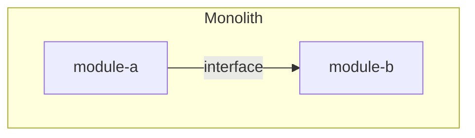

# Application Layer — how the logic is organized, where the boundaries are

## What this is

> [!TEACH] Teach
> The application layer decides how your software's logic is shaped: one
> deployable or many, what the internal boundaries are, how it scales, what
> compute it runs on, and who it trusts. Where the [data](data.md) layer's decisions
> are mostly irreversible, this layer's range is wider — some choices here
> are one-line config reverts, others (your identity provider, your service
> split) are one-way doors. The reversibility field in each ADR tells you
> which kind you're holding.

## Why it matters

> [!TEACH] Teach
> This is the layer where cargo-culting does the most damage, because its
> famous patterns come from companies whose problems you do not have. The
> discipline of this chapter — every recommendation with its failure
> condition ([ADR-005](../decisions/ADR-005-failure-condition-convention.md)) — exists
> substantially for this file.

## Decision 1 — One deployable or many?

> [!LEARN] Learn It
> **Claim:** start as a modular monolith — one deployable with explicit
> internal module boundaries — and split only with demonstrated need.
> **Evidence:** Prime Video's audio-video monitoring team publicly merged
> microservices back into a monolith for a 90% cost reduction; Shopify
> runs one of the world's largest commerce platforms as a modular
> monolith; Fowler's prerequisites for microservices (rapid provisioning,
> monitoring, devops culture) describe a platform team most projects don't
> have (`red-team-seed → application ammunition`;
> `lifecycle-playbook-seed → architecture rules`). **Failure condition:**
> multiple teams blocked on each other's deploys, or components with
> genuinely divergent scaling/compliance profiles — split *those seams*,
> which is exactly what the module boundaries were for.

> [!TIP] Fast Track
> One repo, one deployable, modules with explicit interfaces. Split when a
> measured pain names the seam. You own the outcome.

| Signal | Shape | When NOT to apply |
| :---- | :---- | :---- |
| One team, one product, deploy cadence you control | Modular monolith | — this is the default |
| Teams blocked on each other's releases | Extract the contested module | The "teams" are one person wearing hats |
| One component needs 100× the scale or separate compliance | Extract that component | The need is projected, not measured |
| Every function its own service | Never | Uber's "nanoservices" catalog is the cautionary tale (`system-design-seed → application layer`) |

> [!TEACH] Teach
> The split decision rides on **team size and deployment cadence more than
> raw traffic** (`system-design-seed`). And the boundaries inside the
> monolith are not optional decoration: modules communicate through declared
> interfaces, never by reaching into each other's tables. That discipline is
> what keeps the extraction option open — reversibility, bought cheap.

> [!NOTE] Parnas test
> Module boundaries exist to **hide design decisions likely to change** —
> storage engine, auth provider, pricing rules — not merely to group visible
> steps. Adjacent modules depend on interfaces, not each other's internals.
> See question 1 in [Ch. 02](../README.md) five-paper checklist.

## Decision 2 — What vocabulary for the inside?

> [!TEACH] Teach
> Hexagonal, clean architecture, CQRS, DDD: these are *vocabularies for
> module boundaries*, not club memberships (`system-design-seed → internal
> structure`). Pick the lightest one your project can say out loud:
> "domain logic does not import infrastructure" gets most projects most of
> hexagonal's value.
>
> A note on design patterns, because an AI co-author will offer them
> constantly: **the GoF catalog is a set of workarounds for what specific
> languages lacked**, not universal truths — in a language with first-class
> functions, Visitor, Strategy and Command collapse to passing a function
> (`red-team-seed → application ammunition`). **Failure condition for any
> pattern:** you cannot name the problem it solves *in this codebase*. Ask
> the agent that proposed it to name the problem; "it's a best practice" is
> the wrong answer.

## Decision 3 — How does it scale and stay up?

> [!TEACH] Teach
> **Vertical first.** A bigger machine is the cheapest reversible step.
> Horizontal scaling's hidden cost is *architectural*: every instance must
> be stateless, sessions move to shared storage, deployment grows a load
> balancer — pay it when measurement says so, not before
> (`system-design-seed → scaling`).
>
> The availability math you need for honest promises
> (`system-design-seed → availability in numbers`):

| Target | Downtime/year | What it costs |
| :---- | :---- | :---- |
| 99.9% | ≈ 8.8 hours | Achievable single-node with good ops |
| 99.99% | ≈ 53 minutes | Redundancy, failover, on-call discipline |

> [!TEACH] Teach
> Components in *series* multiply availability down (two 99.9% services
> chained = 99.8%); in *parallel*, failures multiply away. Every dependency
> in your request path lowers the ceiling — count them before promising a
> number. Failover shape: active-passive is simpler (standby capacity idles;
> hot vs cold standby sets your recovery time), active-active buys
> throughput at the price of routing complexity; either way the failover
> window can lose unreplicated writes — that loss window is a [data](data.md)
> layer replication decision, made there.
>
> A reverse proxy is useful even with one server (TLS, compression, a
> stable address); a load balancer earns its keep only with multiple
> servers (`system-design-seed → LB vs reverse proxy`).

## Decision 4 — What compute shape?

> [!TEACH] Teach
> Pick from a decision matrix, not per-fashion
> (`company-framework-seed → compute shape`). Generic categories on purpose
> — map to your provider's names last:

| Workload trait | Long-running server | Serverless function | Scheduled/batch job |
| :---- | :---- | :---- | :---- |
| Duration | Continuous | Seconds–minutes | Minutes–hours |
| Latency sensitivity | Consistent | Cold starts hurt tail latency | None |
| Ops overhead | You patch and scale it | Near zero | Near zero |
| When NOT to apply | Tiny spiky workloads — you pay for idle | Long tasks, heavy deps, steady high traffic (cost crossover) | Anything a user is waiting on |

> [!TEACH] Teach
> Team expertise is a real matrix row: the shape your team can operate
> beats the shape the benchmark prefers.

## Decision 5 — Who does it trust?

> [!TEACH] Teach
> **One identity provider, binary rule:** if the system holds real user
> data, it gets SSO against your single provider — no second user store,
> no "temporary" password table (`company-framework-seed → authentication`).
> **Failure condition:** a public product whose end users can't be in your
> IdP — then the user-facing auth is its own designed component, and the
> rule still holds for everything internal. This is among the most
> irreversible decisions in the layer: migrating identity later means
> migrating every user. Record it as an ADR with that reversibility note.

## Pattern — one codebase for humans and agents

> [!TEACH] Teach
> Design the application so UI, API, and agent-facing surface are thin
> adapters over the same shared logic
> (`company-framework-seed → unified AI-ready application`). Your Ch. 04
> agent team becomes a first-class client instead of a screen-scraper, and
> the [communication](communication.md) layer stays honest because the API *is* the product.
> **Failure condition:** a pure end-user tool with no automation story and
> no agent access planned — then the extra surface is speculative
> generality; skip it and note the seam.

> [!NOTE] Ask your AI agent
> "Here is my data model and my use cases. Propose module boundaries for a
> modular monolith as a Mermaid flowchart with subgraphs (≤ 20 nodes):
> modules, their declared interfaces, and which data each owns. Then
> red-team it: which boundary will leak first, and what's the symptom?"

---

## Template — your application layer

### Module boundaries

### Decisions made

| # | Decision | Choice | Failure condition you accepted | ADR |
| :---- | :---- | :---- | :---- | :---- |
| 1 | Deployable shape | [e.g., modular monolith] | [what would force a split] | [[ADR-NNN]] |
| 2 | Boundary vocabulary | [e.g., "domain doesn't import infra"] | | |
| 3 | Scaling posture & availability target | [e.g., vertical, 99.9%] | | |
| 4 | Compute shape | [from the matrix] | | |
| 5 | Identity provider | [the one] | | |
| 6 | Agent surface | [unified / skipped + seam note] | | |
