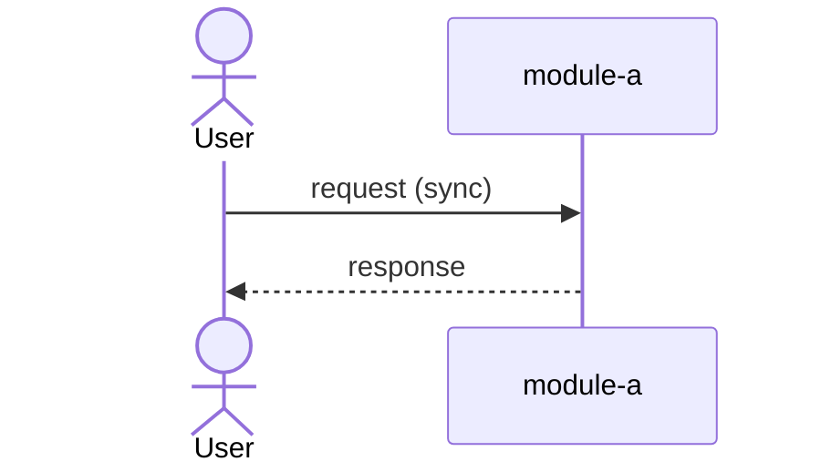

# Communication Layer — how the parts talk, inside and out

## What this is

> [!TEACH] Teach
> The communication layer decides how the pieces of your system exchange
> information: which calls are synchronous, which go through queues, what
> shape your API takes, how updates reach users in real time, and how your
> software talks to AI providers. It comes after [data](data.md) and [application](application.md)
> because both constrain it — what moves is data, and what talks is modules.

## Why it matters

> [!TEACH] Teach
> Most "distributed systems pain" is communication design done by accident:
> a service split that left synchronous call chains everywhere, a queue
> nobody capped, a retry that charged a customer twice. Every pattern here
> is cheap on the whiteboard and expensive in production — the right week to
> think about it is this one.

## Decision 1 — Synchronous or asynchronous?

> [!TEACH] Teach
> **Claim:** queue only what the caller doesn't need in order to proceed;
> keep cheap, fast, real-time operations synchronous
> (`system-design-seed → Asynchronism`). A user clicking "save" needs the
> confirmation; the welcome email can ride a queue. **Failure condition:**
> queueing the response the caller is waiting on — you've added latency,
> infrastructure, and a new failure mode to deliver a worse experience.
>
> Two rules ship with every queue:
>
> - **Back-pressure.** Cap the queue; when full, reject with 503 and
>   exponential backoff at the client. An uncapped queue converts overload
>   into an outage with extra steps (`system-design-seed`).
> - **Idempotency is fundamental, not advanced.** Over a network every
>   operation can be retried, and at-least-once delivery *means* duplicates.
>   Consumers must handle a message twice without double effect — the
>   canonical cautionary tale is Airbnb's double-payments incident
>   (`system-design-seed → delivery semantics`). **Failure condition:**
>   none. If it crosses a network, it retries; design for it.
>
> And one prohibition with its own section in the source material: **never
> use the database as a message queue** — lock contention and polling load
> degrade both jobs (`system-design-seed → MQ antipattern`). The exemption
> that proves the rule: the transactional outbox ([data](data.md) layer) uses a
> table as a *staging post* for a real delivery mechanism, not as the queue.

## Decision 2 — What shape is the API?

| Style | Built for | Strengths | When NOT to apply |
| :---- | :---- | :---- | :---- |
| REST | Public, resource-shaped data | Cacheable, universally understood | Behavior that isn't a resource ("recalculate"); chatty mobile clients paying per round-trip |
| RPC (gRPC etc.) | Internal, behavior-shaped calls | Performance, typed contracts | Public APIs — you force your internals on strangers |
| GraphQL | Many fast-moving clients picking field slices | One round-trip, client-shaped responses | Simple stable clients — you bought a caching problem and an abuse surface for nothing |

> [!TEACH] Teach
> `system-design-seed → REST/RPC/GraphQL`
>
> Default for the book's audience: REST outside, RPC or plain function calls
> inside the monolith. The [application](application.md) layer's unified human+agent
> codebase makes this API the agent surface too — design it once, honestly.

## Decision 3 — How do updates reach users?

> [!TEACH] Teach
> Persistent connections are a continuously-paid resource. **WebSockets**
> when updates are frequent and bidirectional (collaboration, chat);
> **polling** when occasional (a dashboard refreshing each minute) — simple,
> self-throttling, slightly stale (`system-design-seed → realtime`;
> `ashishps1 → tradeoffs`). **Failure condition for WebSockets:** you now
> own fan-out, reconnection, and offline handling; if the product tolerates
> a minute of staleness, you bought complexity the user can't perceive.
> Same logic at the CDN: pull for hot, heavy traffic; push for small,
> rarely-changing sites; staleness-until-TTL is the shared failure mode.

## The anti-pattern this layer exists to prevent

> [!WARNING] The distributed monolith
> Services that make synchronous REST calls in chains, share a database,
> and must deploy together have all of microservices' costs and none of
> its benefits (`red-team-seed → communication ammunition`). The check is
> mechanical: can you deploy one service alone, and does a peer being down
> degrade you gracefully? Two "no"s and the boundaries in [application](application.md)
> were drawn in the wrong place — fix them there; no communication
> machinery repairs a wrong boundary.

> [!TEACH] Teach
> The same seed kills the next escalation: **service meshes** can spend
> extraordinary resources on sidecars — observed overheads up to 90% of
> service resources — and earn their keep only with a platform team and
> dozens of services. **Simpler alternatives first:** an API gateway at the
> edge, instrumentation in application code
> (`red-team-seed → service-mesh overhead`).

## Talking to AI providers

> [!TEACH] Teach
> Your system's calls to LLMs are communication-layer traffic and get the
> same discipline (`company-framework-seed → provider-agnostic AI`):
>
> - **One gateway, no direct calls.** Every LLM call goes through a single
>   routing point (the system this book runs on uses LiteLLM — see
>   [overview](../../context/system/overview.md) dimension 1); swapping providers is then config, not
>   refactor. **Failure condition:** a single-provider prototype you will
>   measure and throw away — a gateway there is ceremony.
> - **Start with the most capable model, prove correctness, then optimize
>   cost** — downgrade with evidence in hand, not hope.
> - Budgets and retries live at the gateway: per-caller spend caps, and
>   idempotency keys on anything that retries a paid call (Decision 1's
>   rule, applied to tokens).

## Handoffs are communication too

> [!TEACH] Teach
> When work moves between people, or between a human and an agent — specs to
> build, build to review, session to session — "complete" must be defined or
> it defaults to "I stopped" (`company-framework-seed → handoff gate`). Every
> recurring handoff gets a **completeness gate**: a checklist, an owner, and
> a sign-off. This book practices it on itself: STATE.md is the session
> handoff, and the Gherkin block in each task ([ADR-002](../decisions/ADR-002-modeling-conventions.md))
> is the agent's completion gate.

> [!NOTE] Ask your AI agent
> "Here are my module boundaries and use cases. For my three most
> important use cases, draw a Mermaid sequenceDiagram (≤ 20 nodes) of the
> calls involved. Mark each arrow sync or async, and flag any synchronous
> chain longer than two hops."

---

## Template — your communication layer

### Key flows

### Decisions made

| # | Decision | Choice | Failure condition you accepted | ADR |
| :---- | :---- | :---- | :---- | :---- |
| 1 | Sync/async split + queue tech | [what queues, what doesn't] | [e.g., queue cap + 503 backoff] | [[ADR-NNN]] |
| 2 | API style(s) | [e.g., REST public, in-process internal] | | |
| 3 | Realtime mechanism | [e.g., polling, 60s] | | |
| 4 | AI gateway | [e.g., LiteLLM, per-agent budgets] | | |
| 5 | Handoff gates | [which handoffs, whose sign-off] | | |
