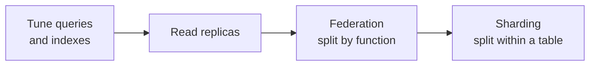
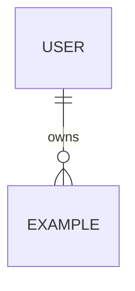

# Data Layer — what is stored, how it relates, how it evolves, how it leaves

## What this is

> [!TEACH] Teach
> The data layer decides what your software remembers: which facts are stored,
> how they relate to each other, how the structure changes over time, and how
> the data gets out again. It is the first layer you design because it is the
> hardest to change — code can be rewritten in an afternoon; a data model with
> a year of production records migrates slowly and dangerously. In ADR terms
> ([[ADR-005-failure-condition-convention|ADR-005]] discipline applies
> throughout): most data decisions sit at the irreversible end, so they earn
> real design effort here.

## Why it matters

> [!TEACH] Teach
> Every other layer leans on this one. The [[application]] layer's boundaries
> tend to follow the data's natural seams; the [[communication]] layer moves
> this data between parts; the [[ux]] layer's speed is mostly a question of
> how fast the right data can be found. Get the data model wrong and you will
> feel it everywhere — usually as slowness first, then as features that are
> strangely expensive to build.

## Decision 1 — Where does the data live?

> [!LEARN] Learn It
> The honest default in 2026 is a boring relational database — PostgreSQL
> or equivalent. **Claim:** start relational unless a specific workload
> argues otherwise. **Evidence:** the most common real-world reversal is
> NoSQL → Postgres, because JSONB columns absorbed the "flexible schema"
> use case that justified document stores for most teams
> (`red-team-seed → data ammunition`). **Failure condition:** a workload
> with little inter-record reference at TB–PB scale, or raw-IOPS hot
> lookups — clickstream ingest, leaderboards, ephemeral carts — where a
> purpose-built store wins (`system-design-seed → SQL or NoSQL`).

> [!TIP] Fast Track
> PostgreSQL. Put semi-structured attributes in a JSONB column. Revisit
> only when a measured workload says so. You own the outcome.

| Signal in your use cases | Pick | When NOT to apply |
| :---- | :---- | :---- |
| Records reference each other; multi-row updates must succeed together | Relational (ACID) | You genuinely never join and never update two things atomically |
| Flexible attributes on otherwise relational data | Relational + JSONB | Attribute queries dominate and need their own indexes at scale |
| Massive write volume, staleness tolerable | Wide-column / key-value (BASE) | Money, inventory, anything users check twice — consistency burden lands in your app code |
| Dense many-to-many traversals as the *core* query | Graph DB | Relationships are incidental — a join table is cheaper to operate |

> [!TEACH] Teach
> `system-design-seed → SQL or NoSQL, NoSQL flavors, ACID and BASE`
>
> Money and inventory are ACID, always. The BASE trade is not "weaker is
> faster, hooray" — it moves the consistency burden out of the database and
> into every piece of code that reads the data.

## Decision 2 — How does the structure evolve?

> [!TEACH] Teach
> Your schema will change; the only question is whether the changes are
> managed. **Claim:** every schema change is a versioned, reversible
> migration file in git from day one. **Evidence:** unmanaged schema
> evolution is invisible rigidity — the database quietly becomes the thing
> nobody dares touch (`red-team-seed → data ammunition`); idempotent,
> reversible migrations are also what make the final move to archive routine
> (`sunset-eol-seed → design-for-sunset`). **Failure condition:** none worth
> naming — a throwaway prototype you will delete within weeks is the only
> honest exemption, and [[01-understand|Ch. 01]] kill criteria define
> "throwaway" *before* it grows users.

## Decision 3 — When it slows down, in what order do you reach for fixes?

> [!TEACH] Teach
> The scaling ladder, cheapest reversible step first
> (`system-design-seed → Database`):
>
> **Claim:** never skip rungs. **Evidence:** premature sharding is the
> classic failure — it masks the real bottleneck, which is almost always
> query patterns, not node count, and buys permanent operational complexity
> (lopsided shards, cross-shard joins, rebalancing) for a problem an index
> might have solved (`red-team-seed`; `system-design-seed → Sharding`).
> **Failure condition for the ladder itself:** you measured, and the working
> set truly exceeds one machine's capacity even after tuning — then shard,
> with consistent hashing, on purpose.
>
> Replication, when you reach rung two: single-primary is the default
> (simple; writes bottleneck at one node; you need promotion logic when it
> dies). A synchronous replica means writes wait but nothing is lost; an
> asynchronous one is fast but has a loss window. Pick per data class — the
> audit log and the page-view counter do not need the same guarantee
> (`system-design-seed → Replication`).

## Decision 4 — What consistency do you actually need?

> [!LEARN] Learn It
> Skip the "CAP theorem: pick two" shorthand — it describes behavior
> during a network partition, which is rare. The useful framing is
> **delay-sensitivity**: even with nothing broken, you constantly trade
> latency against consistency (PACELC). Ask per piece of data: "if this
> read is one second stale, who is harmed?" — that answer, not a theorem,
> picks your guarantee (`red-team-seed → Kleppmann framing`;
> `system-design-seed → CAP/PACELC`).

> [!TEACH] Teach
> When one user action must update data owned by two different parts of the
> system, exactly two patterns are worth teaching: the **transactional
> outbox** (write the event in the same transaction as the data, deliver it
> afterwards) and **sagas** (a sequence of local transactions with
> compensating undo steps). **Failure condition:** a saga's compensations
> must be written and tested up front — a saga without rehearsed undo steps
> is just distributed hope. Two-phase commit only for few nodes with a hard
> atomicity requirement (`system-design-seed → Distributed Transactions`).

## Decision 5 — Caching, treated as a design concern

> [!TEACH] Teach
> Caching is not an afterthought bolt-on; invalidation and failure behavior
> are designed *here*, with the data model
> (`red-team-seed → cache invalidation first-class`).
>
> First, whether to cache at all. **When NOT to cache:** the source is
> nearly as fast as the cache would be, repetition is low, or the data
> changes too fast to be useful stale (`system-design-seed → Cache`). Users
> tolerate slow writes far better than slow reads — spend cache effort on
> the read path.

| Strategy | Staleness | Write latency | Loss risk | When NOT to apply |
| :---- | :---- | :---- | :---- | :---- |
| Cache-aside (default) | First read after change is stale | None | None | Hot keys thunder on expiry — see failure modes |
| Write-through | None | Every write pays double | None | Write-heavy workloads — you cache things never read |
| Write-behind | None | Lowest | **Data lost if cache dies** | Anything you can't afford to lose |
| Refresh-ahead | Low | None | None | Access patterns too irregular to predict |

> [!TEACH] Teach
> `system-design-seed → Cache write strategies`
>
> Failure modes to design for, not discover (idea-only origin — re-verify
> against your cache vendor's docs before relying on specifics): mass TTL
> expiry **stampede** → add jitter to TTLs; **nonexistent-key hammering** →
> cache the null or use a bloom filter; **hot-key expiry** → don't expire
> hot keys, refresh them; **cache death** → circuit breaker so the database
> isn't crushed by the cold-start herd (`system-design-seed → cache failure
> modes`).

## Decision 6 — How does the data leave?

> [!TEACH] Teach
> Design for the exit on day one (`sunset-eol-seed → design-for-sunset`):
>
> - **Export as a feature.** Self-service export (JSON/CSV + schema docs +
>   checksums), tested continuously like any feature. A silently broken
>   export pipeline is catastrophic at shutdown — and at every user
>   offboarding before it ([[ADR-003-removal-vocabulary|ADR-003]] vocabulary).
> - **Lock-out is worse than lock-in.** Costly migration is survivable;
>   losing access to your own data is not. Open data models — a plain
>   `SELECT *` should be useful without proprietary decoding — and standard
>   SQL over proprietary stores.
> - **Retention classes.** Every entity in your model gets a class:
>   export-then-delete, delete-immediately, or archive-and-retain (legal).
>   This is the data half of the classification work below.

## The classification constraint

> [!TEACH] Teach
> Your [[01-understand|Ch. 01]] discovery produced (or should produce — go
> back if not) a **data classification matrix** and **compliance obligation
> map** (`lifecycle-playbook-seed → discovery artifacts`). They live in
> Ch. 01 because they come from understanding users, but they *bind* this
> layer: a field classified as regulated personal data constrains where it
> is stored, who can read it, how long it lives, and how it is exported or
> destroyed. Bring them to the threat-model session — they name your crown
> jewels.

> [!NOTE] Ask your AI agent
> "Here are my use cases and user roles from Ch. 01. Propose a data model
> as a Mermaid erDiagram (≤ 20 entities). For each entity: which use cases
> touch it, its retention class, and its classification. Then challenge
> your own model: which entity is most likely wrong, and what would prove
> it?"

> [!NOTE] Liskov test
> Entity names and ID fields are **contracts**, not merely columns — a consumer
> should use them correctly from the type and invariant alone, without tribal
> knowledge of hidden representation. See question 2 in [[02-design/README|Ch.
> 02]] five-paper checklist.

---

## Template — your data layer

### Data model

### Decisions made

| # | Decision | Choice | Failure condition you accepted | ADR |
| :---- | :---- | :---- | :---- | :---- |
| 1 | Primary store | [e.g., PostgreSQL] | [when this choice is wrong] | [[ADR-NNN]] |
| 2 | Migration tool & rule | [e.g., every change is a migration] | | |
| 3 | Current scaling rung | [e.g., rung 0 — none needed] | | |
| 4 | Consistency per data class | [e.g., orders ACID; analytics BASE] | | |
| 5 | Cache strategy | [e.g., cache-aside, read path only] | | |
| 6 | Export & retention | [per-entity retention classes] | | |

### Classification hooks

- Data classification matrix: [[../01-understand/use-cases|link or inline]]
- Crown jewels (feeds the threat model): [list the 1–3 entities whose loss
  or leak ends the project]
