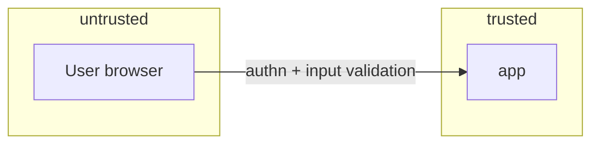

# Threat Model — what can go wrong, on purpose

## What this is

The four layer files design the system working as intended. This file
designs it under attack and under failure: what is worth stealing or
breaking, where the trust boundaries run, how each use case can be
abused, and what the AI agents building the software can themselves get
wrong. It is one file per project, not a section per layer, because
threats do not respect layers — a prompt-injection attack enters through
[communication](layers/communication.md), executes in [application](layers/application.md), and exfiltrates from
[data](layers/data.md).

The **red-team agent** owns this artifact ([agent-team](../context/system/agent-team.md)) — the same
seat that runs ADR pre-mortems. A pre-mortem asks "how does this decision
fail?"; the threat model asks "how does the whole system fail or get
made to fail?" — same muscle, wider aperture.

## Why it matters, and when it gates

This is a **design-phase gate** (`lifecycle-playbook-seed` → Gate B): the
threat model is written and reviewed *before implementation begins* — it
is part of this chapter's exit, alongside the four layer files. Threats
found now are design changes; the same threats found in [Build](../05-build/README.md)
are rework, and found in production they are incidents.

**Claim:** gates must be enforced, not aspirational. **Evidence:** the
canonical failure is Knight Capital — one unenforced deployment gate,
$440M in 45 minutes (`red-team-seed → gates`). **Failure condition for
this whole file:** a threat model written once and never revisited is
compliance theatre; it joins the [DEBT-LEDGER](../06-learn/DEBT-LEDGER.md) when any layer file
changes without a matching review here ([ADR-005](decisions/ADR-005-failure-condition-convention.md)
applies to security patterns same as any other).

## Section 1 — Crown jewels

List the assets whose loss, leak, or corruption ends the project — not
everything, the 1–5 that matter (`lifecycle-playbook-seed` → threat model
contents`). The [data](layers/data.md) layer's classification hooks feed this directly:
your regulated/personal data classes are crown jewels by definition.

## Section 2 — Trust boundaries

Draw where trust changes: user ↔ system, system ↔ third-party, module ↔
module where privileges differ, and — new — human ↔ AI agent. Mermaid
`flowchart` with subgraphs as trust zones, ≤ 20 nodes
([ADR-002](decisions/ADR-002-modeling-conventions.md)); every arrow crossing a zone
border is a boundary needing a control.

## Section 3 — Abuse cases

Every [use case](../01-understand/use-cases.md) has a shadow: how would a
hostile actor use this capability? "Export all my data" shadows as "export
*someone else's* data"; "reset password" shadows as account takeover.
Write abuse cases against the use-case list — frequency × importance
scoring does not apply; an abuse case is rated by damage, and the
must-have lane logic holds (a rare catastrophic abuse outranks a common
nuisance).

## Section 4 — AI-specific threats

Your build process is itself an attack surface
(`lifecycle-playbook-seed` → AI-specific threats`;
`red-team-seed → AI code as untrusted input`):

| Threat | What it looks like | Standing control |
| :---- | :---- | :---- |
| Insecure generated code | ~40% of Copilot outputs in security-sensitive scenarios exploitable; no current model adds CSRF protection, security headers, CORS, or MFA *unprompted* (Pearce et al.; ACM 2024) | Treat AI code as untrusted input: review gates, the [constraints](../03-plan/constraints/global.md) execution discipline, security requirements stated explicitly in tasks — never assumed |
| Prompt injection | Untrusted content (user input, fetched pages, tool output) steering an agent's actions | Agents treat all external content as data, not instructions; tool allowlists per agent (Ch. 04) |
| Data leakage via prompts | Secrets or personal data pasted into model context | "No secrets in prompts" hard rule ([constraints/global](../03-plan/constraints/global.md)); classification matrix marks what may never leave |
| Hallucinated dependencies | Agent invents a plausible package name; attacker registers it | No new dependency without provenance + license review (hard rule) |
| Automation bias | Human verification effort decays as the agent seems reliable (CSET: Tesla/aviation/medical pattern) | Review gates that *cannot* be skipped quietly; periodic low-AI tasks; the human stays the post-mortem agent |

**Failure condition for the controls column:** a control nobody can name
the enforcement mechanism for is aspirational — name the hook, the gate,
or the reviewer, or move the row to accepted risk.

## Section 5 — Detection and recovery, per threat

A threat entry without detection and recovery is a worry, not a model
(`lifecycle-playbook-seed`). For each row in your threat table: how would
you *know* (signal, alert, audit trail — feeds [Ch. 07](../07-ship-operate/README.md)
monitoring), and what is the *recovery path* (restore, revoke, rotate,
notify — rehearsed, not theoretical).

> [!NOTE] Ask your AI agent
> "Here are my use cases, data classification, and trust-boundary
> diagram. Play the red-team agent: write the abuse case for each
> must-have use case, then propose the three most likely threats with
> detection signals and recovery paths. Assume I will skip verification
> when busy — design controls that survive that."

---

## Template — your threat model

### Crown jewels

| # | Asset | Why it's a crown jewel | Where it lives ([data](layers/data.md) entity) |
| :---- | :---- | :---- | :---- |
| 1 | [e.g., customer PII table] | [regulated; breach = project over] | [entity] |

### Trust boundaries

### Threat table

| # | Threat | Asset at risk | Boundary crossed | Abuse/failure scenario | Detection | Recovery | Control & enforcement | Status |
| :---- | :---- | :---- | :---- | :---- | :---- | :---- | :---- | :---- |
| 1 | | | | | | | | open / mitigated / accepted risk |

### Review log

| Date | Trigger (layer change, incident, schedule) | Reviewer | Outcome |
| :---- | :---- | :---- | :---- |
| 2026-06-17 | Pre-mortem before Ch. 05 build (task 01; Gate B) | red-team agent + human | **Fail — design gate not cleared.** Template sections empty; AI standing controls lack per-row detection/recovery. See entry below. Human review pending. |

#### Pre-mortem entry — 2026-06-17 (task 01)

**Threats challenged**

| Area | Finding |
| :---- | :---- |
| Crown jewels | Template row 1 only — no harness assets named (canon markdown, `STATE.md` / dashboard handoff, agent yaml roster, `.build-context/` loader output). Loss or silent corruption of session state is a project-ending event for this repo. |
| Trust boundaries | Placeholder diagram (browser → app) omits **human ↔ IDE agent**, **agent ↔ git**, and **agent ↔ external LLM** boundaries — the actual attack surface for Ch. 05. |
| AI-specific table (§4) | Five standing controls cite [global](../03-plan/constraints/global.md) and Ch. 04 allowlists, but none name **detection** or **recovery** per ADR-005 / §5 — controls read aspirational until hooked to pre-commit, gitleaks, scope checks, or human gate. |
| Automation bias | "Review gates that cannot be skipped quietly" has no named enforcement on Track B beyond human habit — Knight Capital pattern (`red-team-seed → gates`) applies if `validate_md.py` or diff review is bypassed. |
| Failure condition (whole file) | `status: template` while § "Why it matters" claims Gate B blocks implementation — file is teaching scaffold, not a reviewed model. This pre-mortem is the first review pass. |

**Gaps found**

| # | Gap | Severity |
| :-- | :---- | :------- |
| G1 | No crown jewels populated for the book harness | Blocker |
| G2 | No abuse cases mapped from [use-cases](../01-understand/use-cases.md) (table still template) | Blocker |
| G3 | Threat table row 1 empty — no detection, recovery, or enforcement column | Blocker |
| G4 | Gate B SLOs / perf budgets undefined for this project | Major |
| G5 | AI §4 controls not traced to validator hooks (e.g. dependency provenance, prompt-secrets) | Major |

**Open abuse cases — detection / recovery**

| Open abuse case | Detection | Recovery |
| :---- | :---- | :---- |
| *(none documented)* | — | — |

Zero abuse cases in the threat table. Vacuous pass on the Gherkin `Then` clause; **Gate B item "abuse cases documented" fails** (G2).

**Gate B checklist** (`lifecycle-playbook-seed` → before implementation)

| Item | Result | Evidence |
| :---- | :---- | :---- |
| Requirements testable | **Fail** | `01-understand/use-cases.md` is template-only; no reader-product requirements locked |
| Non-goals + abuse cases documented | **Fail** | No abuse-case rows; non-goals not in threat model |
| Threat model reviewed | **Pass** | This dated review-log entry (task 01 pre-mortem) |
| Grounding package updated | **Partial** | `context/` + `03-plan/constraints/global.md` populated; threat model not aligned to harness assets |
| SLOs + perf budgets defined | **Fail** | Not in PROJECT-PLAN or constraints for harness meta-work |

**Verdict:** Gate B **not cleared** — expected for a template threat model. Ch. 05 *book* build may proceed on harness meta-tasks; reader product implementation should not start until G1–G3 close.

> **Escalation — must-have use-case controls**
>
> The MUST lane in use-cases (`regulatory export/delete/a11y`, assumed basics "login works, data isn't lost") has **no matching abuse cases or controls** in this threat model. For the harness itself, treat **session handoff integrity** (`STATE.md`, dashboard L1–L3) as a MUST-basic: silent overwrite or stale handoff is the analog of data loss. Recommended control: session-close checklist in [session-workflow](../context/system/session-workflow.md) + human merge gate (already present); add crown-jewel row and one threat-table row when the reader fills the template — not in scope for task 01.
