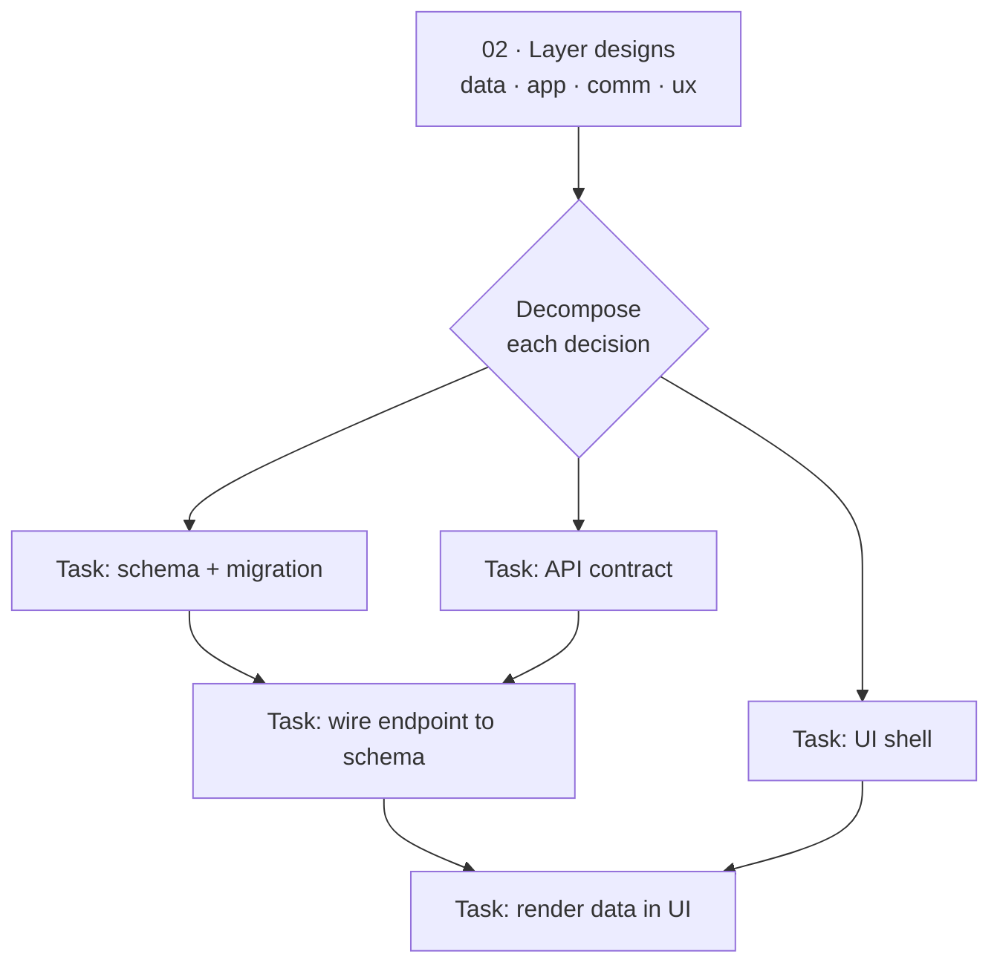

# The plan

> [!TEACH] Teach
> This chapter turns the four layers you designed in [[02-design|Design]] into a
> list of tasks small enough to finish in one sitting, ordered so each one can
> start only when the work it depends on is done. The file you are reading is
> both the lesson and the artifact: the bottom of this page is your project's
> *actual* plan, and it stays live until the last task closes.

> [!LEARN] Learn It
> A plan here is not a schedule. It is a **dependency graph of bounded
> tasks**. Each task names what it consumes, what governs it, who runs it, and
> what it must produce — then states, in testable terms, what "done" means.
> You build the graph by walking the [[02-design|layer designs]] and asking,
> for each decision: what is the smallest change that makes this real and can
> be reverted on its own? That change is a task.

> [!TIP] Fast Track
> Decompose each layer into atomic tasks (≤ one sitting, ≤ 100-line TASK.md).
> One task = one [[new-task|ICOM/Gherkin file]] in `tasks/`. Order by
> dependency, prune aggressively, cite the ADR on every pruned branch. The
> table at the bottom is the source of truth. For regression fixtures per core
> agent role, see [[golden-task-examples]].

## What makes a task a task

> [!TEACH] Teach
> A task is the unit this method commits, reviews, and reverts as a whole. It
> earns its place only if all four hold:
>
> - **Bounded** — finishable in one sitting; its TASK.md stays under the
>   100-line budget in [[global|constraints]]. If it won't fit, decompose the
>   task, not the file.
> - **Atomic** — one logical change, revertible in isolation (the same rule the
>   commit discipline enforces).
> - **Testable** — its success is observable and written as Gherkin `Then`
>   clauses *before* the work starts, per [[ADR-002-modeling-conventions|ADR-002]].
> - **Scoped** — it lists the exact files it may modify. A task that needs to
>   touch a Layer 1 or Layer 2 context file is no longer task-level — escalate.
>
> Every task file is an **ICOM frame** — Inputs, Controls, Mechanisms, Outputs —
> with Gherkin acceptance criteria. Use [[new-task]] as the template; it
> pre-fills structure and placeholders — you fill Inputs/Outputs tables,
> scope lists, and the acceptance block.

## From layers to tasks



> [!TEACH] Teach
> Read top to bottom: the layer designs fan out into tasks; arrows are
> *depends-on*, not time. A task with no inbound arrow can start immediately; a
> task with two inbound arrows waits for both. Keep any one view under the
> 20-node budget — if the graph outgrows it, split it by layer or by milestone.

## Pruning

> [!TEACH] Teach
> A plan that only ever grows is a plan that hides its decisions. When you cut a
> branch — a feature, an approach, a whole task — leave the stub and cite the
> record, so the next reader sees the fork and the reason:

```text
~~Task 12: offline sync engine~~  [PRUNED: deferred to post-v1 — see ADR-014]
```

> [!TEACH] Teach
> Pruning is not deletion. The rejected path is exactly what you reach for when
> the context that justified the cut has faded.

## The living plan

> [!TIP] Fast Track
> This table is the source of truth for task order and status. One row per
> task; the file in `tasks/` holds the detail. Status: `todo` · `doing` ·
> `done` · `blocked` · `pruned`.

| # | Task | Layer | Depends on | Agent | Status | File |
| :-- | :-- | :-- | :-- | :-- | :-- | :-- |
| 01 | Threat-model pre-mortem review | design | — | red-team | done | `04-your-agents/tasks/01-threat-model-premortem.md` |
| 02 | Track A golden-path task run | build | 01 | dev | done | `04-your-agents/tasks/02-track-a-golden-path.md` |
| 03 | Populate `context/` example tree | agents | 02 | dev | done | `04-your-agents/tasks/03-populate-context-tree.md` |
| 04 | Ch. 06 learn-loop templates | learn | 03 | dev | done | `04-your-agents/tasks/04-ch06-learn-loop-templates.md` |

**Harness note:** the rows above are **this book repo's** living plan — the
worked example for spine sessions S19–S23. Replace them with your product's
tasks when you fork the method; keep one row per scoped task file.

*Example rows for a reader product (delete when you replace the table):*

| # | Task | Layer | Depends on | Agent | Status | File |
| :-- | :-- | :-- | :-- | :-- | :-- | :-- |
| — | *(example)* define core schema | data | — | builder | todo | `tasks/01-core-schema.md` |
| — | *(example)* expose read API | application | 01 | builder | todo | `tasks/02-read-api.md` |

## Before you leave this chapter

The plan is ready to execute — and [[05-build|Build]] should not start —
when every box is checked:

- [ ] Every task in the table has an ICOM/Gherkin file in `tasks/`.
- [ ] Acceptance criteria are written as `Then` clauses, not intentions.
- [ ] The dependency order has no cycles; every task can name what unblocks it.
- [ ] Abuse cases and non-goals from [[01-understand|Understand]] are reflected
      in the tasks that touch them; the [[threat-model]] has been reviewed.
- [ ] Pruned branches cite their ADR.
- [ ] Tasks use [[new-task|ICOM+ template]] — Inputs/Outputs artifact·form·where tables; Controls scope + inherited constraints; Mechanisms Executor/Supervisor (S29).
- [ ] Core agent roles have golden-task regression fixtures — see [[golden-task-examples]] and `04-your-agents/golden-tasks/`.

> [!TEACH] Teach
> This is the gate between planning and building: requirements testable, threats
> reviewed, scope bounded. Cross it deliberately.
