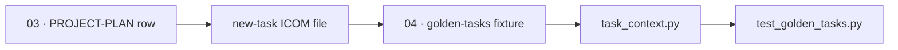

# Golden-task examples — from plan to regression fixtures

> [!TEACH] Teach
> A **golden task** is a bounded ICOM/Gherkin file that regression-tests one
> agent role: it proves `task_context.py` loads the right canon, strips
> teaching blocks per [ADR-006](../02-design/decisions/ADR-006-teaching-block-convention.md), and
> delivers artifact-only context to the model. Golden tasks live in
> `04-your-agents/golden-tasks/` — they are **harness fixtures**, not product
> work you ship to users.

> [!LEARN] Learn It
> When you decompose your [living plan](PROJECT-PLAN.md), each real task names
> an Executor (`agent` in frontmatter) and a `context_load` list. Golden tasks
> mirror that shape at minimum scope: one role, one scenario, testable
> `Then` clauses. Add a golden task when a core role needs a permanent
> regression path — not for every plan row.

## Plan row → golden fixture

| Plan concern | Golden task proves | Harness fixture |
| :----------- | :----------------- | :-------------- |
| Dev executes within scope | Agent defaults + task `context_load` merge; Scope — modify honored | [02-dev-bounded-patch](../04-your-agents/golden-tasks/02-dev-bounded-patch.md) |
| Tester breaks the build | Adversarial mandate + playbook Gate B seed in context | [03-tester-edge-case-repro](../04-your-agents/golden-tasks/03-tester-edge-case-repro.md) |
| Security tester hunts abuse | Threat model + red-team seed loaded; injection scenario | [04-security-injection-probe](../04-your-agents/golden-tasks/04-security-injection-probe.md) |
| Red-team gates design exit | Pre-mortem flow + Gate B checklist in context | [05-redteam-premortem-gate](../04-your-agents/golden-tasks/05-redteam-premortem-gate.md) |
| Evaluator tiebreaks k split | Bias mitigations + score matrix in context | [01-design-option-tiebreak](../04-your-agents/golden-tasks/01-design-option-tiebreak.md) |

Your product plan replaces the scenarios; keep the **fixture shape** (frontmatter
`agent`, `context_load`, ICOM table, Gherkin, acceptance checklist).

## Shape (copy from [new-task](../_templates/new-task.md))

Every golden task file follows the same skeleton as a plan task — under the
100-line [constraints](constraints/global.md) budget:

1. **Frontmatter** — `agent:` matches one `04-your-agents/agents/*.yaml` role.
2. **Inputs** — `context_load:` lists Layer-3 paths beyond agent defaults.
3. **Controls** — inherited constraints; Scope — modify (fixture may be read-only).
4. **ICOM** — one row table summarizing the frame.
5. **Gherkin** — observable `Then` clauses (fixture behavior, not production code).
6. **Acceptance criteria** — human or CI checklist.



## Run and verify

Assemble stripped context for any fixture:

```powershell
python scripts/task_context.py 04-your-agents/golden-tasks/02-dev-bounded-patch.md
```

Regression suite (all five core roles):

```powershell
python scripts/test_golden_tasks.py
```

Full role reference: [agent-team](../context/system/agent-team.md). Wiring detail: [context-loader](../04-your-agents/context-loader.md).

## When to add a row

| Signal | Action |
| :----- | :----- |
| New core agent role in `agents/*.yaml` | Add golden fixture + test assertions |
| Changed `context_load_default` on a role | Update fixture paths; re-run suite |
| Specialist fork only | Defer golden task until post-mortem shows repeat gap |

Do **not** duplicate every PROJECT-PLAN row as a golden task — one fixture per
**core role** is the harness bar (evaluator path shipped S22; full roster S46).
