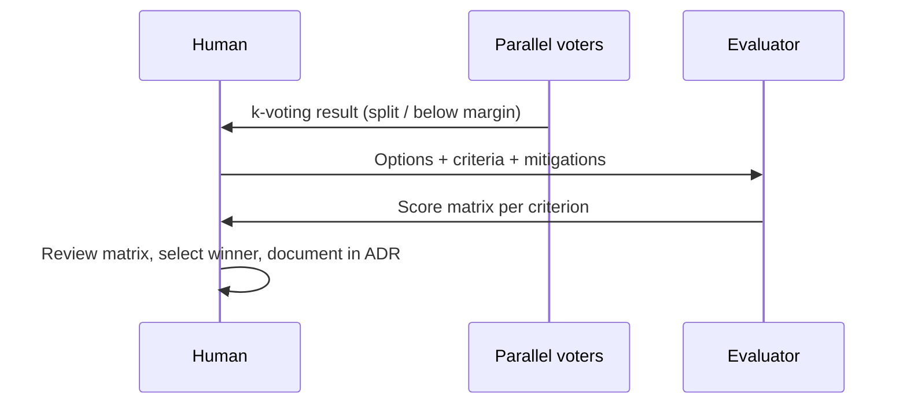

# Evaluator — scoring and k-voting tiebreaker

The evaluator scores design or implementation **options** against criteria you
supply. It runs when parallel k-voting fails to clear the margin — not as a
default gate on every decision. Full roster context: [[agent-team]].

Contract file: `agents/evaluator.yaml` (≤ 60 lines).

## When to invoke

| Trigger | Example |
| :---- | :---- |
| k-voting split | Two cache options tie; k margin not met |
| Design comparison | Storage engine choice needs structured scores |
| Process flag | TASK.md marks "evaluator required" at planning time |

Red-team runs **sequentially on decisions** — not in parallel k-voting.

## Bias mitigations (required)

LLM-as-judge scores can reflect judge bias, not option quality. Apply all four
when the evaluator runs (source: `research/red-team-seed.md` §3):

| Mitigation | What you do |
| :---- | :---- |
| **Family separation** | Use a different model family than the agents that proposed the options |
| **Position swap** | Run scoring twice with option order reversed; flag rank flips |
| **Multi-label** | Score each criterion independently; no single overall "winner" label first |
| **Never sole judge** | Human reviews the score matrix; evaluator input only, not the final vote |

Record mitigations applied in the task review log or ADR evidence section.

## Tiebreak flow



Langfuse experiment wiring is optional until execution tooling is active — see
[[overview]] dimension 8.

## Golden-task suite

Fixture tasks under `golden-tasks/` exercise agent assignment and context load
for the evaluator path. They are **not** production work — they verify the
harness wiring.

| # | Agent | File |
| :-- | :---- | :---- |
| 01 | evaluator | [[golden-tasks/01-design-option-tiebreak]] |
| 02 | dev | [[golden-tasks/02-dev-bounded-patch]] |
| 03 | tester | [[golden-tasks/03-tester-edge-case-repro]] |
| 04 | security-tester | [[golden-tasks/04-security-injection-probe]] |
| 05 | red-team | [[golden-tasks/05-redteam-premortem-gate]] |

Ch. 03 walkthrough: [[golden-task-examples|03-plan/golden-task-examples]].

Run context assembly (any row):

```powershell
python scripts/task_context.py 04-your-agents/golden-tasks/01-design-option-tiebreak.md
```

Automated checks: `python scripts/test_golden_tasks.py`.
