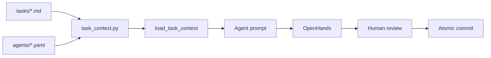

# 05 — Build

The plan from [Ch. 03](../03-plan/PROJECT-PLAN.md) and the agent team from
[Ch. 04](../04-your-agents/README.md) meet here. Each task file names an agent, the
files it may change, and the acceptance criteria that close the task.
This chapter is where those tasks run — using your execution tool to turn
bounded specs into working software and reviewed commits.

> [!LEARN] Learn It
> Build is not "ask the AI to code the app." It is a **repeatable execution
> loop**: assemble stripped context → run the assigned agent → verify acceptance
> criteria → human review → atomic commit. Track A: [openhands](execution-tools/openhands.md). Track B:
> [track-b-checklist](execution-tools/track-b-checklist.md).

> [!TIP] Fast Track
> Track A: [openhands](execution-tools/openhands.md) + `python scripts/task_context.py <task>.md`
> Track B: same context command → [track-b-checklist](execution-tools/track-b-checklist.md)

## Execution loop

## What lives here

| Path | Purpose |
| :---- | :---- |
| `execution-tools/` | Track A: [track-a-setup](execution-tools/track-a-setup.md) · [openhands](execution-tools/openhands.md) · `track-a/` stack (incl. Langfuse) · Track B: [track-b-checklist](execution-tools/track-b-checklist.md) · Git: [bare-worktree-setup](execution-tools/bare-worktree-setup.md) |
| `04-your-agents/tasks/` | Task specs (Ch. 04 owns the template; tasks execute from Build) |

Reader project tasks land in your repo's `tasks/` tree per
[PROJECT-PLAN](../03-plan/PROJECT-PLAN.md). This book's harness example stays in
`04-your-agents/tasks/01-threat-model-premortem.md` until you replace it with
your own backlog.

## Exit discipline

Every task closes when its Gherkin `Then` clauses have evidence — not when
the agent says it is done. Closing a task requires **postcondition evidence**:
each Gherkin `Then` appears in the commit message or post-mortem with a pointer
to proof. Missing evidence blocks closure — this is the Hoare postcondition for
the build loop ([ADR-002](../02-design/decisions/ADR-002-modeling-conventions.md)), not optional polish.

Inherited rules from [constraints](../03-plan/constraints/global.md) still apply: no direct pushes to
protected branches, no secrets in prompts, scope lists are hard boundaries.

Failures and near-misses feed [Ch. 06 Learn](../06-learn/README.md): copy
`_templates/post-mortem.md`, promote patterns to `06-learn/boilerplate/`, log
trigger debts in [DEBT-LEDGER](../06-learn/DEBT-LEDGER.md).

## Observability

Track A ships with **Langfuse** for model-level traces (LiteLLM Path A). Setup
and smoke-test steps: [track-a-setup](execution-tools/track-a-setup.md) § steps 3b, 4, and 4b. UI:
http://127.0.0.1:3001 (OpenHands stays on :3000).

Shipped software feeds [Ch. 07 Operate](../07-ship-operate/README.md): copy
`_templates/runbook.md` into `runbook/` and keep deploy + health checks current.

Whole-product end-of-life feeds [Ch. 08 Sunset](../08-sunset/README.md): decommission
record + Gate F when kill criteria fire.
