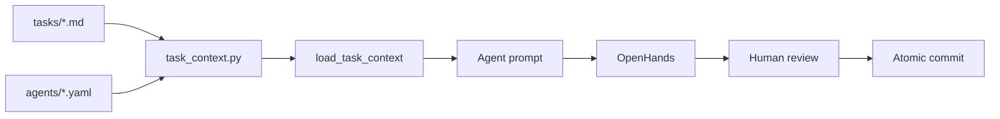

# 05 — Build

The plan from [[03-plan/PROJECT-PLAN|Ch. 03]] and the agent team from
[[04-your-agents|Ch. 04]] meet here. Each task file names an agent, the
files it may change, and the acceptance criteria that close the task.
This chapter is where those tasks run — using your execution tool to turn
bounded specs into working software and reviewed commits.

> [!LEARN] Learn It
> Build is not "ask the AI to code the app." It is a **repeatable execution
> loop**: assemble stripped context → run the assigned agent → verify acceptance
> criteria → human review → atomic commit. Track A: [[openhands]]. Track B:
> [[track-b-checklist]].

> [!TIP] Fast Track
> Track A: [[openhands]] + `python scripts/task_context.py <task>.md`
> Track B: same context command → [[track-b-checklist]]

## Execution loop

## What lives here

| Path | Purpose |
| :---- | :---- |
| `execution-tools/` | Track A: [[track-a-setup]] · [[openhands]] · `track-a/` stack (incl. Langfuse) · Track B: [[track-b-checklist]] · Git: [[bare-worktree-setup]] |
| `04-your-agents/tasks/` | Task specs (Ch. 04 owns the template; tasks execute from Build) |

Reader project tasks land in your repo's `tasks/` tree per
[[03-plan/PROJECT-PLAN|PROJECT-PLAN]]. This book's harness example stays in
`04-your-agents/tasks/01-threat-model-premortem.md` until you replace it with
your own backlog.

## Exit discipline

Every task closes when its Gherkin `Then` clauses have evidence — not when
the agent says it is done. Closing a task requires **postcondition evidence**:
each Gherkin `Then` appears in the commit message or post-mortem with a pointer
to proof. Missing evidence blocks closure — this is the Hoare postcondition for
the build loop ([[ADR-002-modeling-conventions|ADR-002]]), not optional polish.

Inherited rules from [[global|constraints]] still apply: no direct pushes to
protected branches, no secrets in prompts, scope lists are hard boundaries.

Failures and near-misses feed [[06-learn|Ch. 06 Learn]]: copy
`_templates/post-mortem.md`, promote patterns to `06-learn/boilerplate/`, log
trigger debts in [[DEBT-LEDGER]].

## Observability

Track A ships with **Langfuse** for model-level traces (LiteLLM Path A). Setup
and smoke-test steps: [[track-a-setup]] § steps 3b, 4, and 4b. UI:
http://127.0.0.1:3001 (OpenHands stays on :3000).

Shipped software feeds [[07-ship-operate|Ch. 07 Operate]]: copy
`_templates/runbook.md` into `runbook/` and keep deploy + health checks current.

Whole-product end-of-life feeds [[08-sunset|Ch. 08 Sunset]]: decommission
record + Gate F when kill criteria fire.
