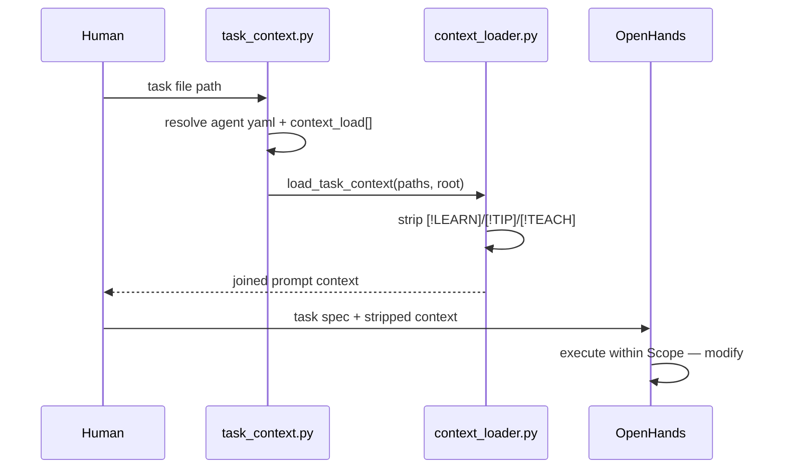

# OpenHands — Track A execution tool

OpenHands is the book's **ideal (Track A)** execution runtime: a self-hosted,
Docker-based loop where an LLM reads your repo, edits files, runs commands,
and iterates until the task's acceptance criteria are met. Design work stays in
your design tool (Ch. 00); OpenHands owns **bounded build tasks** from
`tasks/*.md`. For Track B fallback, see [[track-b-checklist]].

> [!LEARN] Learn It
> **Why OpenHands here:** local control, full repo access, reproducible
> sandboxes, and a path to LiteLLM-backed model aliases (same pattern as
> Ch. 04 agent yaml). Track B (IDE/CLI) uses [[track-b-checklist]] instead
> of per-tool guides — see [[ADR-007-dual-execution-tracks]].

> [!TIP] Fast Track
> Install → point at repo → assemble context → paste prompt → review diff →
> commit on Windows. Commands in [Fast track setup](#fast-track-setup) and
> [Run a task](#run-a-task).

## Prerequisites

| Requirement | Notes |
| :---- | :---- |
| Docker | OpenHands runs in containers — see [OpenHands docs](https://docs.openhands.dev/) |
| Git repo | This vault cloned; branch per session (`session-NN/<topic>`); target layout: [[bare-worktree-setup]] |
| LiteLLM config | Model aliases from agent yaml (`frontier-llm`, `capable-llm`, …) |
| Python 3 | Context assembly uses `scripts/task_context.py` (stdlib + PyYAML if installed) |

Record your OpenHands version and LLM endpoint in `constraints/project.md`
when you fill it — the book does not pin a version for you.

## Context before code

Agents must not receive raw dual-purpose chapter files. The execution path
loads **artifact-only** markdown per [[context-loader]] and ADR-006:



**Merge order:** `context_load_default` from the agent yaml, then
`context_load` from the task frontmatter (task paths append; duplicates
removed, first occurrence wins).

## Fast track setup

```powershell
# From repo root — verify loader + task wiring
python scripts/test_context_loader.py
python scripts/test_task_context.py

# Assemble stripped context for a task (stdout → paste into OpenHands)
python scripts/task_context.py 04-your-agents/tasks/01-threat-model-premortem.md
```

Follow [OpenHands installation](https://github.com/All-Hands-AI/OpenHands)
for Docker compose or desktop — mount **one session worktree** as the workspace
(see [[bare-worktree-setup]]). A single clone is an acceptable ramp until you
adopt bare + worktrees.

## Run a task

### 1. Pick the task

Open the task file (example: [[tasks/01-threat-model-premortem]]). Confirm:

- `agent` field matches a yaml in `04-your-agents/agents/`
- `context_load` lists every input the agent needs
- **Scope — modify** and acceptance criteria are explicit

### 2. Assemble context

```powershell
python scripts/task_context.py 04-your-agents/tasks/01-threat-model-premortem.md `
  > .build-context/01-premortem-context.md
```

Review the output — teaching callouts should be gone; tables and Gherkin
should remain. ADRs and `context/system/sessions/` pass through unchanged.

### 3. Open OpenHands

- Workspace: **session worktree** directory on branch `session-NN/<topic>` — see [[bare-worktree-setup]]
- Model: match the task's agent yaml (`red-team-agent` → `frontier-llm`)

### 4. Initial prompt template

Paste a prompt shaped like this (fill from the task file):

```markdown
You are the {agent role} for this project.

## Task
{paste task markdown — or link to the task file path}

## Loaded context (ADR-006 stripped)
{paste output of task_context.py}

## Rules
- Modify only files listed under "Scope — modify"
- Quote each Gherkin Then clause with evidence before claiming done
- Escalate if a change would touch Layer 1/2 context files
```

### 5. Human review gate (mandatory)

Per [[global|constraints]] and D-001: **you** review every diff on Windows,
run `python scripts/validate_md.py --all`, then commit with Conventional
Commits. The agent suggests; you approve.

```powershell
python scripts/validate_md.py --all
git add <files>
git commit -m "type(scope): subject" -m "Body with why."
```

## Harness example — task 01

The book's first execution exercise is the red-team pre-mortem on
[[threat-model]] — smallest task that exercises agent assignment, context
load, and Gherkin closure without product code.

```powershell
python scripts/task_context.py 04-your-agents/tasks/01-threat-model-premortem.md
```

Expected stripped inputs include the threat-model artifact sections (not
`[!TEACH]` blocks), ADR-005, and research seeds listed in the task's
`context_load`.

## When OpenHands is the wrong tool

| Situation                   | Consider                                       |
| :-------------------------- | :--------------------------------------------- |
| No Docker / no local admin  | Jules or another cloud stub (Ch. 00)           |
| Single-file script, no repo | Claude Code / Codex CLI                        |
| Parallel multi-agent IDE    | Cursor / Antigravity (design + execution stub) |

Document the switch in a short ADR if it affects team workflow.

## Track A run log

| Date | Task | Branch | Model | Status | Notes |
| :--- | :--- | :--- | :--- | :--- | :--- |
| 2026-06-22 21:51 | 02 | session-21/track-a-first-run | capable-llm | pass | Golden path execution verified; LiteLLM + OpenHands integration working |

## Reference

- Agent roster: [[agent-team]]
- Loader spec: [[context-loader]]
- Git layout: [[bare-worktree-setup]]
- Seed repo: `github.com/All-Hands-AI/OpenHands`
