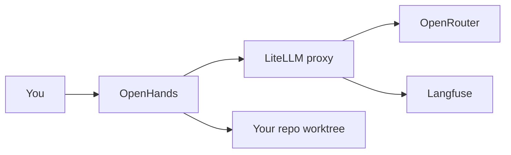
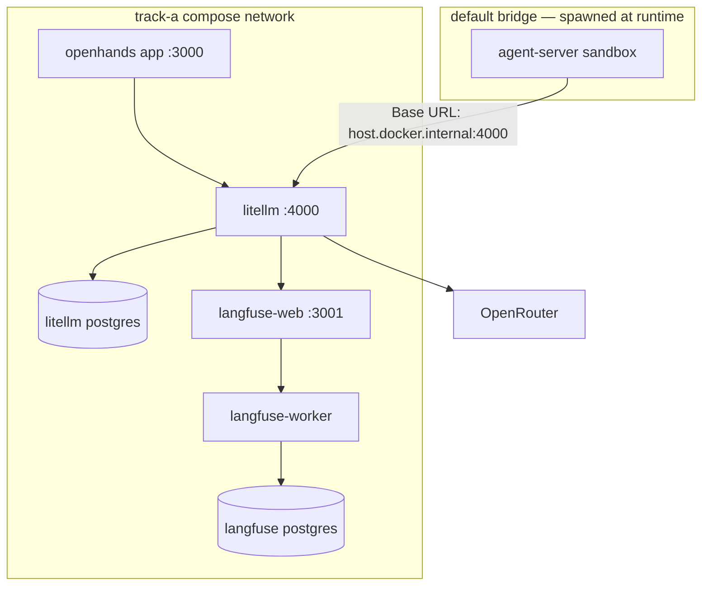

# Track A setup — install and configure

One-time setup for **Track A**: Docker, OpenRouter, LiteLLM, and OpenHands
wired as a local stack. After this guide, use [openhands](openhands.md) to run tasks.

> [!LEARN] Learn It
> **What this file owns:** the order of setup, what to configure in *this*
> repo, and how to know you are ready. **What it does not own:** install
> screens, CLI flags, or version-specific UI — those change; we link to
> official docs instead.

> [!TIP] Fast Track
> Docker installed → OpenRouter key → copy `.env` → `docker compose up` →
> OpenHands UI on `127.0.0.1:3000` → record versions in [constraints/project](../../03-plan/constraints/project.md).
> Details in [Scaffold path](#scaffold-path).

## What you are building





OpenHands runs the agent. LiteLLM routes models and budgets. OpenRouter bills
upstream models. Langfuse captures **model-level traces** from LiteLLM (Path A).
Your repo mounts as the workspace — see [bare-worktree-setup](bare-worktree-setup.md).

The **agent-server** sandbox is **not** on the compose network — see step 5
Base URL note.

**Chain rule:** OpenHands → LiteLLM → provider. Never point OpenHands at
OpenRouter directly ([ADR-007-dual-execution-tracks](../../02-design/decisions/ADR-007-dual-execution-tracks.md)).

## Book vs external docs

| Topic | This book maintains | Use official docs for |
| :---- | :------------------ | :-------------------- |
| Compose layout + aliases | `track-a/docker-compose.yml`, `litellm_config.yaml` | — |
| Agent model names | `frontier-llm`, `capable-llm`, `fast-llm` in config | Provider model catalog |
| Docker install | Prerequisites + verify commands | Install steps, WSL2, GPU |
| OpenRouter | Account + scoped key + credit limit | Pricing, model list, API reference |
| LiteLLM | `.env` keys + virtual key for OpenHands | Proxy admin UI, advanced routing |
| Langfuse | Compose services + LiteLLM callback in `litellm_config.yaml` | UI tour, evaluations, prompt mgmt |
| OpenHands | LLM wiring values for this stack | UI tour, agent types, updates |

## Before you start

| Requirement | Pass when |
| :---------- | :---------- |
| Admin rights to install Docker | `docker version` succeeds |
| Docker Desktop memory | **≥ 8 GB** allocated (Track A + Langfuse stack) |
| OpenRouter account + payment or credits | You can create an API key |
| This repo cloned on a session branch | `git status` shows expected branch |
| Python 3 for context assembly | `python scripts/test_task_context.py` green |

```powershell
# From repo root — smoke-test that task context wiring works before you open OpenHands.
python scripts/test_task_context.py
```

No Docker or unwilling to run containers? Use [track-b-checklist](track-b-checklist.md) instead —
same task files, different runtime.

## Scaffold path

Work top to bottom. Do not skip **LiteLLM secrets (step 3)** or **Langfuse
secrets (step 3b)** before first `docker compose up`.

### 1. Install Docker

Install a current **Docker Desktop** (or Docker Engine + Compose on Linux).

| Action | Where |
| :----- | :---- |
| Install Docker Desktop | [Docker Desktop docs](https://docs.docker.com/desktop/) |
| Understand Compose | [Docker Compose docs](https://docs.docker.com/compose/) |
| Windows: WSL2 backend if prompted | [Docker Desktop on Windows](https://docs.docker.com/desktop/setup/install/windows-install/) |

Verify:

```powershell
# Show Docker client and server versions — proves Docker Desktop is running.
docker version

# Show Docker Compose version — used to start the Track A stack in step 4.
docker compose version
```

**Pass when:** both commands print client and server versions without error.

### 2. OpenRouter — account and key

| Action | Where |
| :----- | :---- |
| Create account | [OpenRouter](https://openrouter.ai/) |
| Add credits or billing | [Credits / billing](https://openrouter.ai/docs/faq#how-do-credits-work) |
| Create a **scoped** API key with a **credit limit** | [API keys](https://openrouter.ai/keys) |
| Pick models (optional reading) | [Models catalog](https://openrouter.ai/models) |

Copy the key — you will paste it into `.env` only. Never commit it.

**Pass when:** key starts with `sk-or-` and has a spend cap you are comfortable with.

### 3. Configure this repo's stack

Stack files live in `05-build/execution-tools/track-a/`.

> [!NOTE]
> **You do not install LiteLLM on your PC.** LiteLLM runs inside Docker —
> `docker compose up` (step 4) downloads and starts it from the image in
> `docker-compose.yml`. This step only creates `.env` so that container has
> the secrets it needs on first boot.

| Step | Action |
| :--: | :----- |
| 1 | Copy `.env.example` → `.env` (gitignored) |
| 2 | Paste your OpenRouter key into `OPENROUTER_API_KEY=` |
| 3 | Generate **two different** secrets — one for `LITELLM_MASTER_KEY=`, one for `LITELLM_SALT_KEY=` |
| 4 | Set `WORKSPACE_PATH=` to your session worktree or clone |
| 5 | Leave `OPENHANDS_STATE_DIR` default unless you need a custom path |

**Where each `.env` value goes:**

| Line in `.env` | You get the value from |
| :------------- | :--------------------- |
| `OPENROUTER_API_KEY=` | Step 2 — OpenRouter dashboard |
| `LITELLM_MASTER_KEY=` | Command A below — paste after the `=` |
| `LITELLM_SALT_KEY=` | Command B below — **different** string, paste after the `=` |
| `WORKSPACE_PATH=` | Full path to the repo folder OpenHands should edit |
| `LANGFUSE_NEXTAUTH_SECRET=` etc. | Commands C–E in step 3b |
| `LANGFUSE_PUBLIC_KEY=` / `LANGFUSE_SECRET_KEY=` | Step 4b — Langfuse UI (after first boot) |

```powershell
# Run from repo root.

# Duplicate the example env file into a real .env (gitignored — safe for secrets).
Copy-Item 05-build\execution-tools\track-a\.env.example `
  05-build\execution-tools\track-a\.env

# Open .env in your editor. You will paste three secrets into it next.
notepad 05-build\execution-tools\track-a\.env
```

Generate the two LiteLLM secrets **before** your first `docker compose up`.
Run each command once; copy its output into the matching line in `.env`.

```powershell
# --- Command A: LITELLM_MASTER_KEY ---
# Plain English: invent a long random admin password for the LiteLLM proxy.
# Copy the whole line printed below and paste it AFTER "LITELLM_MASTER_KEY=" in .env
# (replace the placeholder sk-litellm-master-...)
"sk-litellm-master-" + (-join ((1..32) | ForEach-Object { '{0:x2}' -f (Get-Random -Max 256) }))
```

```powershell
# --- Command B: LITELLM_SALT_KEY ---
# Plain English: invent a SECOND random string — different from Command A.
# Copy the line printed below and paste it AFTER "LITELLM_SALT_KEY=" in .env
# (replace the ... placeholder). LiteLLM uses this to encrypt stored keys.
# You cannot change this value later without resetting LiteLLM's database.
-join ((1..32) | ForEach-Object { '{0:x2}' -f (Get-Random -Max 256) })
```

Example — your edited `.env` should look like this (fake values shown):

```text
OPENROUTER_API_KEY=YOUR_OPENROUTER_KEY          # from OpenRouter dashboard
LITELLM_MASTER_KEY=YOUR_LITELLM_MASTER_KEY       # from Command A
LITELLM_SALT_KEY=...                          # from Command B — not the same as master
WORKSPACE_PATH=C:/Users/you/src/project-harness # your repo — forward slashes on Windows
```

Also set `WORKSPACE_PATH` to the folder where your session branch is checked out
— not your home directory. See [bare-worktree-setup](bare-worktree-setup.md) for worktree layout.

**Two mounts — do not skip either:**

| Mount | Container | Purpose |
| :---- | :-------- | :------ |
| `WORKSPACE_PATH` → `/opt/workspace_base` | OpenHands app | UI and repo picker |
| `WORKSPACE_PATH` → `/workspace/project` via `SANDBOX_VOLUMES` | Agent-server sandbox | Where the agent reads and edits files |

OpenHands spawns a separate **agent-server** container per conversation. That sandbox
defaults to an empty git repo unless `SANDBOX_VOLUMES` is set on the OpenHands service.
See [Docker sandbox — mounting your code](https://docs.openhands.dev/openhands/usage/sandboxes/docker).

Official reference for proxy env vars:
[LiteLLM environment settings](https://docs.litellm.ai/docs/proxy/configs).

**Pass when:**
- `.env` exists locally,
- `OPENROUTER_API_KEY` has a real value,
- `LITELLM_MASTER_KEY` has a real value,
- `LITELLM_SALT_KEY` has a real value, and
- `WORKSPACE_PATH` points at the folder OpenHands should edit.

### 3b. Langfuse secrets (before first `docker compose up`)

Langfuse v3 ships in the same compose file. Generate **three one-time secrets**
before the first boot — you cannot rotate them later without resetting Langfuse
data.

```powershell
# --- Command C: LANGFUSE_NEXTAUTH_SECRET ---
# Copy the line printed below → paste after LANGFUSE_NEXTAUTH_SECRET= in .env
-join ((1..32) | ForEach-Object { '{0:x2}' -f (Get-Random -Max 256) })

# --- Command D: LANGFUSE_SALT ---
# Copy the line printed below → paste after LANGFUSE_SALT= in .env
-join ((1..24) | ForEach-Object { '{0:x2}' -f (Get-Random -Max 256) })

# --- Command E: LANGFUSE_ENCRYPTION_KEY (64 hex chars) ---
# Copy the line printed below → paste after LANGFUSE_ENCRYPTION_KEY= in .env
-join ((1..32) | ForEach-Object { '{0:x2}' -f (Get-Random -Max 256) })
```

Leave `LANGFUSE_PUBLIC_KEY` and `LANGFUSE_SECRET_KEY` empty until step 4b.
Optional first-run admin — uncomment in `.env`:

```text
LANGFUSE_INIT_USER_EMAIL=dev@localhost
LANGFUSE_INIT_USER_NAME=dev
LANGFUSE_INIT_USER_PASSWORD=<choose-a-local-password>
```

**Pass when:** `.env` also has real values for `LANGFUSE_NEXTAUTH_SECRET`,
`LANGFUSE_SALT`, and `LANGFUSE_ENCRYPTION_KEY`.

### 4. Start the stack

Docker Compose reads `docker-compose.yml` and starts **LiteLLM, OpenHands,
Langfuse, and backing stores**. You do not install them on Windows — Docker
runs them.

```powershell
# Move into the folder that contains docker-compose.yml and .env.
Set-Location 05-build\execution-tools\track-a

# Download images (first time only) and start containers in the background.
docker compose up -d

# List containers and their health — langfuse-web may take 1–2 min on first boot.
docker compose ps
```

| Service | Healthy signal |
| :------ | :------------- |
| `db` | `healthy` — Postgres for LiteLLM virtual keys |
| `langfuse-postgres`, `langfuse-redis`, `langfuse-clickhouse` | `healthy` — ClickHouse uses `127.0.0.1` ping (not `localhost`; IPv6 false negative on Alpine) |
| `langfuse-web` | `running` — UI on **http://127.0.0.1:3001** (needs ~1.5 GB RAM; OOM at 512M) |
| `litellm` | `healthy` — OpenHands waits on this |
| `openhands` | `running` after LiteLLM is healthy |

OpenHands UI: **http://127.0.0.1:3000** · Langfuse UI: **http://127.0.0.1:3001**
(localhost only).

### 4b. Wire Langfuse API keys → LiteLLM

Path A: every LLM call through LiteLLM is traced in Langfuse — no OpenHands
code changes.

| Step | Action |
| :--: | :----- |
| 1 | Open **http://127.0.0.1:3001** — sign in (or use `LANGFUSE_INIT_*` account) |
| 2 | Open project **track-a** (or create one) → **Settings → API Keys** |
| 3 | Copy **Public key** and **Secret key** into `.env` → `LANGFUSE_PUBLIC_KEY=` / `LANGFUSE_SECRET_KEY=` |
| 4 | Restart LiteLLM so callbacks pick up keys: `docker compose up -d --force-recreate litellm` |

> [!NOTE]
> `docker compose restart litellm` does **not** reload `.env` — use `--force-recreate`
> after adding or changing Langfuse keys.

**Smoke trace** — proves the callback path:

```powershell
# Replace YOUR_VIRTUAL_KEY with the LiteLLM virtual key from step 5 below.
$headers = @{
  Authorization = "Bearer YOUR_VIRTUAL_KEY"
  "Content-Type"  = "application/json"
}
$body = @{
  model    = "capable-llm"
  messages = @(@{ role = "user"; content = "Reply with exactly: trace-ok" })
} | ConvertTo-Json -Depth 5

Invoke-RestMethod -Uri http://127.0.0.1:4000/chat/completions `
  -Method Post -Headers $headers -Body $body
```

**Pass when:** Langfuse UI → **Traces** shows a new trace within ~30 seconds.
Official reference: [LiteLLM × Langfuse](https://docs.litellm.ai/docs/observability/langfuse_integration).

Official references:

- [OpenHands installation](https://docs.openhands.dev/)
- [OpenHands GitHub](https://github.com/All-Hands-AI/OpenHands)
- [LiteLLM Docker deploy](https://docs.litellm.ai/docs/proxy/deploy)

**Pass when:** UI loads; LiteLLM health check returns OK:

```powershell
# LiteLLM is ready when this returns StatusCode 200 (no API key needed).
# Note: /health without /liveliness may return 401 — that is normal.
Invoke-WebRequest -Uri http://127.0.0.1:4000/health/liveliness -UseBasicParsing
```

### 5. Wire OpenHands to LiteLLM

LiteLLM is **not** in the LLM Provider dropdown. OpenHands 1.8 routes proxy
models through **Settings → LLM → Advanced** using the `litellm_proxy/` prefix
per [OpenHands LiteLLM proxy docs](https://docs.openhands.dev/openhands/usage/llms/litellm-proxy).

| Step | Action |
| :--: | :----- |
| 1 | Open **http://127.0.0.1:3000/settings** (gear icon → **LLM** in sidebar) |
| 2 | Open the **Advanced** tab — not Basic or the first-run provider modal |
| 3 | Set **Custom Model**, **Base URL**, **API Key** (table below) |
| 4 | Click **Save Changes** |
| 5 | Optional: **Settings → Condenser** — add profile `condenser-llm` with same Base URL/key |
| 6 | **LLM profiles list** should show `capable-llm` (default) and optionally `condenser-llm` |

Do **not** use `openhands/...` model strings unless you are on OpenHands Cloud —
that is a different provider ([LLM overview](https://docs.openhands.dev/openhands/usage/llms/llms)).

| Field | Value for this stack |
| :---- | :------------------- |
| Custom Model | `litellm_proxy/capable-llm` — alias from `litellm_config.yaml`, not the OpenRouter slug |
| Base URL | `http://host.docker.internal:4000` — see note below |
| API Key | LiteLLM **virtual key** (below) — not `LITELLM_MASTER_KEY` |

**Base URL — why not `litellm:4000`?** The OpenHands **app** container shares the
compose network and could use `http://litellm:4000`. The **agent-server**
sandbox is a **separate container** spawned via Docker socket (default `bridge`
network). It cannot resolve the hostname `litellm`. Logs show:

`Cannot connect to host litellm:4000 [Name or service not known]`

Use **`http://host.docker.internal:4000`** so the sandbox reaches LiteLLM via
the host port mapping. Apply the same Base URL on **both** LLM profiles
(`capable-llm` and `condenser-llm`).

Issue a virtual key (after stack is up). OpenHands uses this key — **not**
`LITELLM_MASTER_KEY` (master key is admin-only).

```powershell
# Still in 05-build/execution-tools/track-a/

# Load variable names from .env into this PowerShell session (so we do not paste secrets twice).
Get-Content .env | ForEach-Object {
  if ($_ -match '^\s*([^#][^=]+)=(.*)$') {
    Set-Item -Path "env:$($matches[1].Trim())" -Value $matches[2].Trim()
  }
}

# Ask LiteLLM to create a scoped key for OpenHands ($20/month cap in this example).
# Plain English: POST to /key/generate, prove we are admin with LITELLM_MASTER_KEY.
$response = Invoke-RestMethod -Uri http://127.0.0.1:4000/key/generate `
  -Method POST `
  -Headers @{ Authorization = "Bearer $env:LITELLM_MASTER_KEY" } `
  -ContentType "application/json" `
  -Body '{"max_budget": 20.0, "budget_duration": "1mo", "key_alias": "openhands-dev"}'

# Print the new key — paste into Settings → LLM → Advanced → API Key.
$response.key
```

Official references:

- [OpenHands — LiteLLM proxy](https://docs.openhands.dev/openhands/usage/llms/litellm-proxy)
- [OpenHands — LLM overview](https://docs.openhands.dev/openhands/usage/llms/llms)
- [LiteLLM virtual keys](https://docs.litellm.ai/docs/proxy/virtual_keys)

**Config file alternative:** copy `openhands.config.toml.example` into your
OpenHands state dir (`OPENHANDS_STATE_DIR`) if you prefer env-style config over UI.

Agent yaml aliases (already in `litellm_config.yaml`):

| Alias | Typical agent |
| :---- | :------------ |
| `frontier-llm` | `red-team-agent` |
| `capable-llm` | `dev-agent` |
| `fast-llm` | `tester-agent`, `evaluator` |

**Pass when:** a test prompt in OpenHands returns a model response without auth errors.

> [!NOTE] S21 verified
> Harness smoke test passed 2026-06-20: `litellm_proxy/capable-llm` via
> `http://host.docker.internal:4000`, agent-server on default bridge, LiteLLM
> 2G memory limit + Postgres. See [openhands](openhands.md) run log.

### 6. Record your setup

Fill **Models and endpoints** in [constraints/project](../../03-plan/constraints/project.md) — OpenHands
image tag, LiteLLM endpoint, alias status. This is your audit trail when
upstream docs change.

## Safety rules (local Track A)

Short list — not a substitute for reading upstream security notes.

| Rule | Why |
| :--- | :-- |
| Bind OpenHands to `127.0.0.1` only | No built-in authentication |
| Mount one worktree — not `~/` | Limits credential and file exposure |
| Virtual key for OpenHands | Master key is admin |
| `confirmation_mode = true` | Human gate on risky shell commands |
| Set `max_budget_per_task` and `max_iterations` | Stops runaway spend |
| Never commit `.env` | gitleaks + git history |

OpenHands security context:
[OpenHands docs — security](https://docs.openhands.dev/).

## Verify checklist

You are ready for [openhands](openhands.md) § Run a task when **all** are yes:

- [ ] `docker compose ps` shows LiteLLM healthy and OpenHands running
- [ ] OpenHands UI responds on localhost
- [ ] Test completion succeeds with `litellm_proxy/capable-llm` via `http://host.docker.internal:4000`
- [ ] `WORKSPACE_PATH` is the branch you intend to edit
- [ ] Agent can read a repo file (e.g. `04-your-agents/tasks/02-track-a-golden-path.md`) — start a **new** conversation after changing `WORKSPACE_PATH` or `SANDBOX_VOLUMES`
- [ ] `python scripts/task_context.py <task.md>` writes stripped context to a file

```powershell
# From repo root — create output folder once, then assemble stripped context
New-Item -ItemType Directory -Force -Path .build-context | Out-Null
python scripts/task_context.py 04-your-agents/tasks/02-track-a-golden-path.md `
  > .build-context/02-track-a-context.md
```

- [ ] [constraints/project](../../03-plan/constraints/project.md) records versions and endpoint

## Common blockers

| Symptom | Likely cause | See |
| :------ | :----------- | :-- |
| Image pull fails: `docker.all-hands.dev` / `no such host` | **Stale registry** — org renamed to OpenHands; old domain is dead | Update compose to `ghcr.io/openhands/openhands` — see [Image pull errors](#image-pull-errors) |
| Image pull fails: timeout on `ghcr.io` | Slow or flaky DNS (router `192.168.x.x`) | Try `8.8.8.8` DNS; retry; or use `docker.openhands.dev` mirror in `.env` |
| OpenHands cannot reach LLM | Base URL `http://litellm:4000` — sandbox is on a different Docker network | Use `http://host.docker.internal:4000` on all LLM profiles |
| `401` from LiteLLM | Master key in UI instead of virtual key | [Virtual keys](https://docs.litellm.ai/docs/proxy/virtual_keys) |
| Empty workspace in agent; task file "does not exist" | Missing `SANDBOX_VOLUMES` — app sees repo at `/opt/workspace_base`, sandbox does not | `docker-compose.yml` sets `SANDBOX_VOLUMES=${WORKSPACE_PATH}:/workspace/project:rw`; recreate stack; **new** conversation — [Docker sandbox mounts](https://docs.openhands.dev/openhands/usage/sandboxes/docker) |
| `Sandbox entered error state: oh-agent-server-…` | Agent-server still starting — default grace is **15s**; cold start on Windows often **20s+** | Set `SANDBOX_STARTUP_GRACE_SECONDS=60` on the OpenHands service; remove stale `oh-agent-server-*` containers; start a **new** conversation |
| UI "No Repo Connected" but LLM works | Same split: app vs agent-server mounts | Fix `WORKSPACE_PATH` + `SANDBOX_VOLUMES`; confirm path in [Docker file sharing](https://docs.docker.com/desktop/settings-and-troubleshooting/overview/) |
| LiteLLM won't start | Missing `LITELLM_SALT_KEY` on first run | Step 3; [LiteLLM configs](https://docs.litellm.ai/docs/proxy/configs) |
| LiteLLM `Restarting (137)` | OOM kill — memory limit too low | Compose now gives LiteLLM 2G; ensure Docker Desktop has ≥ 8G RAM allocated |
| LiteLLM unhealthy, proxy works | Healthcheck used `curl` (not in image) | Fixed — uses `python3` + `/health/liveliness` per [LiteLLM issue #11094](https://github.com/BerriAI/litellm/issues/11094) |
| Unicode error pasting context (Windows) | Console encoding | Redirect to file — see verify checklist command |

Still blocked after upstream docs? Document evidence in [openhands](openhands.md) run log and
use Track B for the same task file.

## Image pull errors

### `lookup docker.all-hands.dev: no such host`

**Diagnosis:** Your compose file references a **dead registry**. OpenHands
renamed from `All-Hands-AI` to `OpenHands`; images moved off
`docker.all-hands.dev/all-hands-ai/*`.

| Check | Command | Healthy result |
| :---- | :-------- | :------------- |
| Old domain (should fail) | `nslookup docker.all-hands.dev` | `Non-existent domain` |
| Current CDN mirror | `nslookup docker.openhands.dev` | Resolves (may be slow) |
| GitHub Container Registry | `nslookup ghcr.io` | Resolves |

**Fix:** Pull from the current registry. This repo's `docker-compose.yml` uses
`ghcr.io/openhands/openhands:1.8` by default. Sandbox uses
`ghcr.io/openhands/agent-server:1.26.0-python` via env vars — not the old
`runtime:*-nikolaik` images.

```powershell
# Still in 05-build/execution-tools/track-a/

# Pull the app image directly — proves your network can reach GitHub Container Registry.
docker pull ghcr.io/openhands/openhands:1.8

# Pull the agent sandbox image OpenHands spawns for each task.
docker pull ghcr.io/openhands/agent-server:1.26.0-python

# Start the full stack again.
docker compose up -d
docker compose ps
```

Official image names and tags change — verify against
[OpenHands local setup](https://docs.openhands.dev/openhands/usage/run-openhands/local-setup)
before overriding `.env`.

**CDN alternative:** if `ghcr.io` is slow, set in `.env`:

```text
OPENHANDS_IMAGE=docker.openhands.dev/openhands/openhands:1.8
```

### LiteLLM pull interrupted

If OpenHands failed first, LiteLLM may show `Interrupted` — not a separate
LiteLLM bug. Fix OpenHands images, then re-run `docker compose up -d`.

### LiteLLM `Restarting (137)` or unhealthy

**Diagnosis:** Exit code **137** = process killed — usually **out of memory**. Our
first compose capped LiteLLM at **512M**; the proxy needs more headroom
(especially on first boot with Postgres migrations).

| Check | Command | What it means |
| :---- | :-------- | :-------------- |
| OOM killed? | `docker inspect track-a-litellm-1 --format "{{.State.OOMKilled}}"` | `true` = raise Docker Desktop RAM or compose memory limit |
| Last logs | `docker compose logs litellm --tail 50` | Config errors, DB connection, startup trace |

**Fix (after pulling latest compose):**

```powershell
# Still in 05-build/execution-tools/track-a/

# Stop the broken stack
docker compose down

# Optional: confirm Docker Desktop → Settings → Resources has at least 8 GB RAM

# Start again — compose now includes Postgres + 2G LiteLLM limit + fixed healthcheck
docker compose up -d
docker compose ps
```

Add to `.env` if missing:

```text
POSTGRES_PASSWORD=YOUR_LOCAL_ONLY_PASSWORD
```

## What to do next

1. Read [openhands](openhands.md) — context assembly and run-a-task loop
2. Run your first task (example: [02-track-a-golden-path](../../04-your-agents/tasks/02-track-a-golden-path.md))
3. Human review on Windows (D-001) → commit

## Observability (Langfuse)

The stack includes **Langfuse v3** for model-level traces (LiteLLM Path A).
OpenHands agent-level OTEL (Path B) is deferred — see
[spine-sitrep-s26](../../context/system/sessions/spine-sitrep-s26.md).

| UI | URL |
| :-- | :-- |
| OpenHands | http://127.0.0.1:3000 |
| Langfuse | http://127.0.0.1:3001 |
| LiteLLM health | http://127.0.0.1:4000/health/liveliness |

Wiring lives in `litellm_config.yaml` (`success_callback: ["langfuse"]`) and
`LANGFUSE_*` env vars on the `litellm` service. Intake background:
`_inbox/Langfuse Integration Report — Observability Layer for the LiteLLM + OpenRouter + OpenHands Stack.md`
(not canon — patterns promoted here).

## Path C — IDE hooks (Track B)

When you author on Track B (Cursor/VS Code), the same Langfuse project receives
**Path C** traces from project hooks:

| Artifact | Path |
| :------- | :--- |
| Hook wiring | `.cursor/hooks.json` |
| Bridge script | `scripts/langfuse_trace_bridge.py` |
| Contract | [path-c-hook-contract](path-c-hook-contract.md) |

**Setup:** reuse `LANGFUSE_PUBLIC_KEY` / `LANGFUSE_SECRET_KEY` from step 4b in
this guide. Restart the IDE after key changes. **Smoke:** new agent chat → one
tool action → Langfuse UI tag `path-c`.

Path C is **fail-open** — if Langfuse is down, hooks queue locally and the
agent continues. Process trace (STATE, git) remains mandatory per ADR-009.

## Reference

- Execution loop: [openhands](openhands.md)
- Git workspace: [bare-worktree-setup](bare-worktree-setup.md)
- Track B fallback: [track-b-checklist](track-b-checklist.md)
- Decision: [ADR-007-dual-execution-tracks](../../02-design/decisions/ADR-007-dual-execution-tracks.md)
- Stack files: `05-build/execution-tools/track-a/`
