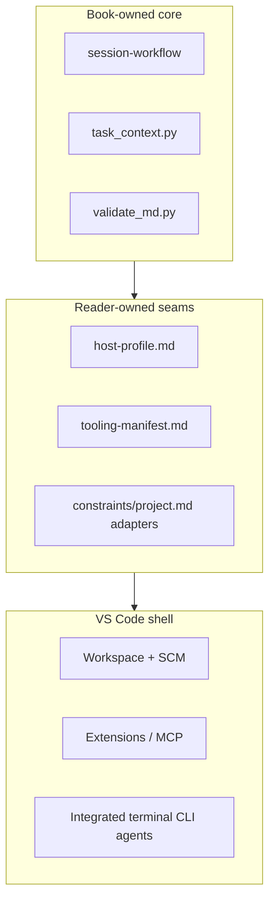

# VS Code hub — Track B execution shell

**Track B default for solo POC:** VS Code (or a VS Code–compatible IDE) is the
**shell** — workspace, extensions, Git panel, integrated terminal, MCP host.
CLI agents and subscription chat agents plug in as **adapters**, not separate
book chapters.

> [!LEARN] Learn It
> The harness uses a **barbell** ([[manifesto]]): book-owned **core** stays
> stable; reader-owned **edge** (host profile, product names) lives in
> `_templates/host-profile.md` and `_templates/tooling-manifest.md`.

> [!TIP] Fast Track
> Worktree on session branch → fill [[host|constraints/host]] + [[tooling-manifest|tooling-manifest]] →
> `task_context.py` → agent with role + scope → review diff →
> `validate_md.py --all` → commit on host shell (D-001). Map steps via
> [[track-b-checklist]]; block language per [[host|constraints/host]].

## Barbell split

| Zone | Owner | Artifacts |
| :---- | :---- | :-------- |
| **Solid core** | Book | [[session-workflow]], [[STATE]], validators, ICOM+, `task_context.py`, [[path-c-hook-contract\|hook contract]], temporal schema |
| **Host seam** | Reader | `_templates/host-profile.md` → [[host\|constraints/host]] |
| **Tooling seam** | Reader | `_templates/tooling-manifest.md` → filled copy + project adapters |
| **Shell** | Reader | VS Code + extensions + CLI agents in integrated terminal |

## What the shell provides

| Capability | Harness use | Book documents |
| :----------- | :---------- | :------------- |
| Workspace root | Session worktree checkout | [[bare-worktree-setup]] |
| Source control | Diff review before commit | [[track-b-checklist]] §6 |
| Integrated terminal | Git on host shell (D-001); CLI agents | [[host\|constraints/host]] |
| Extensions | Linters, formatters, Git helpers | Concern row in tooling-manifest |
| MCP | Obsidian, browser, issue trackers | Concern row in tooling-manifest |
| Hooks (Path C) | Langfuse trace bridge | [[path-c-hook-contract]] |

## Adapter agents (not per-vendor chapters)

The book documents **one** Track B checklist ([[track-b-checklist]]). Your
**tooling manifest** names the products:

| Agent style | Typical products | Where it runs |
| :---------- | :--------------- | :------------ |
| IDE chat | Cursor, Copilot Chat, Antigravity | Editor panel |
| CLI | Claude Code, Codex, OpenCode | Integrated terminal |
| Hybrid | Cursor chat + terminal CLI | Both rows in manifest |

Record adapter lines in [[project|constraints/project]] § Tool adapters — one
line per checklist concern ([[track-b-checklist]] §7).

## VS Code–compatible IDEs

Cursor, Windsurf, and other VS Code forks use the **same hub pattern**. Fill
the manifest with your fork's feature names. The book does not fork per IDE.

## Relationship to Track A

[[ADR-007-dual-execution-tracks|ADR-007]]: Track A (OpenHands) is **ideal** for
sandboxed multi-file builds. Track B (this hub) is **fallback** and **default
for harness meta-work** today. Same task files; different runtime. Move to Track
A when Docker + LiteLLM is viable — see [[openhands]].

## Relationship to design tools

**Design phase** (Ch. 00–04): pick a design tool from
[[../../00-start-here/setup/design-tools/README|design-tools index]] — may
overlap with your IDE (e.g. Cursor for both). **Build phase** (Ch. 05+): this
hub + [[track-b-checklist]].

## Session loop in the hub

| Phase | Hub action |
| :---- | :--------- |
| Plan | Agent reads STATE; human says proceed — no branch yet |
| Boot | `git checkout -b session-NN/<topic>` in worktree |
| Build | `task_context.py` → agent → diff in SCM panel |
| Close | `validate_md.py --all`; STATE + dashboard; human commits on host shell (D-001) |

Full procedure: [[session-workflow]].

## POC default (this harness)

| Field | Value |
| :---- | :---- |
| Shell | Cursor (VS Code–compatible) |
| Manifest | Book template at `_templates/tooling-manifest.md` |
| Filled adapters | [[project\|constraints/project]] § Tool adapters |
| Observability | Path C live — [[path-c-hook-contract]]; process trace live ([[ADR-009-observability-paths-abc\|ADR-009]]) |

## Reference

- Decision: [[ADR-010-vscode-hub-barbell]] · [[ADR-011-host-profile-seam]]
- Host profile: [[host|constraints/host]]
- Checklist: [[track-b-checklist]]
- Manifest template: [[tooling-manifest|_templates/tooling-manifest.md]]
- Execution index: [[../../00-start-here/setup/execution-tools/README|execution-tools index]]
- Roadmap: [[session-roadmap-s40-plus]] § VS Code hub
