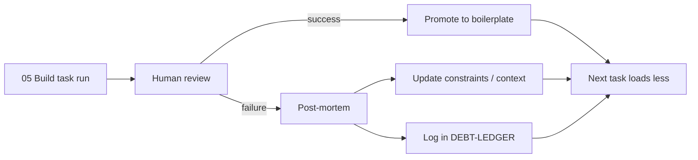

# 06 — Learn

Build from [[05-build|Ch. 05]] produces code and commits. Learn closes the
loop: every failure or success becomes a durable artifact the next task can
load. Without this chapter, agents repeat the same mistakes; with it, execution
gets cheaper and more reliable over time.

> [!LEARN] Learn It
> Three sinks capture what the build cycle taught:
> **[[DEBT-LEDGER]]** — trigger-based compromises;
> **[[06-learn/boilerplate/README|boilerplate/]]** — promoted working patterns;
> **[[_templates/post-mortem|post-mortem template]]** — structured failure analysis;
> **[[engineering-handoff-checklist]]** — POC → engineering day-1 (S47).
> A task closes in Build; a *lesson* closes here.

> [!TIP] Fast Track
> After any failed or surprising task run: copy `_templates/post-mortem.md` →
> `06-learn/post-mortems/`, fill it, then promote any reusable pattern into
> `boilerplate/` and log trigger debts in [[DEBT-LEDGER]].

## Learning loop

## What lives here

| Path | Purpose |
| :---- | :---- |
| [[DEBT-LEDGER]] | Trigger-based debt register — inherited from WhiteBoxMAKER |
| [[06-learn/boilerplate/README\|boilerplate/]] | Living library: specs, tasks, code patterns |
| [[06-learn/post-mortems/README\|post-mortems/]] | Filled post-mortems after build cycles |
| `_templates/post-mortem.md` | Blank template (repo root — copy before each post-mortem) |

## Promotion rules

1. **Candidate** — agent output or human fix that worked on a real task.
2. **Review** — human confirms it is reusable, not one-off hack.
3. **Promote** — copy into `boilerplate/` with a one-line *when to use* header.
4. **Reference** — future task files list promoted paths under **Boilerplate to use**.

Negative patterns (what *not* to do) go to `constraints/` or Layer 2 context —
not the boilerplate library.

## Exit discipline

Ch. 06 is complete for a build cycle when at least one of: a post-mortem is
filed, a debt is logged, or a pattern is promoted. Empty `post-mortems/` after
many builds is a signal the loop is skipped.
