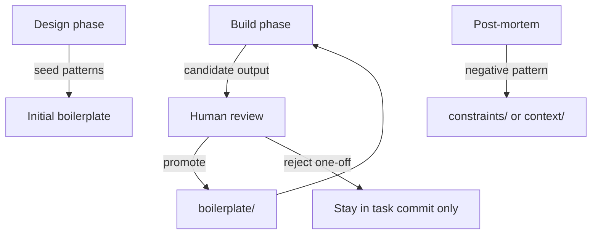

# Boilerplate library

**Boilerplate** is working, project-proven material ready to adapt — distinct
from empty **templates** in `_templates/`. Templates scaffold; boilerplate
executes.

## Four folders

| Folder | Holds | Example |
| :---- | :---- | :---- |
| `reader-skeleton/` | Empty product repo template (`context/` + `setup/`) | [[reader-skeleton/README\|reader-skeleton]] — fork to start your app repo |
| `specs/` | Document patterns (tasks, checklists, handoffs) | [[harness-task-spec-example]] |
| `tasks/` | Filled task skeletons — start from [[new-task]] | *(reader adds after first promotion)* |
| `code/` | Runnable implementation snippets | *(reader product code — see README there)* |

## Harness-meta examples (this repo)

These two files are **worked examples** for the book harness — not reader
product code. Copy and adapt when authoring harness tasks or session closes:

1. [[harness-task-spec-example]] — document-only task with Gherkin closure
2. [[harness-session-close-checklist]] — STATE + dashboard handoff checklist

## Promotion loop

As the library matures, exploration tasks shrink → cheaper models → faster runs.
