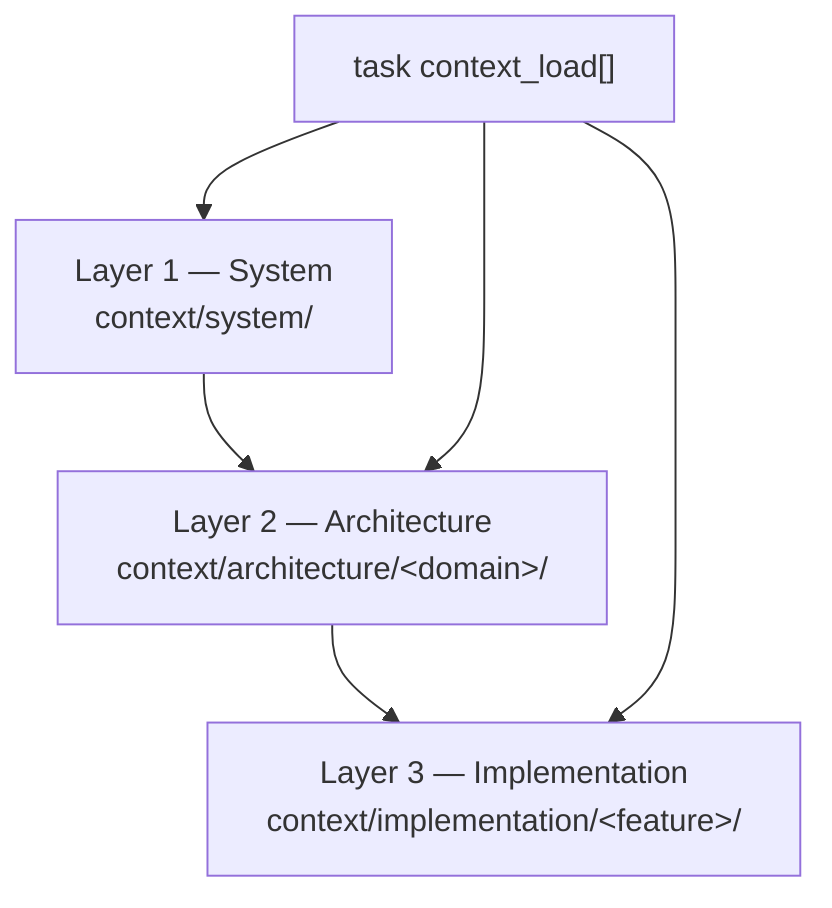

# Context tree — three layers for agent tasks

Agents load **only** what a task lists in `context_load:` frontmatter. Replace
the placeholder files below with distillations from your Ch. 02 layer designs.

## Layer map

| Layer | Scope | Loaded when |
| :---- | :---- | :---- |
| 1 — System | Whole project orientation | Agent defaults + most tasks |
| 2 — Architecture | One domain (data, app, comm, ux) | Task touches that domain |
| 3 — Implementation | One feature or task slice | Task-specific narrow context |

## Layer 2 — fill from Ch. 02

| Domain | File | Hint |
| :---- | :---- | :---- |
| data | [[architecture/data/your-data-layer]] | Schema, storage, migration rules |
| application | [[architecture/application/your-application-layer]] | Modules, boundaries, runtime |
| communication | [[architecture/communication/your-communication-layer]] | APIs, events, provider contracts |
| ux | [[architecture/ux/your-ux-layer]] | Roles, flows, latency budgets |

## Layer 3 — add per feature

Start from [[implementation/_example-feature/README|implementation/_example-feature/]].
Add one folder per bounded feature when architecture files are not enough.

## Wiring a task

1. List Layer 2 domains the task touches in **Inputs**.
2. Mirror paths in task frontmatter `context_load:`.
3. Add Layer 3 files only when the task needs detail beyond architecture.
4. Preview with `python scripts/task_context.py <task-file>` if you use the harness scripts.
