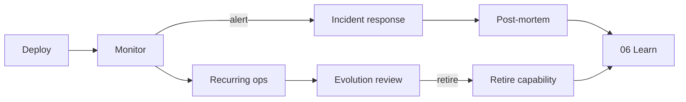

# 07 — Ship & Operate

Build from [[05-build|Ch. 05]] ships working software. Learn from
[[06-learn|Ch. 06]] captures what failures taught. Operate is everything
between "the code works on my machine" and "users rely on it daily" — and
the discipline to **retire** shipped parts when signals say so, without
confusing that with design-time *pruning* (Ch. 03) or whole-product
*sunset* (Ch. 08). See [[ADR-003-removal-vocabulary]].

> [!LEARN] Learn It
> Operating is not a one-time deploy. It is a **runbook-driven loop**:
> deploy → observe → respond → recurring maintenance → review what to
> retire. Incidents feed [[06-learn|Learn]] via post-mortems; successful
> patterns promote to [[06-learn/boilerplate/README|boilerplate]].

> [!TIP] Fast Track
> Copy `_templates/runbook.md` → `07-ship-operate/runbook/` and fill one
> service at a time. See [[runbook/README|runbook/]] and the harness-meta
> example for this book's validator + Track A stack.

## Operate loop

## What lives here

| Path | Purpose |
| :---- | :---- |
| [[runbook/README\|runbook/]] | Living runbooks — one file per service or environment |
| `_templates/runbook.md` | Blank runbook template (repo root) |
| [[runbook/example-harness-track-a-runbook\|example-harness-track-a-runbook]] | Harness-meta worked example (validator + Track A stack) |
| [[publish/README\|publish/]] | Optional static site later — no live deploy in this public copy |
| [[automation-portfolio-scorecard\|automation-portfolio-scorecard]] | Intake ROI ranking, portfolio health (active / degraded / retired), retirement triggers |

Reader projects add operator roles to [[user-roles]] and operational use cases
to [[use-cases]] — they compete for priority in [[03-plan/PROJECT-PLAN|Plan]]
like any other work.

## 1 — Deploy

**Goal:** reproducible promotion from "works in build" to "runs where users
are."

| Step | Reader action |
| :---- | :-------------- |
| Define environments | dev · staging · production — what differs between them |
| Pin artifacts | container images, config hashes, migration versions |
| Gate promotion | tests green · human approval · rollback path documented |
| Record | deploy date, version, who approved — in runbook deploy log |

> [!TEACH] Teach
> Deploy tasks belong in PROJECT-PLAN like build tasks: bounded scope,
> Gherkin acceptance, atomic commit. Agents propose; humans approve
> production promotion.

## 2 — Monitor

**Goal:** know something broke before a user tells you.

| Signal type | Examples |
| :---- | :---- |
| **Health** | HTTP 200 on `/health`, process up, queue depth |
| **SLO** | latency p95, error rate, availability window |
| **Cost** | daily spend vs budget (especially LLM routes) |
| **Synthetic** | scheduled probe that mimics a critical user path |

Document thresholds in the runbook **Health checks** section. Alert →
runbook **Incident playbook** — not ad-hoc Slack threads.

## 3 — Incidents

**Goal:** restore service, then learn.

1. **Triage** — severity, owner, comms channel.
2. **Mitigate** — rollback, feature flag, scale, isolate.
3. **Resolve** — root cause fix or accepted workaround.
4. **Learn** — copy `_templates/post-mortem.md` within 48 hours; action
   items tracked to completion.

Same bounded-task discipline as Build: incident fixes are tasks with scope
lists, not open-ended "fix prod."

## 4 — Recurring operations

**Goal:** prevent death by a thousand untracked chores.

| Cadence | Examples (reader-facing suggestions) |
| :---- | :---- |
| Daily | backup verify, error log scan, cost check |
| Weekly | dependency patch review, access audit sample |
| Monthly | restore drill, capacity review, runbook freshness |
| Quarterly | low-usage feature review, provider concentration review |

Cadences are **suggestions for your product** — this book stays
artifact-driven. If a cadence has no runbook line, it will rot.

## 5 — Evolution and retirement

**Goal:** AI accelerates addition; governance must accelerate *removal* of
what no longer earns its cost.

Per [[ADR-003-removal-vocabulary]] — **retire** (not prune, not sunset):

| Phase | Action |
| :---- | :----- |
| Deprecate | announce end date, migration path, RFC 8594-style notice where applicable |
| Migrate | move users/data off the capability |
| Remove | delete code, revoke credentials, update runbook |

**Evolvability test:** can you remove a feature, replace a provider, or
retire a data flow without existential risk? If no — design debt; log in
[[DEBT-LEDGER]] or promote a constraint.

Quarterly review prompts: lowest-usage features, abandoned dependencies,
single-provider concentration.

## 6 — Exit discipline

You leave this chapter when at least one runbook exists and covers deploy,
health checks, one incident path, and one recurring task. Empty `runbook/`
after shipping to production is a Canon Gap for your project.

Harness readers: start from [[runbook/example-harness-track-a-runbook]].

## Portfolio prioritization

- [Automation portfolio scorecard](automation-portfolio-scorecard.md) — intake ROI ranking and sample portfolio health table.
