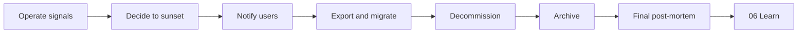
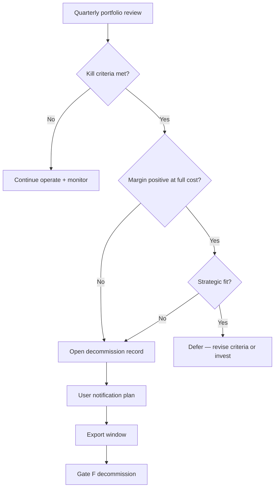

# 08 — Sunset

Every product ends — replaced, merged, or simply no longer worth running. A
top-1% project plans the ending at the beginning, because graceful shutdown
is cheap to design and expensive to retrofit. This chapter covers deciding
*when* to **sunset** the whole product (not a feature — that is *retire* in
Ch. 07; not an unbuilt branch — that is *prune* in Ch. 03). See
[[ADR-003-removal-vocabulary]].

> [!LEARN] Learn It
> Sunset is a **checklist-driven arc**: decide → notify users → export and
> migrate → decommission → archive → final post-mortem into
> [[06-learn|Learn]]. The last artifact is a **decommission record** the
> next project starts from.

> [!TIP] Fast Track
> Copy `_templates/decommission-record.md` →
> `08-sunset/decommission/` when kill criteria fire. See
> [[decommission/README|decommission/]] for harness-meta and fictional SaaS
> examples.

## Sunset arc

Signals come from [[07-ship-operate|Ch. 07]] — cost, usage, margin, strategic
alignment — not gut feeling alone.

## What lives here

| Path | Purpose | Notes |
| :---- | :---- | :---- |
| [[decommission/README\|decommission/]] | Folder index | Filled decommission records |
| `_templates/decommission-record.md` | Blank template (repo root) | |
| [[decommission/example-harness-repo-sunset\|example-harness-repo-sunset]] | Worked example | Harness-meta |
| [[decommission/example-fictional-saas-sunset\|example-fictional-saas-sunset]] | Worked example | Fictional SaaS |

## 1 — Decide when to sunset

**Goal:** data-backed decision before sunk-cost attachment wins.

| Input             | Source                                                              |
| :---------------- | :------------------------------------------------------------------ |
| Usage and revenue | [[07-ship-operate\|Operate]] monitoring and cost review             |
| Kill criteria     | Pre-registered at launch in [[use-cases]] or product brief          |
| Strategic fit     | [[03-plan/PROJECT-PLAN\|Plan]] — does the product still earn a row? |
| Margin            | Full cost of support + infra, not headline revenue                  |

**Reader discipline:** define kill thresholds *before* launch when possible.
Revise at annual review — thresholds age, but the habit of having them does
not.

Gate: leadership (or solo reader) signs a one-page **sunset decision record**
before public notice.

### Sunset decision tree

Use when kill criteria fire or quarterly portfolio review flags a product.
Combine **margin data**, not user count alone — low MAU can still mean high
profit per seat.

| Trigger category | Example signal | Typical response |
| :---- | :---- | :---- |
| Low adoption | MAU below pre-registered threshold, no growth trend | Verify margin before sunset |
| Strategic misalignment | Product no longer serves ICP | Sunset or pivot decision record |
| Unit economics | Support + infra cost exceeds revenue | Sunset unless strategic subsidy |
| Quality debt | Remediation cost exceeds decommission | Sunset with migration path |
| M&A overlap | Redundant portfolio post-merger | Accelerated Gate F |

**Product lifecycle** sunset stages (communicate early): design freeze → last-time buy → last
ship → end of support → end of life. Vendor benchmarks: Microsoft ~10-year
window; Atlassian 2-year + LTS; Google Cloud 12-month minimum notice for
material API changes.

Provenance: `research/sunset-eol-seed.md` ← inbox EOL report (S47 archive).

## 2 — Notify users

**Goal:** honor commitments — notice periods, refunds, contracts.

| Obligation | Document in decommission record |
| :---- | :---- |
| Notice period | dates communicated vs contractual minimum |
| Export window | how long users can pull data |
| Support mode | what still gets answered during wind-down |
| Refunds / credits | policy and execution owner |

Operational *retirements* (single feature) use Ch. 07; whole-product sunset
uses this chapter.

## 3 — Export and migrate

**Goal:** users leave with their data; you leave with obligations closed.

| Artifact | Reader action |
| :---- | :---- |
| Export formats | documented in [[02-design/layers/data\|data layer]] early — CSV, API bulk, vault zip |
| Migration paths | link to replacement product or open-source fork if any |
| Retention classes | what you delete vs archive vs legal hold |
| Verification | sample restore or export audit before power-off |

"Export all my data" is a **use case** — capture it in [[use-cases]] at
design time, not the week before shutdown.

## 4 — Decommission

**Goal:** no orphaned access, unmanaged data, or unsupported dependency.

**Gate F checklist** (exit when all are yes):

| # | Gate | Pass when |
| :-: | :---- | :---- |
| F1 | User access | All production accounts disabled or deleted |
| F2 | Credentials | API keys, OAuth apps, webhooks revoked |
| F3 | Data | Retention policy executed; legal holds documented |
| F4 | Vendors | Subscriptions cancelled; final invoices reconciled |
| F5 | Infrastructure | Compute, DNS, storage torn down or archived |
| F6 | Dependencies | No unmaintained lib left running in prod |
| F7 | Archive | Searchable record exists for compliance and next project |
| F8 | Obligations | No unowned contract, SLA, or support queue |

Run decommission as **bounded tasks** in PROJECT-PLAN — same scope and review
discipline as Build.

## 5 — Archive

**Goal:** the organization (or solo reader) can answer "what did we build and
why" years later.

| Archive item | Typical location |
| :---- | :---- |
| Code + config | read-only git mirror or tarball |
| Vault / docs | export per retention class |
| Decommission record | `08-sunset/decommission/` |
| Final post-mortem | `06-learn/post-mortems/` |
| Reusable patterns | `06-learn/boilerplate/` |

## 6 — Final post-mortem

**Goal:** convert shutdown into reusable capability — not blame.

Within two weeks of final decommissioning (while memory is fresh):

1. Copy `_templates/post-mortem.md` — product shutdown variant.
2. Cover: what the product taught, what to reuse, what to never repeat.
3. Promote patterns to [[06-learn/boilerplate/README|boilerplate]]; log debts
   in [[DEBT-LEDGER]].

Distinct from incident post-mortems — celebrate learning value alongside
failures.

## 7 — Exit discipline

You leave this chapter when a decommission record exists and Gate F is
evidenced. The project's last artifact feeds the **next** project's Ch. 00.

Harness readers: study [[decommission/example-harness-repo-sunset]] and
[[decommission/example-fictional-saas-sunset]] before filling your own.

## What this means for earlier chapters

Sunset obligations are priced in at [[01-understand/use-cases|Understand]]
(must-have export paths), [[02-design|Design]] (data portability), and
[[07-ship-operate|Operate]] (signals that trigger the decision). Cadences
like quarterly portfolio review are **reader-facing suggestions** — this book
stays artifact-driven.
