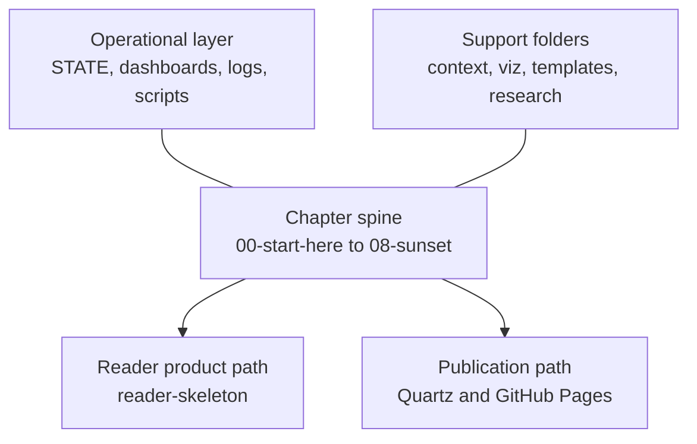

# Project Map

Navigational index of **Project Harness** — a book-as-folder-structure for
AI-assisted software development. Each numbered chapter folder (`00`–`08`)
teaches the method and scaffolds reader decisions. Supporting folders hold
operational state, validators, views, and research.

> **Start here:** [[README|README.md]] · [[00-start-here/getting-started|Getting started]] · [[Agents.md|Agents.md]] · [[STATE|STATE.md]]

---

## Top-level layout



---

## Root files

| File | Role |
| :--- | :--- |
| `README.md` | Project entry point — paths for readers, maintainers, and co-authors |
| `Agents.md` | Operating instructions for AI agents co-authoring the book |
| `STATE.md` | Live session snapshot — current position, active work, next bootstrap |
| `PROJECT-MAP.md` | This file — folder and file index |
| `.pre-commit-config.yaml` | Pre-commit hooks (markdown validation, etc.) |
| `.gitignore` | Git ignore rules |

---

## Chapter spine (`00`–`08`)

Work chapters in order. Each folder is a book chapter that teaches and scaffolds.

| Ch | Folder | Purpose | Key contents |
| :-: | :----- | :------ | :----------- |
| 00 | `00-start-here/` | Orient, philosophy, tool setup | `README.md`, `manifesto.md`, `getting-started.md`, `maintainers.md`, `setup/design-tools/`, `setup/execution-tools/` |
| 01 | `01-understand/` | User roles and use cases | `user-roles.md`, `use-cases.md` |
| 02 | `02-design/` | Four layers, ADRs, arc42, threat model | `layers/` (data, application, ux, communication), `decisions/ADR-*.md`, `arc42/`, `threat-model.md` |
| 03 | `03-plan/` | Decomposition tree and constraints | `PROJECT-PLAN.md`, `constraints/global.md`, `constraints/project.md`, `constraints/host.md` |
| 04 | `04-your-agents/` | Agent team, tasks, golden tests | `agents/*.yaml`, `tasks/`, `golden-tasks/`, `context-loader.md`, `evaluator.md` |
| 05 | `05-build/` | Execution guides (Track A/B) | `execution-tools/openhands.md`, `track-b-checklist.md`, `track-a/` (Docker, LiteLLM config) |
| 06 | `06-learn/` | Learning loop, boilerplate, skeleton | `boilerplate/reader-skeleton/` (fork template), `post-mortems/`, `DEBT-LEDGER.md` |
| 07 | `07-ship-operate/` | Deploy and operate (reader product) | `runbook/`, `publish/` (Quartz sync scripts, deploy example) |
| 08 | `08-sunset/` | End-of-life records (reader product) | `decommission/` (example sunset records) |

### Chapter detail

#### `00-start-here/`

```text
00-start-here/
├── README.md
├── manifesto.md
├── getting-started.md
├── maintainers.md
└── setup/
    ├── design-tools/       # cowork, cursor, antigravity
    └── execution-tools/    # Track A/B index
```

#### `02-design/`

```text
02-design/
├── README.md
├── threat-model.md
├── layers/
│   ├── data.md
│   ├── application.md
│   ├── ux.md
│   └── communication.md
├── decisions/              # ADR-001 … ADR-011
└── arc42/                    # arc42 sections 01–12
```

#### `04-your-agents/`

```text
04-your-agents/
├── README.md
├── context-loader.md
├── evaluator.md
├── agents/
│   ├── dev-agent.yaml
│   ├── tester-agent.yaml
│   ├── security-tester.yaml
│   ├── red-team-agent.yaml
│   └── evaluator.yaml
├── tasks/                    # Harness meta-tasks (01–04)
└── golden-tasks/             # Agent regression fixtures
```

Reader product context lives in `context/` (see below), not under this chapter folder.

#### `05-build/execution-tools/`

```text
05-build/
├── README.md
└── execution-tools/
    ├── openhands.md          # Track A primary guide
    ├── track-a-setup.md
    ├── track-b-checklist.md
    ├── vscode-hub.md
    ├── bare-worktree-setup.md
    ├── path-c-hook-contract.md
    └── track-a/
        ├── docker-compose.yml
        ├── litellm_config.yaml
        ├── openhands.config.toml.example
        └── .env.example
```

#### `06-learn/boilerplate/`

```text
06-learn/
├── README.md
├── DEBT-LEDGER.md
├── engineering-handoff-checklist.md
├── boilerplate/
│   ├── README.md
│   ├── reader-skeleton/      # Copy to start your own product repo
│   ├── code/
│   ├── specs/
│   └── tasks/
└── post-mortems/
```

#### `07-ship-operate/publish/`

```text
07-ship-operate/
├── README.md
├── runbook/
└── publish/
    └── README.md
```

---

## Operational folders

These folders keep the harness repo running — session state, validation, and human-facing dashboards.

| Folder | Purpose |
| :----- | :------ |
| `_index/` | Visual status at three zoom levels (C4-style dashboard) |
| `_views/` | Static HTML control surface — gates, arc roadmaps, session close pages |
| `logs/sessions/` | Session close stubs (`<uuid>.md` + `.meta.json`) |
| `scripts/` | Python validators, context loader, Langfuse bridge, tests |
| `.github/workflows/` | CI — `validate-md.yml` |

### `_index/`

```text
_index/
├── glossary.md
└── dashboard/
    ├── README.md
    ├── 01-context.md         # L1 — system context
    ├── 02-containers.md      # L2 — containers
    └── 03-components.md      # L3 — components / active work
```

### `_views/`

```text
_views/
├── README.md                   # Page registry and DATA schemas
├── _shared/                    # shell.css, render.js, gate.js, export.js, nav.js
├── project/                    # Project status index
├── arc/                        # Arc roadmaps and close pages
├── session/                    # Session close pages + _template/
└── gates/                      # proceed, validate, merge, inbox-triage
```

### `scripts/`

```text
scripts/
├── validate_md.py              # Markdown validator (pre-commit + CI)
├── context_loader.py
├── task_context.py
├── annotate_session_gate.py
├── langfuse_trace_bridge.py
├── playground_archive.py
├── md_checks/                  # ADR patterns, fog words, link resolution, …
├── langfuse_bridge/            # Session ingest and redaction
└── test_*.py                   # Unit tests for validators and loaders
```

### `logs/sessions/`

One pair per closed session:

- `<uuid>.md` — session stub (goal, decisions, follow-ups)
- `<uuid>.meta.json` — machine metadata

Legacy naming: `s1.md`, `s1.meta.json`.

---

## Agent context tree (`context/`)

Three-layer information hiding for agent tasks. See [[context/README|context/README.md]].

```text
context/
├── README.md
├── system/                     # Layer 1 — book/harness orientation
│   ├── overview.md
│   ├── book-architecture.md
│   ├── session-workflow.md
│   ├── agent-team.md
│   ├── diagram-taxonomy.md
│   ├── icom-plus-convention.md
│   ├── html-views-dashboard-design.md
│   ├── plans/
│   └── sessions/               # Session design notes and archives
├── architecture/               # Layer 2 — domain architecture
│   ├── data/
│   ├── ux/
│   ├── application/
│   └── communication/
└── implementation/             # Layer 3 — feature scope
    └── context-tree/
```

---

## Diagrams and notation (`viz/`)

Canonical diagram examples referenced from chapter content.

```text
viz/
├── README.md
├── bpmn/                       # process-subset.md
├── c4/                         # context, container, component, deployment, dynamic
├── dmn/                        # decision-table.md
├── icom/                       # task-box.md
└── uml/                        # sequence.md, state.md
```

---

## Templates and intake

| Folder | Purpose | Canon? |
| :----- | :------ | :----- |
| `_templates/` | Reusable note templates (ADR, task, runbook, post-mortem, …) | Yes — copy into chapters |
| `_inbox/` | Intake queue — material awaiting promotion | No — load only when human names a path |
| `_playground/` | Experiments, mockups, L4 models | No — never agent-load by default |
| `outputs/` | Agent-generated drafts and diagnostics (not merged canon) | No |
| `research/` | Research seeds and archived reports | Archive is reference; seeds are inputs |
| `review/` | Standalone review HTML (e.g. inbox triage board) | Reference |

### `_templates/`

```text
_templates/
├── chapter-what-lives-here-table.md
├── new-decision.md
├── new-task.md
├── post-mortem.md
├── runbook.md
├── decommission-record.md
├── host-profile.md
└── tooling-manifest.md
```

### `_inbox/`

```text
_inbox/
├── README.md
└── diagram-explorers/          # React TSX explorers (playground only)
```

### `research/`

```text
research/
├── *-seed.md                   # Prompt seeds for research passes
└── archive/                    # Promoted research reports (reference)
```

---

## Tooling and editor config

| Path | Role |
| :--- | :--- |
| `.cursor/` | Cursor hooks, settings, Langfuse session config |
| `.claude/` | Local Claude settings |
| `.history/` | Local editor history snapshots (not canon) |
| `.build-context/` | Build cache (gitignored) |

---

## How folders relate

| You want to… | Go to |
| :----------- | :---- |
| Start reading or set up tools | `00-start-here/getting-started.md` |
| See current session and next steps | `STATE.md` |
| Understand agent operating rules | `Agents.md` |
| Check visual project status | `_index/dashboard/` or `_views/project/index.html` |
| Find an architectural decision | `02-design/decisions/ADR-*.md` |
| Run or extend validators | `scripts/validate_md.py`, `scripts/md_checks/` |
| Fork the method for your own product | `06-learn/boilerplate/reader-skeleton/` |
| Publish the book to a static site | `07-ship-operate/publish/README.md` |
| Triage non-canon intake | `_inbox/README.md` |

---

## Excluded from this map

The following are intentionally omitted or summarized:

- **`.git/`** — version control internals
- **Every session log filename** — see `logs/sessions/` pattern above
- **`_playground/` file listing** — 50+ experiment files; see `_playground/README.md`
- **`.history/`** — local editor snapshots
- **Secrets** — never commit `.env` (only `.env.example` in `05-build/`)

---

*Generated for navigation. For chapter teaching content, follow the spine in order starting at [[00-start-here/README|Ch. 00]].*
