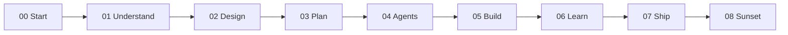

# Project Harness

**Problem this solves:** Internal AI tools often start as vibe-coded one-offs — insecure, hard to hand over, and impossible to maintain. This harness standardizes how teams **scope** a problem, **direct coding agents** inside bounds, **observe** work (optional Langfuse / LiteLLM), and **hand over or retire** the result.

A book-as-folder for humans who write specs and acceptance gates. Agents run bounded tasks. Maintainers get runbooks and clear retirement rules.

You can read this page on GitHub. Obsidian is optional later for wiki-links and callouts.

> [!TIP]
> **Reviewer quick tour (60 seconds)**
> - **Dual human + agent docs:** [`scripts/context_loader.py`](scripts/context_loader.py) / [`scripts/task_context.py`](scripts/task_context.py) strip `[!LEARN]` / `[!TEACH]` teaching blocks so agents get compact ops context ([ADR-006](02-design/decisions/ADR-006-teaching-block-convention.md)).
> - **Fail-open telemetry:** [`.cursor/hooks.json`](.cursor/hooks.json) + [`scripts/langfuse_trace_bridge.py`](scripts/langfuse_trace_bridge.py).
> - **Bounded agents + red-team gates:** [`04-your-agents/`](04-your-agents/README.md).
> - **Context budgets + secrets:** [`scripts/validate_md.py`](scripts/validate_md.py) + [`.pre-commit-config.yaml`](.pre-commit-config.yaml).
> - **Shipped example (spec → tests):** [`examples/acme-pto-faq/`](examples/acme-pto-faq/README.md) — policy file, stdlib FAQ reader, 10 golden tests, HR handover.
> - **What to automate next:** [`07-ship-operate/automation-portfolio-scorecard.md`](07-ship-operate/automation-portfolio-scorecard.md) (intake ROI + portfolio health).

## What this is

An educational harness for internal tools: **upskill** people to scope and review agent work, plus **automation guardrails** so shared tools stay reliable and easy to hand over. Stdlib-first Python in `scripts/`; optional Docker, LiteLLM, OpenHands, Langfuse, and pre-commit when you need them.

## How this harness works

1. **Judgment before code**: Chapters `00`–`03` clarify roles, design trade-offs, and constraints before agents run.
2. **One tree for humans and agents**: Readable docs; context loader strips teaching callouts at runtime.
3. **Operate, hand over, and sunset**: Chapters `05`–`08` cover execution, post-mortems, runbooks, and retirement.

## Choose your path

| Goal | Entry point |
| :--- | :--- |
| **Set up locally** | [Getting started](00-start-here/getting-started.md) |
| **Learn the method** | [Chapter 00](00-start-here/README.md), then `00`–`08` in order |
| **See a working example** | [Acme PTO FAQ](examples/acme-pto-faq/README.md) |
| **Prioritize automations** | [Portfolio scorecard](07-ship-operate/automation-portfolio-scorecard.md) |
| **Bootstrap a new tool** | [Reader skeleton](06-learn/boilerplate/reader-skeleton/README.md) |
| **Agent operating rules** | [Agents.md](Agents.md) |
| **Validate + unit tests** | `python scripts/validate_md.py --all` · `python -m unittest discover -s scripts -p "test_*.py" -v` · `python -m unittest discover -s examples/acme-pto-faq -p "test_*.py" -v` |

## Chapter spine

| Ch | Folder | Purpose |
| :-: | :--- | :--- |
| 00 | [00-start-here](00-start-here/README.md) | Orient, tool setup, getting started |
| 01 | [01-understand](01-understand/user-roles.md) | User roles and use cases |
| 02 | [02-design](02-design/README.md) | Layers, ADRs, arc42, threat model |
| 03 | [03-plan](03-plan/PROJECT-PLAN.md) | Plan and constraints |
| 04 | [04-your-agents](04-your-agents/README.md) | Agent YAML, tasks, golden tests |
| 05 | [05-build](05-build/README.md) | Execution tracks and tool guides |
| 06 | [06-learn](06-learn/README.md) | Boilerplate, post-mortems, skeleton |
| 07 | [07-ship-operate](07-ship-operate/README.md) | Runbooks, scorecard, publish notes |
| 08 | [08-sunset](08-sunset/README.md) | Decommissioning and retirement |

## Worked example

[Acme PTO FAQ](examples/acme-pto-faq/README.md) is a fictional HR/ops assistant: cite a clause from a single policy file, or refuse and log. Includes a stdlib Python reader, ten golden tests, and a non-engineer handover guide. It demonstrates judgment and evaluation — it is not a hosted LLM product.

## Quality bar and repository hygiene

- **Automated validation:** [`scripts/validate_md.py`](scripts/validate_md.py)
- **Architecture decisions:** `02-design/decisions/`
- **Known compromises:** [DEBT-LEDGER](06-learn/DEBT-LEDGER.md)
- **Sanitized public release:** Fictional host example ([host.example.md](03-plan/constraints/host.example.md)); Gitleaks via [`.pre-commit-config.yaml`](.pre-commit-config.yaml)

## What this is not

- Not a production system from an employer, and not endorsed by any employer
- Not a software-engineer interview repo, and not a model-training project
- Not a place to commit secrets, host inventories, or private documents
