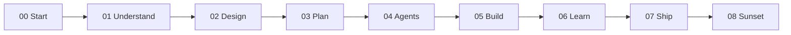

# Project Harness

A book-as-folder-structure for safe AI-assisted software delivery. Chapters `00` through `08` teach the method. Validators, agent configs, and task files live in the same repo.

You can read this page on GitHub. Obsidian is optional if you want wiki-links and callouts later.

## What this is

An educational harness for internal tools. A human writes the spec and the constraints. Agents do bounded tasks. A human maintainer can adopt, test, and change what ships.

## What this is not

- Not a production system from an employer, and not endorsed by any employer
- Not a software-engineer interview repo, and not a model-training project
- Not a place to commit secrets, host inventories, or private documents

## Choose your path

| You want to… | Start here |
| :--- | :--- |
| **Setup** | [Getting started](00-start-here/getting-started.md) |
| **Learn the method** | [Chapter 00](00-start-here/README.md) then the chapters in order |
| **Copy skeleton** | [Reader skeleton](06-learn/boilerplate/reader-skeleton/README.md) |
| **For agents** | [Agents.md](Agents.md) |
| **See one worked example** | [Acme PTO FAQ](examples/acme-pto-faq/README.md) |

The harness documents itself. A real product belongs in a separate repo copied from the reader skeleton.

## Chapter spine

| Ch | Folder | Purpose |
| :-: | :--- | :--- |
| 00 | [00-start-here](00-start-here/README.md) | Orient, setup, getting started |
| 01 | [01-understand](01-understand/user-roles.md) | User roles and use cases |
| 02 | [02-design](02-design/README.md) | Layers, ADRs, arc42, threat model |
| 03 | [03-plan](03-plan/PROJECT-PLAN.md) | Plan and constraints |
| 04 | [04-your-agents](04-your-agents/README.md) | Agent yaml, tasks, golden tests |
| 05 | [05-build](05-build/README.md) | Execution tracks and tool guides |
| 06 | [06-learn](06-learn/README.md) | Boilerplate, post-mortems, skeleton |
| 07 | [07-ship-operate](07-ship-operate/README.md) | Runbooks and a later publish note |
| 08 | [08-sunset](08-sunset/README.md) | Decommission |

## Worked example

[Acme PTO FAQ](examples/acme-pto-faq/README.md) is a fictional internal bot: one problem, a spec, an agent task breakdown, and a definition of done for a human maintainer. Skim that path before you copy the skeleton.

## Quality bar

- YAML frontmatter on markdown files the validator checks
- Significant decisions go in `02-design/decisions/`
- Known compromises for this book sit in [DEBT-LEDGER](06-learn/DEBT-LEDGER.md)
- The host file in this public copy is a fictional example: [host.example.md](03-plan/constraints/host.example.md)
