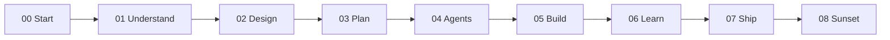

# Project Harness

A book-as-folder harness for safe AI-assisted internal software delivery. Humans write the problem, constraints, and acceptance gates. Coding agents run bounded tasks. Maintainers get handover-ready runbooks, optional trace telemetry, and clear rules for when to retire a tool.

You can read this page on GitHub. Obsidian is optional later for wiki-links and callouts.

## What this is

An educational harness for internal tools: upskilling people to scope and review agent work, plus automation guardrails so shared tools stay reliable and easy to hand over. Stdlib-first Python scripts in `scripts/` support context loading, validation, and fail-open telemetry; optional stacks (Docker, LiteLLM, OpenHands, Langfuse, pre-commit) are documented when you need them.

## What this is not

- Not a production system from an employer, and not endorsed by any employer
- Not a software-engineer interview repo, and not a model-training project
- Not a place to commit secrets, host inventories, or private documents

> [!TIP]
> **60-second reviewer tour**
> - **Teaching blocks vs agent context ([ADR-006](02-design/decisions/ADR-006-teaching-block-convention.md))**: [`scripts/context_loader.py`](scripts/context_loader.py) and [`scripts/task_context.py`](scripts/task_context.py) strip human teaching callouts (`[!LEARN]`, `[!TIP]`, `[!TEACH]`) and assemble compact context bundles so agents load operational instructions, not the full lesson.
> - **Fail-open IDE and agent telemetry**: [`.cursor/hooks.json`](.cursor/hooks.json) and [`scripts/langfuse_trace_bridge.py`](scripts/langfuse_trace_bridge.py) capture session and tool-use traces into Langfuse without blocking work when offline.
> - **Bounded agent roles and red-team gates**: [`04-your-agents/agents/`](04-your-agents/README.md) defines scoped roles ([`dev-agent.yaml`](04-your-agents/agents/dev-agent.yaml), [`tester-agent.yaml`](04-your-agents/agents/tester-agent.yaml), [`evaluator.yaml`](04-your-agents/agents/evaluator.yaml), [`red-team-agent.yaml`](04-your-agents/agents/red-team-agent.yaml)) paired with probes in [`04-your-agents/golden-tasks/`](04-your-agents/golden-tasks/README.md).
> - **Context-budget and secret guardrails**: [`scripts/validate_md.py`](scripts/validate_md.py) and [`.pre-commit-config.yaml`](.pre-commit-config.yaml) enforce Gitleaks scanning, frontmatter schemas, link integrity, Mermaid node caps, and per-file line budgets (`60` lines for agent YAMLs, `100` for tasks, `200` for system context).
> - **Worked specification and handover path**: [`examples/acme-pto-faq/`](examples/acme-pto-faq/README.md) walks problem → constraints → bounded agent tasks → definition of done, with a runbook template in [`07-ship-operate/runbook/`](07-ship-operate/runbook/example-harness-track-a-runbook.md).

## How this harness works

1. **Judgment before code**: Chapters `00` through `03` clarify user roles ([`01-understand/user-roles.md`](01-understand/user-roles.md)), architecture trade-offs ([`02-design/README.md`](02-design/README.md)), and constraints ([`03-plan/constraints/global.md`](03-plan/constraints/global.md)) before agents run.
2. **One tree for humans and agents**: Docs stay readable on GitHub or in Obsidian; [`scripts/context_loader.py`](scripts/context_loader.py) strips teaching callouts at runtime so agents stay inside token budgets.
3. **Operate, hand over, and sunset**: Chapters `05` through `08` cover execution stacks ([`05-build/execution-tools/track-a/docker-compose.yml`](05-build/execution-tools/track-a/docker-compose.yml)), post-mortems ([`06-learn/README.md`](06-learn/README.md)), maintainer runbooks ([`07-ship-operate/README.md`](07-ship-operate/README.md)), and retiring automations that no longer earn their keep ([`08-sunset/README.md`](08-sunset/README.md)).

## Choose your path

| Goal | Entry point |
| :--- | :--- |
| **Set up locally** | [Getting started](00-start-here/getting-started.md) |
| **Learn the method** | [Chapter 00](00-start-here/README.md), then chapters `00`–`08` in order |
| **Bootstrap a new internal tool** | [Reader skeleton](06-learn/boilerplate/reader-skeleton/README.md) |
| **Load agent operating rules** | [Agents.md](Agents.md) |
| **Review a worked breakdown** | [Acme PTO FAQ](examples/acme-pto-faq/README.md) |
| **Run validation and unit tests** | `python scripts/validate_md.py --all` and `python -m unittest discover -s scripts -p "test_*.py"` |

## Chapter spine

| Ch | Folder | Purpose |
| :-: | :--- | :--- |
| 00 | [00-start-here](00-start-here/README.md) | Orient, tool setup, getting started |
| 01 | [01-understand](01-understand/user-roles.md) | User roles and use cases |
| 02 | [02-design](02-design/README.md) | Layers, ADRs, arc42, threat model |
| 03 | [03-plan](03-plan/PROJECT-PLAN.md) | Plan and constraints |
| 04 | [04-your-agents](04-your-agents/README.md) | Agent YAML, tasks, golden tests |
| 05 | [05-build](05-build/README.md) | Execution tracks and tool guides |
| 06 | [06-learn](06-learn/README.md) | Boilerplate, post-mortems, skeleton |
| 07 | [07-ship-operate](07-ship-operate/README.md) | Runbooks and publication checklist |
| 08 | [08-sunset](08-sunset/README.md) | Decommissioning and retirement |

## Worked example

[Acme PTO FAQ](examples/acme-pto-faq/README.md) is a fictional internal HR/ops Q&A automation: problem ([`01-problem.md`](examples/acme-pto-faq/01-problem.md)), citation/abstention constraints ([`02-spec-and-constraints.md`](examples/acme-pto-faq/02-spec-and-constraints.md)), bounded agent tasks ([`03-agent-tasks.md`](examples/acme-pto-faq/03-agent-tasks.md)), and human maintainer acceptance ([`04-definition-of-done.md`](examples/acme-pto-faq/04-definition-of-done.md)).

## Quality bar and repository hygiene

- **Automated validation**: [`scripts/validate_md.py`](scripts/validate_md.py) checks YAML frontmatter (`status`), headings, link resolution, and line/diagram budgets.
- **Architecture decisions**: Significant trade-offs live in `02-design/decisions/`.
- **Known compromises**: [DEBT-LEDGER](06-learn/DEBT-LEDGER.md).
- **Sanitized public release**: Employer-agnostic reference edition. Host configs use fictional examples ([host.example.md](03-plan/constraints/host.example.md)). Secrets, real host inventories, and private session logs are out of scope; Gitleaks runs via [`.pre-commit-config.yaml`](.pre-commit-config.yaml). Empty maintainer template: [STATE.md](STATE.md).
