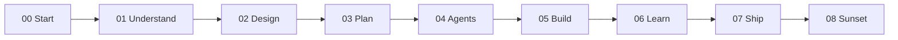

# Context — book project at a glance

**Slogan:** Go beyond vibe coding to reach top 1% AI-assisted software project
development.

**What this repo is:** The book-as-folder-structure (`00`–`08` chapters) that
teaches and operates as a real project harness.

| Signal        | Value                               |
| :------------ | :---------------------------------- |
| Session       | 47 — **closed**                     |
| Validator     | `validate_md.py --all` — 0 failures |
| Open threads  | 0                                   |
| ADRs accepted | 11 (001–011)                        |
| Git branch    | `main` · merged S47 |
| Remote        | `github.com/YOUR_USER/project-harness` |

The **Git branch** row is your `git checkout` branch — not a dashboard zoom
name.

## Chapter spine

Legend: **done** 00–03 · **partial** 04–08 · **meta** `_playground/` + `context/system/` + **`viz/`** + **`arc42/`** + **`review/`** + **ADR-009–011**. Partial chapters: see [02-containers](02-containers.md).

Weighted spine progress ≈ **98%**. Post-arc42 arc S41–S47 **complete**. Mission: solo POC → engineering handoff **achieved**.

## Open threads (summary)

*None.*

## History

| When | Session | Snapshot |
| :---- | :---- | :---- |
| 2026-07-02 19:30 | S47 close | Promotion wave 1; remote/CI; handoff; arc complete |
| 2026-07-02 12:03 | S46 close | Golden tasks all roles; Ch. 03 Canon Gap cleared |
| 2026-07-02 09:56 | S45 close | Temporal layer + session log; bootstrap S46 |
| 2026-07-01 17:33 | S44 close | Path C hooks + bridge; smoke trace; bootstrap S45 |
| 2026-07-01 04:28 | S43 close | ADR-010/011; hub + host profile; bootstrap S44 |
| 2026-07-01 03:29 | S42 close | ADR-009 Paths A/B/C; arc42 §8; bootstrap S43 |
| 2026-06-30 23:27 | S41 close | Inbox triage + HTML gate |
| 2026-06-30 22:31 | S40 close | Target snapshot S47 + roadmap-document-shape |
| 2026-06-30 22:09 | S40 merge | Roadmap S41–S47 v4 |
| 2026-06-30 20:04 | S39 close | arc42 §10–§12 complete |

Older rows → `context/system/sessions/dashboard-history-archive.md` when table
exceeds 10 entries.
