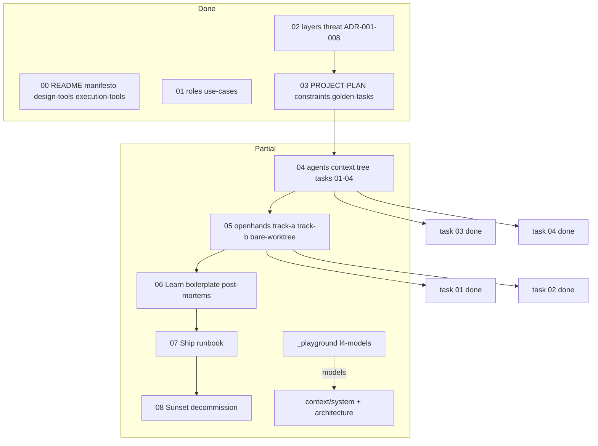

# Containers — chapter and artifact status

Mid zoom: each **chapter** and its primary deliverables.

**Gap labels** (chapter table):

| Label | Meaning |
| :---- | :------ |
| **Harness Gap (Type A)** | This **book repo** has not filled a reader/project slot (template exists). |
| **Canon Gap (Type B)** | The **chapter product** is still missing pieces for every reader (methodology debt). |
| **—** | No gap of that type. |

*Partial* = scaffold shipped; at least one Harness Gap or Canon Gap remains (or build work not run yet).

## Chapter table

| Ch | Name | Status | Key artifacts | Harness Gap (Type A) | Canon Gap (Type B) |
| :---- | :---- | :---- | :---- | :---- | :---- |
| 00 | Start Here | done | README, manifesto, **design-tools** + execution-tools indexes | — | — |
| 01 | Understand | done | user-roles (+ discovery boundaries), use-cases (ADR-006) | reader template slots (if unfilled) | — |
| 02 | Design | done | 4 layers, threat-model, ADR-001–008, **arc42/**, five-paper checklist | — | — |
| 03 | Plan | done | PROJECT-PLAN, **golden-task-examples**, global + **host** + **project** constraints, new-task + **ICOM+ tables** | — | — |
| 04 | Your Agents | partial | 5× yaml, evaluator, golden-tasks, `context/` tree, tasks 01–04 **done**, orchestration rule | — | — |
| 05 | Build | partial | [vscode-hub](../../05-build/execution-tools/vscode-hub.md), [path-c-hook-contract](../../05-build/execution-tools/path-c-hook-contract.md) + temporal layer, openhands, [track-a-setup](../../05-build/execution-tools/track-a-setup.md), `track-a/` compose (+ **Docker patterns S47**) + **Langfuse**, track-b-checklist, tooling-manifest, bare-worktree-setup, quote-Then gate, tasks 01–02 **done** | — | — |
| 06 | Learn | partial | DEBT-LEDGER, boilerplate/ + **reader-skeleton/** + **[engineering-handoff-checklist](../../06-learn/engineering-handoff-checklist.md)**, post-mortems/ (+ **RCA picker S47**), `_templates/post-mortem.md` | reader code boilerplate | — |
| 07 | Ship & Operate | partial | README skeleton, [runbook/](README.md) (+ **Docker hygiene S47**), `_templates/runbook.md`, harness example | reader product runbooks | — |
| 08 | Sunset | partial | README (+ **EOL decision tree S47**), [decommission/](README.md), `_templates/decommission-record.md`, harness + fictional examples | reader product records | — |

## System containers (meta)

| Container | Status | Location |
| :---- | :---- | :---- |
| Validator | live | `scripts/validate_md.py`, `scripts/md_checks/` (Phase 3 + fog-word lint) |
| Context loader | live v1.5 | `scripts/context_loader.py` |
| Context tree (harness) | live | `context/README.md`, `context/architecture/`, `context/implementation/` |
| Reader skeleton template | live | `06-learn/boilerplate/reader-skeleton/` |
| Task context assembler | live | `scripts/task_context.py` |
| Golden-task suite | live | `04-your-agents/golden-tasks/` (5 fixtures, all core roles), `scripts/test_golden_tasks.py` |
| Execution tracks | live | ADR-007/010/011, `vscode-hub.md`, `track-b-checklist.md`, `openhands.md`, `track-a-setup.md`, `bare-worktree-setup.md` |
| Host profile | live | `constraints/host.md`, `_templates/host-profile.md` (ADR-011) |
| Tooling manifest | live | `_templates/tooling-manifest.md` (ADR-010 barbell seam) |
| Track A stack | live | `track-a/` compose — LiteLLM + OpenHands + **Langfuse** |
| Communication standard | live | ADR-008, six-step human gate (Mockup B), AGENTS.md |
| Notation canon | live v0.4 | `context/system/icom-plus-convention.md`, `diagram-taxonomy.md` (+ **notation rationale S47**) |
| Visual notation | live | `viz/` — full harness examples all families (S31 + S36) |
| arc42 documentation | live | `02-design/arc42/` — §1–§12 harness examples (S32–S39) |
| Playground models | experiment | `_playground/l4-models/` (Track B REAL) |
| Playground | live | `_playground/`, `scripts/playground_archive.py` |
| Session handoff | live | STATE.md, session-workflow.md, `logs/sessions/<id>.md` (runtime), dashboard/ |
| HTML review gates | live | `review/` — inbox triage board (S41); Markdown export pattern |
| Path C hooks | live | `.cursor/hooks.json`, `scripts/langfuse_trace_bridge.py`, temporal + session log (S45) |
| Observability | live | ADR-009 Paths A/B/C; Path A + **Path C** in compose + IDE hooks |
| Glossary | live | `_index/glossary.md` |
| Research seeds | reference | `research/*-seed.md` |
| Research archive | reference | `research/archive/` — inbox imports (S47) |
| GitHub CI | live | `.github/workflows/validate-md.yml` |

## History

| When | Session | Snapshot |
| :---- | :---- | :---- |
| 2026-07-02 19:30 | S47 close | Promotion wave 1; remote/CI; handoff checklist; inbox archived |
| 2026-07-02 12:03 | S46 close | Golden tasks 01–05; Ch. 03 Canon Gap cleared |
| 2026-07-02 09:56 | S45 close | Temporal layer; session log schema; arc42 §8 |
| 2026-07-01 17:33 | S44 close | Path C hooks + bridge; arc42 §8 Path C live |
| 2026-07-01 04:28 | S43 close | ADR-010/011; vscode-hub; host profile; constraints/host |
| 2026-07-01 03:29 | S42 close | ADR-009 accepted; arc42 §8 Paths table |
| 2026-06-30 23:27 | S41 close | Inbox triage approved; `review/` HTML gate live |
| 2026-06-30 22:31 | S40 close | Target snapshot canon; roadmap-document-shape live |
| 2026-06-30 22:09 | S40 close | Roadmap S41–S47 approved; STATE snapshot restructure |
| 2026-06-30 20:04 | S39 close | arc42 §10–§12 fills; §1–§12 harness examples complete |
| 2026-06-29 16:38 | S38 close | arc42 §1–§2 §4 fills; §1–§9 complete except §10–§12 |
| 2026-06-29 16:04 | S37 close | arc42 §5–§8 harness fills; §3–§9 worked except §1–§2 §4 §10–§12 |
| 2026-06-29 12:00 | S36 close | `viz/` fills — C4 L2–Deployment, ICOM, BPMN, UML, DMN |
| 2026-06-29 09:31 | S35 close | Ch. 04/05 orchestration; session-workflow state/evidence; notation v0.4 |

Older rows → `context/system/sessions/dashboard-history-archive.md` when table
exceeds 10 entries.
