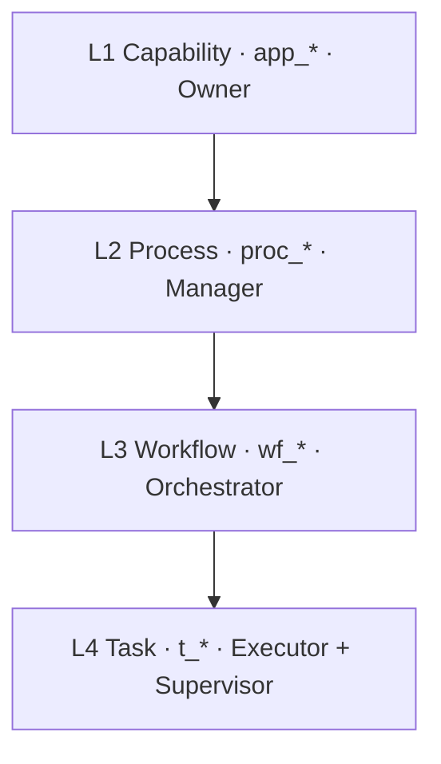

# Process-stack models (playground)

Ground-up dynamic models. **Not canon** until promoted.

## Stack (decisions 2026-06-15)

**C4 static** (Container/module `m_*`, Component `comp_*`) links in prose —
not merged into process level names.

## Folders

| Folder | Capability | Process | Workflow |
| :----- | :--------- | :------ | :------- |
| [commit-process/](commit-process/README.md) | `app_book_harness` | `proc_session_build` | `wf_commit_process` |
| [session-close/](session-close/README.md) | `app_book_harness` | `proc_session_close` | `wf_session_close` |

Convention detail: [ICOM+ v0.3](../../context/system/icom-plus-convention.md) ·
[Diagram taxonomy v0.3](../../context/system/diagram-taxonomy.md) ·
[role colors](../../context/system/icom-plus-convention.md#color-map-roles) ·
box schema in [commit-process/README](commit-process/README.md).
