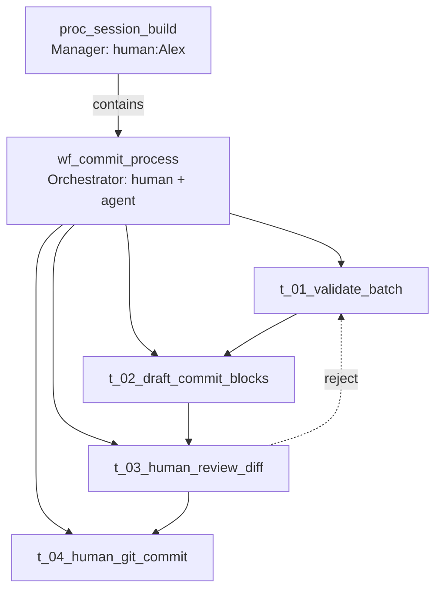

# L2 — Session build process

**Question:** What happens during one session's build phase before close?

**Parent capability:** `app_book_harness` · [L1-cap-session-governance](L1-cap-session-governance.md)

**Process ID:** `proc_session_build` · **C4 link:** **module** `m_book_repo`
(C4 Container — diagram label unchanged).

---

## Process box

| Field | Value |
| :---- | :---- |
| **Process ID** | `proc_session_build` |
| **Process name** | Run session build |
| **Parent** | `app_book_harness` (L1 · [L1-cap-session-governance](L1-cap-session-governance.md)) |
| **Manager** | `human:Alex` |
| **Level** | L2 (process stack) |

### Orchestrator

`human:Alex` + `exe_agent_cursor` — branch per [session-workflow](../../../context/system/session-workflow.md); agent
edits; human owns gates and git author path (D-001).

### Input

| Artifact | Form | Where | From |
| :------- | :--- | :---- | :--- |
| Session bootstrap block | signal | `STATE.md` | `human:Alex` |
| Context files for task | file | paths in bootstrap | `exe_agent_cursor` |
| `session-NN/topic` branch | git ref | local repo | `human:Alex` |

### Output

| Artifact | Form | Where | To |
| :------- | :--- | :---- | :--- |
| Committed batches on session branch | git object | `session-NN/topic` | `human:Alex` |
| Validator-clean tree between batches | shell log | chat | `human:Alex` · `exe_agent_cursor` |
| Draft close artifacts | file | STATE, dashboard | `human:Alex` *(at session end)* |

### Tools

| Tool | Used for |
| :--- | :------- |
| `git` | Branch, status, commit |
| `powershell` | Windows host (D-001) |
| `python` | Validator, loader, tests |

---

## Child workflows

| Workflow ID | Name | File |
| :------------ | :--- | :--- |
| `wf_commit_process` | Commit one logical batch | [L3-commit-process](L3-commit-process.md) |

One session build may run `wf_commit_process` **many times** (one per logical
batch). Then [proc_session_close](../session-close/L2-proc-session-close.md).
