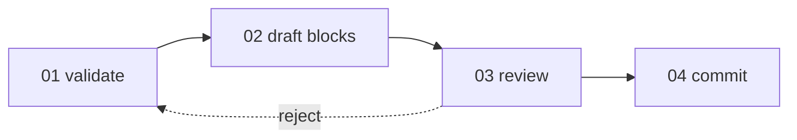

# L3 — Commit process (one logical batch)

**Question:** How does one revertible commit leave the agent's hands and land on
the session branch?

This is **Track B** (book repo session work), not reader product architecture.
Governed by [session-workflow](../../../context/system/session-workflow.md) batch discipline and D-001 (git on Windows only).

**Workflow ID:** `wf_commit_process` · **C4 link:** spans session-build **module**
`m_book_repo` (Container diagram label unchanged).

---

## Workflow box

| Field | Value |
| :---- | :---- |
| **Workflow ID** | `wf_commit_process` |
| **Workflow name** | Commit one logical batch |
| **Parent** | `proc_session_build` (L2 · [L2-proc-session-build](L2-proc-session-build.md)) |
| **Level** | L3 (process stack) |

### Orchestrator

`human:Alex` + `exe_agent_cursor` — agent prepares tasks; human owns review
and git author on the protected path (D-001). **Not** the same as per-task Executor.

### Input

| Artifact | Form | Where | From |
| :------- | :--- | :---- | :--- |
| Modified files on session branch | file | worktree | `exe_agent_cursor` |
| `Agents.md` + [global](../../../03-plan/constraints/global.md) commit rules | file | repo paths | `human:Alex` |
| Session intent / prior batch output | signal | chat | `human:Alex` |

### Output

| Artifact | Form | Where | To |
| :------- | :--- | :---- | :--- |
| New commit on session branch | git object | `session-NN/topic` | `human:Alex` |
| Clean validation record | shell log | chat | `human:Alex` · `exe_agent_cursor` |
| Rejected diff / fix list | file list | chat | `exe_agent_cursor` |

### Tools

| Tool | Used for |
| :--- | :------- |
| `git` | Status, diff, commit (human-run for write) |
| `powershell` | Host shell on Windows (D-001) |
| pre-commit hooks | gitleaks, validate-md on commit |

---

## L4 tasks (order)

| # | Task | File |
| :-: | :--- | :--- |
| 01 | Validate batch | [01-validate-batch](01-validate-batch.md) |
| 02 | Draft commit blocks | [02-draft-commit-blocks](02-draft-commit-blocks.md) |
| 03 | Human review diff | [03-human-review-diff](03-human-review-diff.md) |
| 04 | Human git commit | [04-human-git-commit](04-human-git-commit.md) |

Handoff rule: task **Output to** must match next task **Input from** (or **to**
recipient who then supplies next input).
