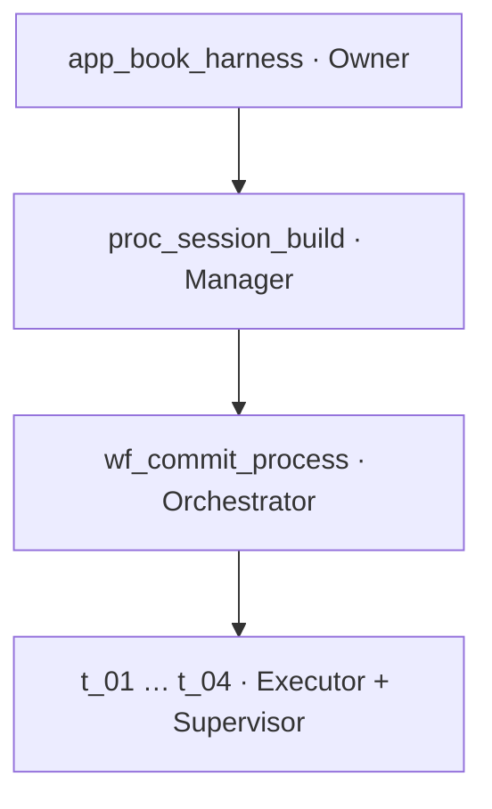

# L4 models — commit process stack

> [!NOTE] Learning folder — not canon
> Full stack L1→L4 for Track B session commit. Reference L4 box:
> [[01-validate-batch]].

## Stack map

| Level | ID | File | Governance |
| :---- | :--- | :--- | :--------- |
| L1 Capability | `app_book_harness` | [[L1-cap-session-governance]] | Owner |
| L2 Process | `proc_session_build` | [[L2-proc-session-build]] | Manager |
| L3 Workflow | `wf_commit_process` | [[L3-commit-process]] | Orchestrator |
| L4 Task | `t_*` | `01`–`04` | Executor + Supervisor |

## Two stacks (decision 1)

| Stack | Question | This folder |
| :---- | :------- | :---------- |
| **Process** | What happens? | `app_*` → `proc_*` → `wf_*` → `t_*` |
| **C4 static** | What exists? | `m_book_repo`, `m_scripts` (module = Container in diagrams) |

Do not rename process levels into C4 levels.

## ID prefixes (decisions 3, 5)

| Prefix | Maps to | Example |
| :----- | :------ | :------ |
| `app_*` | Capability (L1) | `app_book_harness` |
| `proc_*` | Process (L2) | `proc_session_build` |
| `wf_*` | Workflow (L3) | `wf_commit_process` |
| `t_*` | Task (L4) | `t_01_validate_batch` |
| `exe_*` | Executor | `exe_agent_cursor` |
| `m_*` | C4 Container (say **module** in prose) | `m_scripts` |
| `comp_*` | C4 Component | *(link when needed)* |
| `act_*` | Actor | *(edge handoffs only)* |

## L1 capability fields

| Field | What to write |
| :---- | :------------ |
| **Capability ID** | `app_*` |
| **Owner** | Accountable for capability outcomes |
| **Input / Output / Tools** | Same routing rules as L4 |

## L2 process fields

| Field | What to write |
| :---- | :------------ |
| **Process ID** | `proc_*` |
| **Manager** | Accountable for process outcomes |
| **Orchestrator** | Who coordinates (may match Manager) |
| **Input / Output / Tools** | Same routing rules as L4 |

## L3 workflow fields

| Field | What to write |
| :---- | :------------ |
| **Workflow ID** | `wf_*` |
| **Orchestrator** | Who coordinates this workflow (not per-task Executor) |
| **Input / Output / Tools** | Same routing rules as L4 |

## L4 task fields (reference)

| Field | What to write |
| :---- | :------------ |
| **Task ID** | `t_*` |
| **Executor** | Who runs this sitting — `exe_*` + display name |
| **Supervisor** | Who accepts output; irreversible gates → human only |
| **Input** | Artifact · form · where · from executor |
| **Output** | Artifact · form · where · to executor |
| **Tools** | External apps/runtimes only |
| **Control** | Policy + Gherkin and/or DMN |
| **Measures** | Task KPIs |

**Form:** `file` · `shell` · `DB entry` · `signal`  
**Where:** path · chat · DB · RAM

## Files

| File | Level |
| :---- | :---- |
| [[L1-cap-session-governance]] | L1 capability |
| [[L2-proc-session-build]] | L2 process |
| [[L3-commit-process]] | L3 workflow |
| [[01-validate-batch]] | L4 — reference box |
| [[02-draft-commit-blocks]] | L4 task |
| [[03-human-review-diff]] | L4 task |
| [[04-human-git-commit]] | L4 — irreversible gate |

**Defer:** auditing task.

**Colors:** [[context/system/icom-plus-convention#Color map (roles)|ICOM+ role color map]].

## How to read

1. Top-down: L1 → L2 → L3 → L4.
2. Bottom-up: [[01-validate-batch]] then follow 01→04 handoffs.
3. Convention: [[context/system/icom-plus-convention|ICOM+ v0.3]] · [[context/system/icom-plus-convention#Color map (roles)|colors]].
