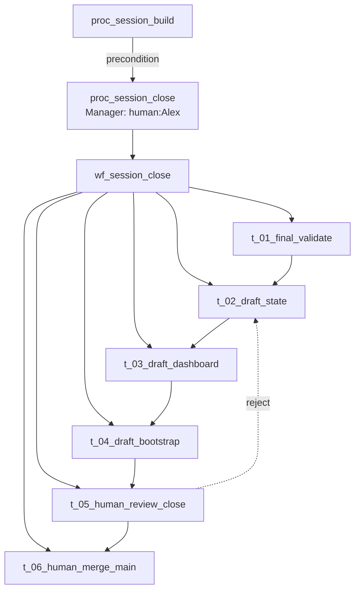

# L2 — Session close process

**Question:** How does a session branch land on `main` with a clean handoff?

**Parent capability:** `app_book_harness` · [L1](../commit-process/L1-cap-session-governance.md)

**Process ID:** `proc_session_close` · **C4 link:** **module** `m_book_repo`
(C4 Container — diagram label unchanged).

**Precondition:** `proc_session_build` finished — all batches committed on
`session-NN/topic` via [wf_commit_process](../commit-process/L3-commit-process.md).

---

## Process box

| Field | Value |
| :---- | :---- |
| **Process ID** | `proc_session_close` |
| **Process name** | Close session |
| **Parent** | `app_book_harness` (L1) |
| **Manager** | `human:Alex` |
| **Level** | L2 (process stack) |

### Orchestrator

`human:Alex` + `exe_agent_cursor` — agent drafts close artifacts; human runs
final validation and **merge** (D-001). Per [session-workflow](../../../context/system/session-workflow.md).

### Input

| Artifact | Form | Where | From |
| :------- | :--- | :---- | :--- |
| Session branch with all batches committed | git ref | `session-NN/topic` | `human:Alex` |
| Build-phase validator evidence | shell log | chat | `exe_agent_cursor` ← build |
| Open threads + decisions to record | signal | chat · memory | `human:Alex` |

### Output

| Artifact | Form | Where | To |
| :------- | :--- | :---- | :--- |
| `main` updated with session work | git ref | local + remote | `human:Alex` |
| Updated [STATE](../../../STATE.md) | file | `STATE.md` | `human:Alex` · `exe_agent_cursor` |
| Updated dashboard L1–L3 | file | `_index/dashboard/` | `human:Alex` · `exe_agent_cursor` |
| Next-session bootstrap block | signal | `STATE.md` | `exe_agent_cursor` (next open) |
| Session branch deleted (optional) | git ref | — | `human:Alex` |

### Tools

| Tool | Used for |
| :--- | :------- |
| `git` | checkout, merge, branch delete |
| `powershell` | Windows host (D-001) |
| `python` | Final `validate_md.py --all` |

---

## Child workflows

| Workflow ID | Name | File |
| :------------ | :--- | :--- |
| `wf_session_close` | Draft close handoff | [L3-wf-session-close](L3-wf-session-close.md) |

**Stub:** L4 tasks 02–05 fully drafted in `session-close/`.
