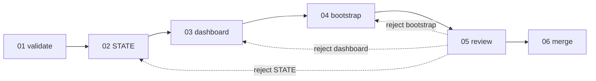

# L3 — Session close workflow

**Question:** What does the agent draft before Alex merges to `main`?

**Parent process:** `proc_session_close` · [L2-proc-session-close](L2-proc-session-close.md)

**Workflow ID:** `wf_session_close` · Maps to [session-workflow](../../../context/system/session-workflow.md) close checklist
A → D; task 06 is checklist E (git).

---

## Workflow box

| Field | Value |
| :---- | :---- |
| **Workflow ID** | `wf_session_close` |
| **Workflow name** | Draft close handoff |
| **Parent** | `proc_session_close` (L2 · [L2-proc-session-close](L2-proc-session-close.md)) |
| **Orchestrator** | `human:Alex` + `exe_agent_cursor` |

### Input

| Artifact | Form | Where | From |
| :------- | :--- | :---- | :--- |
| Clean session branch | git ref | `session-NN/topic` | `human:Alex` |
| Session outcome summary | signal | chat | `human:Alex` |

### Output

| Artifact | Form | Where | To |
| :------- | :--- | :---- | :--- |
| Close-ready STATE draft | file | `STATE.md` (uncommitted until merge) | `human:Alex` |
| Dashboard L1–L3 drafts | file | `_index/dashboard/` | `human:Alex` |
| Merge + branch-delete PS blocks | shell | chat | `human:Alex` → task 06 |

### Tools

| Tool | Used for |
| :--- | :------- |
| `python` | Final validation |
| `git` | Read-only until task 06 |

---

## L4 tasks (order)

| # | Task ID | Name | Executor | Supervisor | File |
| :-: | :------ | :--- | :------- | :--------- | :--- |
| 01 | `t_01_final_validate` | Final validate | `exe_agent_cursor` | `human:Alex` | [01-final-validate](01-final-validate.md) |
| 02 | `t_02_draft_state` | Draft STATE close | `exe_agent_cursor` | `human:Alex` | [02-draft-state](02-draft-state.md) |
| 03 | `t_03_draft_dashboard` | Draft dashboard | `exe_agent_cursor` | `human:Alex` | [03-draft-dashboard](03-draft-dashboard.md) |
| 04 | `t_04_draft_bootstrap` | Draft next bootstrap | `exe_agent_cursor` | `human:Alex` | [04-draft-bootstrap](04-draft-bootstrap.md) |
| 05 | `t_05_human_review_close` | Review close pack | `exe_human_alex` | `human:Alex` | [05-human-review-close](05-human-review-close.md) |
| 06 | `t_06_human_merge_main` | Merge to main | `exe_human_alex` | `human:Alex` | [06-human-merge-main](06-human-merge-main.md) |

**Checklist map:** 01 = A · 02–04 = B,C,D · 05 = human gate · 06 = E (irreversible).
