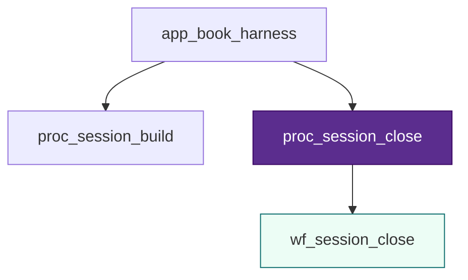
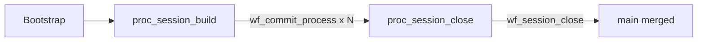

# Session close — `proc_session_close`

> [!NOTE] Playground — not canon
> Precondition: [wf_commit_process](../commit-process/L3-commit-process.md) complete.

## Stack slice

| Level | ID | File |
| :---- | :--- | :--- |
| L1 | `app_book_harness` | [L1](../commit-process/L1-cap-session-governance.md) |
| L2 | `proc_session_close` | [L2-proc-session-close](L2-proc-session-close.md) |
| L3 | `wf_session_close` | [L3-wf-session-close](L3-wf-session-close.md) |
| L4 | `t_01` … `t_06` | `01`–`06` below |

**Canon procedure:** [session-workflow](../../../context/system/session-workflow.md) close checklist A–E.

## L4 tasks

| # | File | Checklist |
| :-: | :--- | :-------- |
| 01 | [01-final-validate](01-final-validate.md) | A Verify |
| 02 | [02-draft-state](02-draft-state.md) | B STATE |
| 03 | [03-draft-dashboard](03-draft-dashboard.md) | C Dashboard |
| 04 | [04-draft-bootstrap](04-draft-bootstrap.md) | D Bootstrap + merge PS |
| 05 | [05-human-review-close](05-human-review-close.md) | Human gate |
| 06 | [06-human-merge-main](06-human-merge-main.md) | E Git (irreversible) |

## Session lifecycle

**Diagram:** full colored L4 chain in [ICOM+ Example G](../../../context/system/icom-plus-examples-trackb.md#example-g-l3l4-real-track-b-wf_session_close).

## Pending

- [ ] Auditing as `t_*` task (optional)
