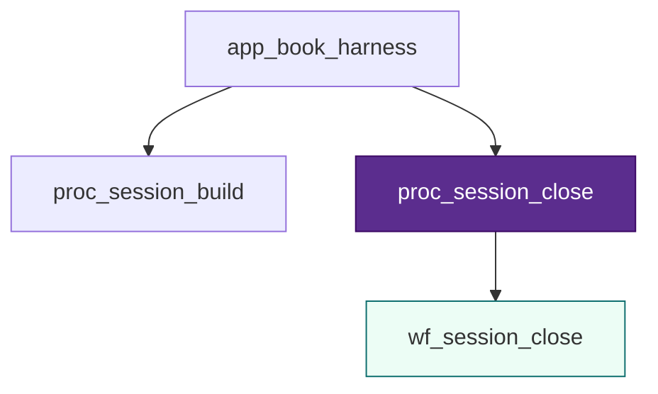
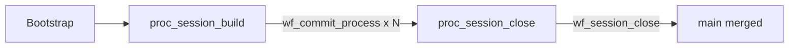

# Session close — `proc_session_close`

> [!NOTE] Playground — not canon
> Precondition: [[../commit-process/L3-commit-process|wf_commit_process]] complete.

## Stack slice

| Level | ID | File |
| :---- | :--- | :--- |
| L1 | `app_book_harness` | [[../commit-process/L1-cap-session-governance|L1]] |
| L2 | `proc_session_close` | [[L2-proc-session-close]] |
| L3 | `wf_session_close` | [[L3-wf-session-close]] |
| L4 | `t_01` … `t_06` | `01`–`06` below |

**Canon procedure:** [[session-workflow]] close checklist A–E.

## L4 tasks

| # | File | Checklist |
| :-: | :--- | :-------- |
| 01 | [[01-final-validate]] | A Verify |
| 02 | [[02-draft-state]] | B STATE |
| 03 | [[03-draft-dashboard]] | C Dashboard |
| 04 | [[04-draft-bootstrap]] | D Bootstrap + merge PS |
| 05 | [[05-human-review-close]] | Human gate |
| 06 | [[06-human-merge-main]] | E Git (irreversible) |

## Session lifecycle

**Diagram:** full colored L4 chain in [[context/system/icom-plus-examples-trackb#Example G — L3/L4 REAL Track B (`wf_session_close`)|ICOM+ Example G]].

## Pending

- [ ] Auditing as `t_*` task (optional)
