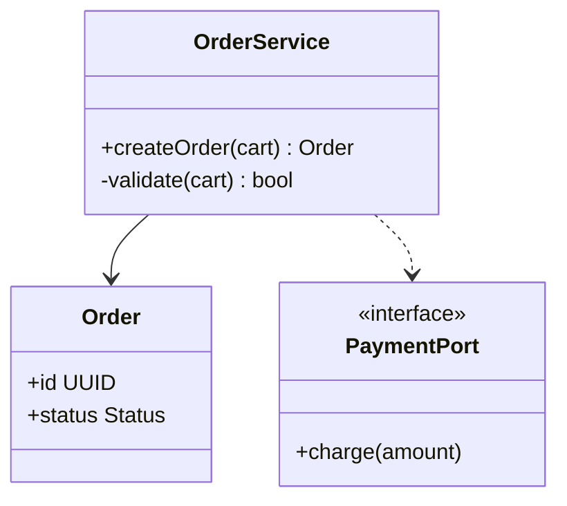

# C4 — Code diagram (L4)

> **FICTITIOUS** — Order Service component. **Family:** static. (UML class view.)

**Shows well:** types and relationships in code.  
**Poor at:** acceptance criteria (use Gherkin).
