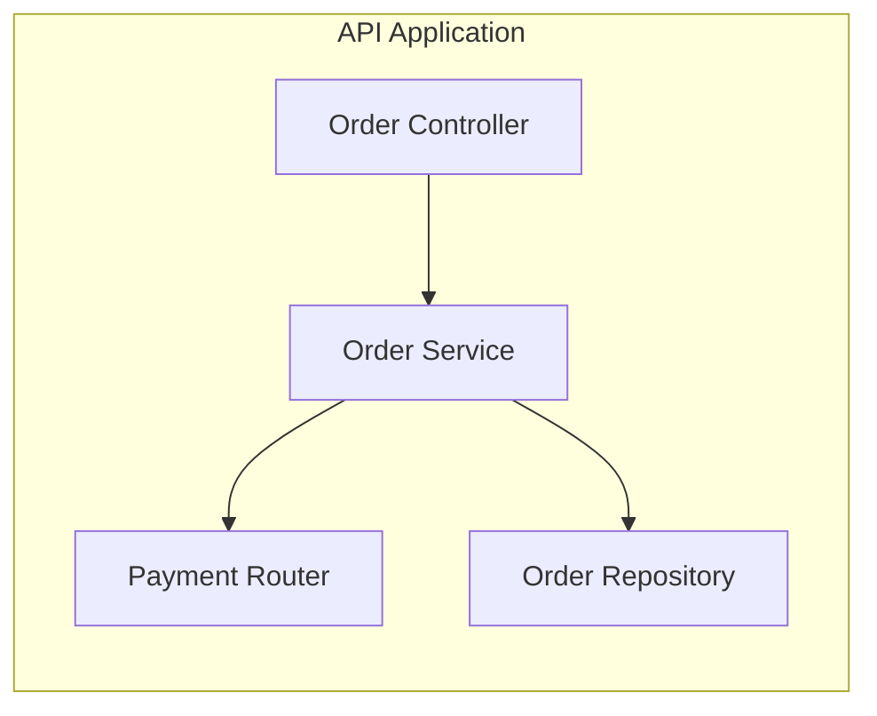

# C4 — Component diagram (L3)

> **FICTITIOUS** — inside API Application container. **Family:** static.

**Shows well:** modules inside one container.  
**Poor at:** cross-container deployment; runtime timing.
