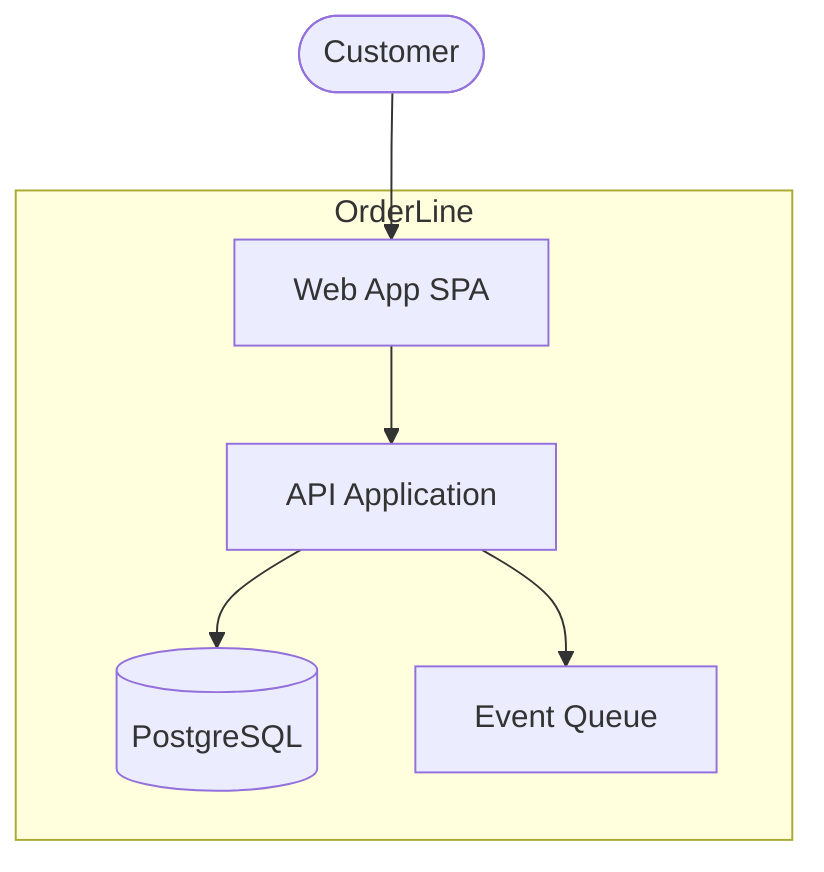

# C4 — Container diagram (L2)

> **FICTITIOUS** — inside OrderLine. **Family:** static.

**Shows well:** deployable parts and data stores.  
**Poor at:** classes; step-by-step checkout flow (use BPMN2 or sequence).
