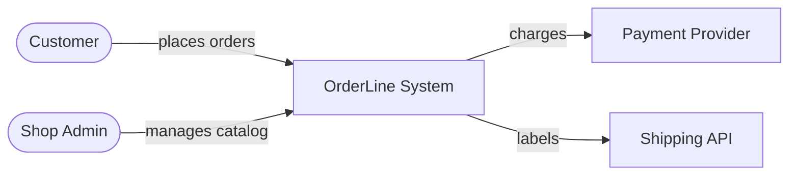

# C4 — System Context diagram (L1)

> **FICTITIOUS** — OrderLine shop. **Family:** static. **Not** a flowchart.

**Shows well:** one system boundary; people and external systems.  
**Poor at:** containers inside OrderLine; message order.
