# DMN — Decision requirements diagram (L2)

> **FICTITIOUS** — decisions a container needs. **Family:** decision.

```mermaid
flowchart TB
    DR[<<decision>> Shipping Eligibility]
    DS[<<decision>> Fraud Score]
    BK[<<business knowledge>> Carrier rules]
    IN[<<input data>> Order + Address]
    IN --> DR
    IN --> DS
    BK --> DR
    DR --> OUT[Checkout Process]
    DS --> OUT
```

**Shows well:** which decisions depend on which knowledge/inputs.  
**Poor at:** infrastructure diagram; sequence timing.
