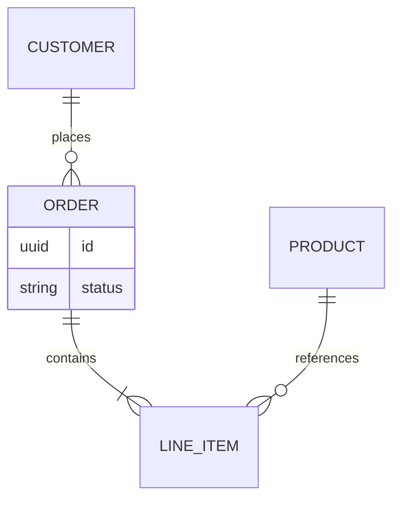

# ER — Logical entity-relationship (L2/L3)

> **FICTITIOUS** — OrderLine data. **Family:** static.  
> **In harness:** `02-design/layers/data.md`.

**Shows well:** entities and cardinalities.  
**Poor at:** API call order; deployment.
