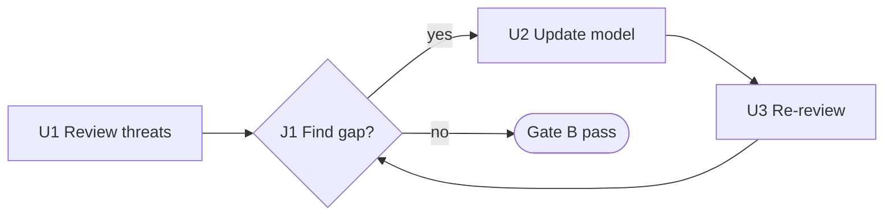

# IDEF3 — Process description (L3)

> **FICTITIOUS** — rework loop on review. **Family:** dynamic.

**Shows well:** junctions, fan-out/in, precedence, feedback.  
**Poor at:** data definitions (IDEF1X); deployment.

*IDEF3 uses units (U) and junctions (J) — Mermaid approximates for learning.*
