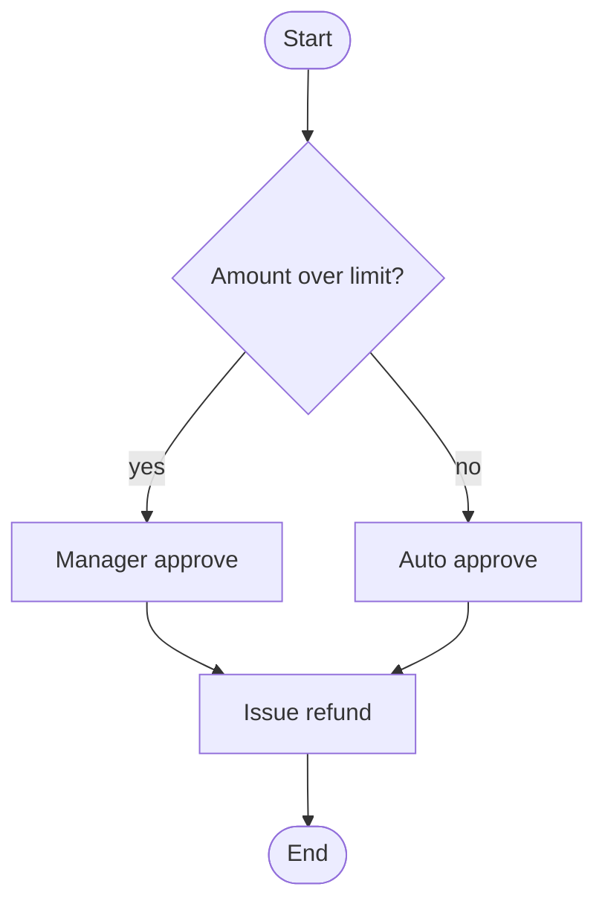

# UML — Activity diagram (L3)

> **FICTITIOUS** — refund approval branch. **Family:** dynamic.

**Shows well:** control flow with forks.  
**Poor at:** cross-org message contracts (use BPMN2 choreography).
