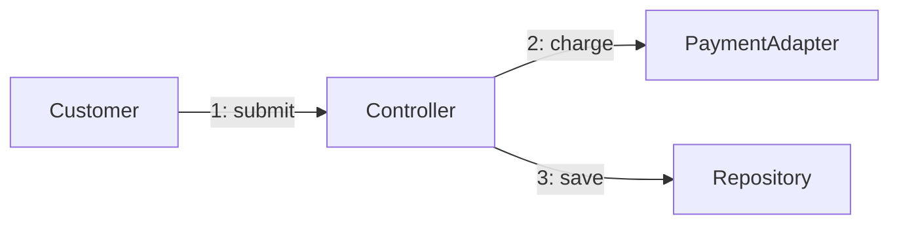

# UML — Communication diagram (L3)

> **FICTITIOUS** — object links during order flow. **Family:** dynamic.

**Shows well:** which objects collaborate; numbered steps optional.  
**Poor at:** strict time axis (use sequence or timing).
