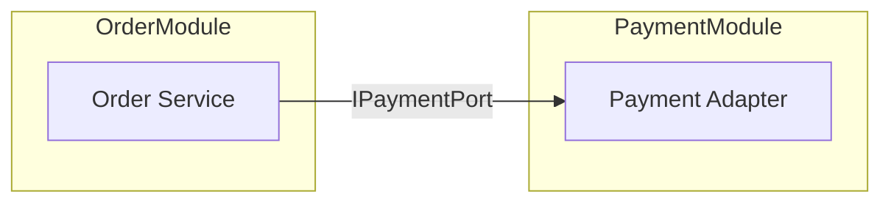

# UML — Component diagram (L3)

> **FICTITIOUS** — interfaces between modules. **Family:** static.

**Shows well:** provided/required interfaces.  
**Poor at:** message sequence (use sequence diagram).
