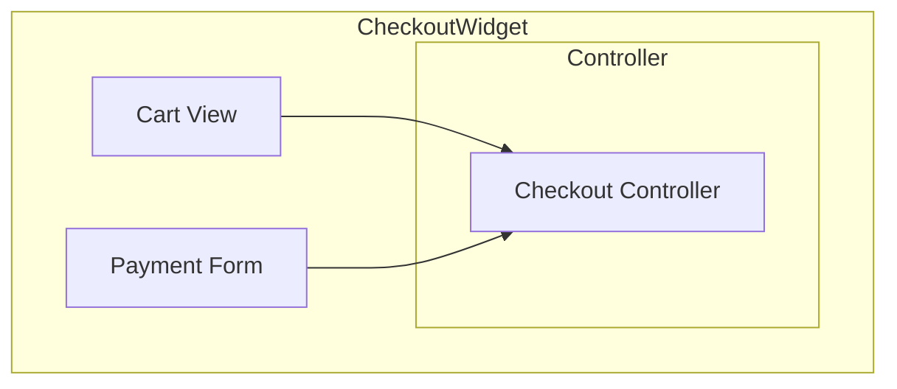

# UML — Composite structure diagram (L3)

> **FICTITIOUS** — internals of Checkout widget. **Family:** static.

**Shows well:** internal parts of one component.  
**Poor at:** cross-system pools (use BPMN2 collaboration).
