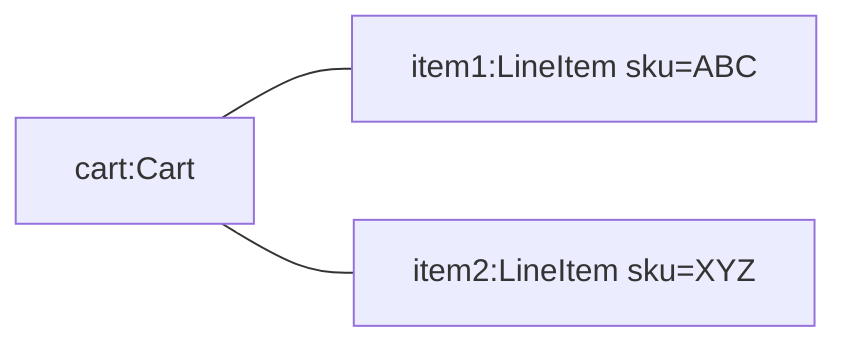

# UML — Object diagram (L4)

> **FICTITIOUS** — snapshot at checkout moment. **Family:** static (one instant).

**Shows well:** particular instances and links at one moment.  
**Poor at:** history over time (use sequence or state).
