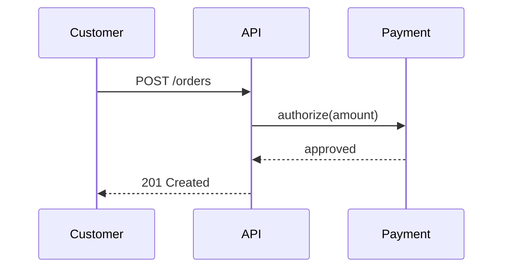

# UML — Sequence diagram (L3/L4)

> **FICTITIOUS** — place order happy path. **Family:** dynamic.  
> **In harness:** `02-design/layers/communication.md`, `05-build/.../openhands.md`.

**Shows well:** who talks to whom, in order.  
**Poor at:** deployment layout; policy tables.
