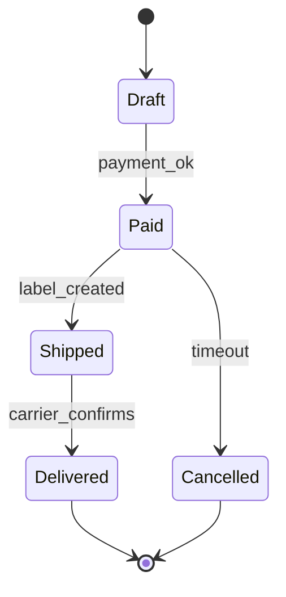

# UML — State machine diagram (L3/L4)

> **FICTITIOUS** — order lifecycle. **Family:** dynamic.

**Shows well:** states and transitions for one entity.  
**Poor at:** multi-actor swimlanes (use BPMN2).
