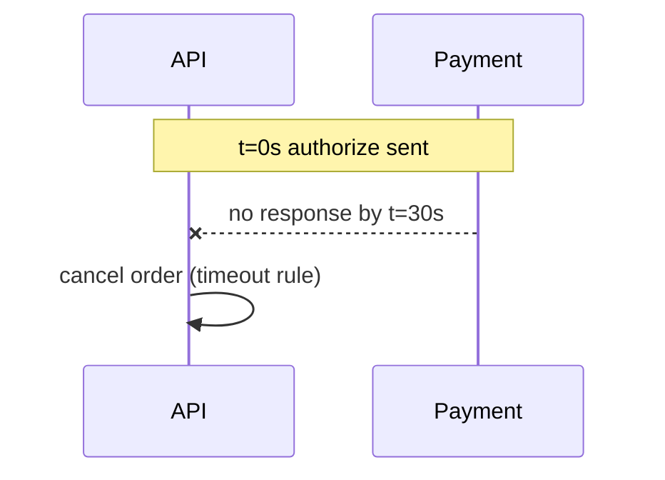

# UML — Timing diagram (L4)

> **FICTITIOUS** — payment timeout constraint. **Family:** dynamic.

**Shows well:** time constraints on interactions.  
**Poor at:** business policy prose (use DMN table).

*Note: full UML timing uses time-axis notation; Mermaid approximates with notes.*
