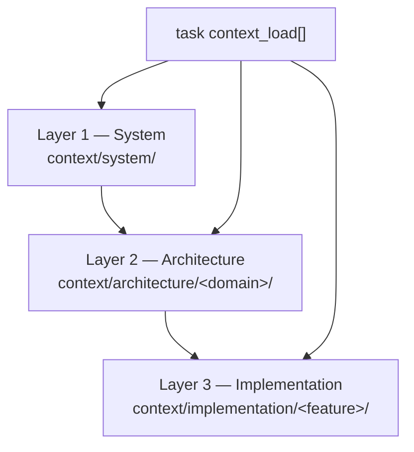

# Context tree — three layers for agent tasks

Agents load **only** what a task lists. This repo's worked example uses
**harness-meta** context: it describes the book-as-harness itself, not a
reader product. Your fork replaces Layer 2 and Layer 3 with distillations
from [Ch. 02 layer designs](../02-design/layers/data.md). The three layers implement
**information hiding** (Parnas): system orientation, domain architecture, and
feature implementation can each change without forcing agents to load the whole
repo.

## Layer map

| Layer | Scope | Loaded when | This repo |
| :---- | :---- | :---- | :---- |
| 1 — System | Whole project orientation | Agent defaults + most tasks | `context/system/*.md` (notation, workflow, agent-team) |
| 2 — Architecture | One domain (data, app, comm, ux) | Task touches that domain | `context/architecture/<domain>/` — harness-meta distillations |
| 3 — Implementation | One feature or task slice | Task-specific narrow context | `context/implementation/<feature>/` |

> [!NOTE] Deterministic loading
> Tasks name paths explicitly in `context_load:` frontmatter. No vector search.
> See [context-loader](../04-your-agents/context-loader.md) and `scripts/task_context.py`.

## Layer 2 — architecture domains (harness example)

| Domain | File | What it captures for *this* repo |
| :---- | :---- | :---- |
| data | [harness-artifacts](architecture/data/harness-artifacts.md) | Canon artifacts, frontmatter, STATE as truth |
| application | [validation-and-loader](architecture/application/validation-and-loader.md) | Validator, context loader, task assembler |
| communication | [handoff-and-git](architecture/communication/handoff-and-git.md) | Human gates, session workflow, git (D-001) |
| ux | [book-structure](architecture/ux/book-structure.md) | Chapter spine, dual path, dashboard zoom |

## Layer 3 — implementation (harness example)

| Feature | File | What it captures |
| :---- | :---- | :---- |
| context-tree | [task-03-scope](implementation/context-tree/task-03-scope.md) | Task 03 scope — populating this tree |

## Wiring a task

1. List Layer 2 domains the task touches in **Inputs** (human-readable).
2. Mirror the same paths in task frontmatter `context_load:`.
3. Add Layer 3 files only when the task needs task-specific detail beyond arch.
4. Run `python scripts/task_context.py <task-file>` to preview stripped prompt text.

Example: [03-populate-context-tree](../04-your-agents/tasks/03-populate-context-tree.md).

## Your project

Copy [reader-skeleton](../06-learn/boilerplate/reader-skeleton/README.md) to a new repo,
then replace harness-meta files with your product's layer designs:

- `context/architecture/data/` — schema, storage, migration rules
- `context/architecture/application/` — modules, boundaries, runtime
- `context/architecture/communication/` — APIs, events, provider contracts
- `context/architecture/ux/` — roles, flows, latency budgets

Keep `context/system/` for cross-cutting orientation. Add
`context/implementation/<feature>/` per bounded feature as tasks multiply.
